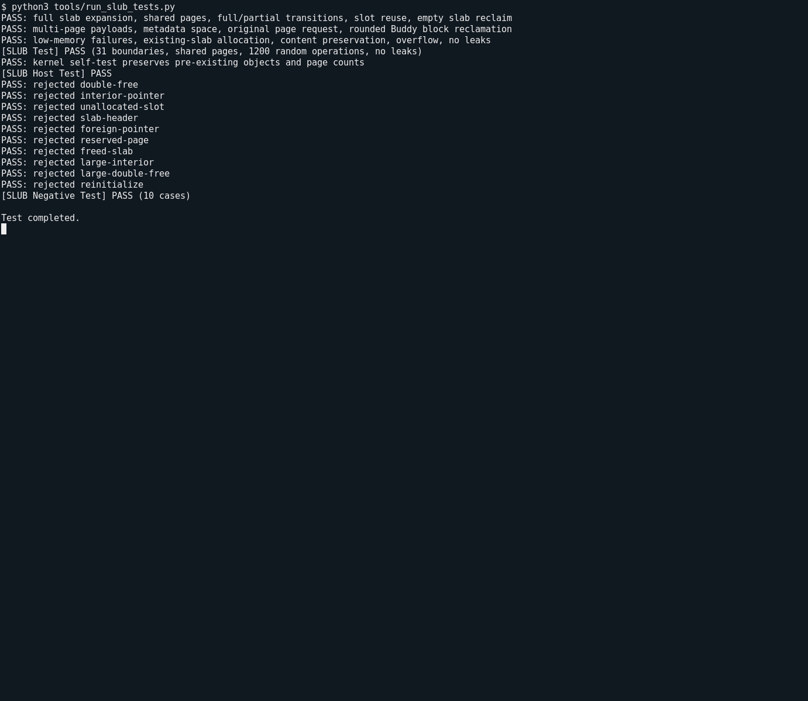

# 操作系统实验报告

## 实验基本信息

| 项目 | 内容 |
|------|------|
| **实验名称** | Lab 2：物理内存和页表 |
| **小组成员** | 2412940-曹皓轩 |
| **完成日期** | 2026-10-14 |

### 小组分工

| 成员 | 负责的练习/模块 |
|------|----------------|
| 2412940-曹皓轩 | 物理内存初始化、Best-Fit、Buddy System、SLUB、GDB 调试 |

---

## 一、实验目的

1. 理解设备树提供的物理内存范围，以及 Page 描述符、已用页面和空闲页面之间的关系。
2. 实现并比较连续物理页的 First-Fit、Best-Fit 与 Buddy System 分配策略。
3. 在页分配器之上实现小对象分配，理解 slab 对象槽与底层物理页之间的关系。
4. 通过构建、启动、边界测试和 GDB 调试检查分配器状态及 Sv39 地址转换。

---

## 二、实验环境

| 成员 | AI 编程工具 | 底层模型 | 备注 |
|------|------------|---------|------|
| 2412940-曹皓轩 | Codex（终端 Agent） | GPT-6 |  |

实验在 RISC-V 64 位 uCore Lab2 工程中完成，使用项目配置的 RISC-V 交叉编译工具链和 QEMU 启动内核。

---

## 三、实验整体逻辑分析

### 2.1 本章节的逻辑主线

内核启动后先从设备树取得 DRAM 的基址和长度，再结合内核自身布局排除 OpenSBI、内核镜像和 Page 描述符数组占用的空间。剩余的完整页面由物理内存管理器接管。物理页分配器建立后，SLUB 再以这些页面为基础提供小对象分配。

启动阶段已经建立 Sv39 映射，因此初始化还必须维持启动代码使用的虚拟地址到物理地址偏移。GDB 调试进一步观察了客体访存从软件 TLB 未命中、页表查询到 TLB 填充的过程。

### 2.2 功能的逐步实现

1. 根据设备树和内核布局完成物理内存初始化，为后续分配器建立可信页面范围。
2. 阅读 First-Fit 的空闲链表、块分裂和相邻块合并逻辑。
3. 实现 Best-Fit，并与已有统一管理器接口对接。
4. 实现 Buddy System，处理按阶分裂、伙伴合并和非 2 的幂请求。
5. 在物理页分配器之上实现 SLUB 对象分配，最后通过测试和双 GDB 调试验证资源状态及地址转换。

---

## 四、实验内容与实现

### 功能模块一：物理内存初始化功能

**负责人：** 2412940-曹皓轩

#### 模块功能描述

实现 `page_init()`。函数通过设备树接口读取 DRAM 范围，将管理上界限制在框架允许范围内，根据内核结束地址布置连续的 Page 描述符数组，并将 OpenSBI、内核镜像、描述符数组及其占用的页面保留。描述符数组之后的完整页面通过当前 `pmm_manager` 注册为空闲区。

描述符数量由可管理页号范围决定：`npage` 是物理页号的排他上界，数组元素数为 `npage - nbase`。默认内存范围 `[0x80000000, 0x88000000)` 对应 `npage = 0x88000`、描述符数量 `0x8000`。代码不依赖这些默认值，而是根据探测范围和 `sizeof(struct Page)` 计算布局。

#### 最终提示词

在 `pmm.c` 中完成 `page_init()`，遵循已有线性映射和管理器接口，检查设备树范围、整数溢出、页对齐及描述符空间，并验证默认启动和边界情况。

#### 实现迭代过程

初始化先固定 `va_pa_offset` 为启动映射使用的偏移，再验证物理范围。描述符数组起点按页向上对齐，可管理末端按页向下对齐；数组占用的物理页面不进入空闲区。没有完整空闲页面时不调用 `init_memmap()`，无效范围或无法容纳描述符数组时通过 `panic()` 终止。

默认内存下，`page_init()` 的模块测试通过。独立边界验证覆盖有效范围、管理上界截断、非页对齐末端、无完整空闲页和无效布局，共 15 项。

### Challenge：硬件可用物理内存范围的获取方法

**负责人：** 2412940-曹皓轩

处理器的物理地址空间可能包含设备寄存器、地址空洞和保留区域，因此不能仅凭地址可访问就判断它属于可分配 RAM。本实验通过启动环境传入的设备树获取内存范围：内核保存 DTB 地址，`dtb_init()` 解析 memory 节点的 `reg` 属性，供 `page_init()` 使用。

通用内核还需处理多段 RAM、设备区域和固件保留区。对每一段范围都应检查地址加法溢出、重叠和对齐，并只将完整可用页面交给分配器。直接向未知地址写入测试值可能破坏数据或触发设备操作，不适合作为通用内存探测方法。

### 练习：理解 First-Fit 连续物理内存分配算法

**负责人：** 2412940-曹皓轩

First-Fit 在按物理地址排序的空闲块链表中选择第一个足够大的块。申请后从块的低地址端取出所需页面，剩余部分继续作为空闲块；释放时将块按地址插入，并与物理上连续的前后块合并。块头的 `property` 记录连续页数，页面标志用于区分块头和普通页面。

线性遍历在空闲块数量较多时会增加查找成本。可以考虑按大小分组、增加辅助索引或采用 Next-Fit；评估时还应观察不同申请序列下的碎片，而不能只比较一次分配的剩余空间。

### 功能模块二任务二：Best-Fit 连续物理内存分配算法

**负责人：** 2412940-曹皓轩

#### 模块功能描述

实现 Best-Fit 管理器的初始化、内存注册、分配、释放和空闲页统计回调，并通过 `pmm_manager` 接口接入工程。分配时遍历空闲块，选择能够满足请求的最小块；大小相同时优先选择低地址块。大块从低地址处分配，剩余部分重新插入有序空闲链表。

释放时按物理地址有序插入，仅合并物理上相邻的块。链表相邻本身不代表页面地址连续。原有 `basic_check()` 和 `best_fit_check()` 继续使用，用于检查基本分配行为和管理器状态。

#### 最终提示词

阅读已有 `pmm_manager` 和 First-Fit 实现，在 Best-Fit 文件中完成管理器回调；覆盖最小可用块选择、分裂、失败不改状态以及释放时双向相邻合并，并以定向和随机测试验证。

#### 实现迭代过程

Best-Fit 的空闲链表按地址维护，分配查找最小可用块，插入时检查前后页面是否连续。测试覆盖精确匹配、不同大小候选、同大小候选、分裂、空闲块不足、碎片以及单侧和双侧合并。独立随机测试执行 10000 次分配与释放操作。

将评分运行在 Best-Fit 配置的临时副本中，Page Init 和 Best-Fit 两项评分均通过，总分为 20/20。提交工程的默认管理器保持 Buddy System。

### 功能模块二任务三：Buddy System 伙伴系统分配算法

**负责人：** 2412940-曹皓轩

#### 模块功能描述

Buddy System 按阶维护空闲块，阶 `k` 对应 `2^k` 个页面。申请页数向上取整到可满足请求的最小阶；大块逐级分裂。释放时，只有同阶、空闲且互为伙伴的块才能合并，伙伴位置依据绝对物理页号和块大小计算。

实现新增 `buddy_pmm.c` 和 `buddy_pmm.h`，通过 `pmm_manager` 接口接管初始化空闲区、分配、释放和统计。私有元数据记录页面状态、阶数和原始申请页数，使释放时遵守底层接口的整块释放约定。启动自检及独立模型测试检查空闲链表、页面覆盖、计数和合并结果。

#### 最终提示词

新增 Buddy System 管理器并接入现有物理内存框架，保留已有公共接口；实现按阶初始化、分配分裂、释放合并和统计，再以独立状态模型覆盖边界、异常及随机操作。

#### 实现迭代过程

启动自检执行 1024 次随机分配和释放，并恢复测试前状态。独立测试覆盖非对齐区间、非 2 的幂区间、分裂、耗尽、多种释放顺序、伙伴合并、错误释放和随机操作。定向测试及 5000 次随机操作通过，13 项负向测试均触发预期拒绝路径。64、128、256 MiB 内存配置下启动自检通过。

伙伴系统能快速定位块的潜在伙伴，但将请求向上取整会产生内部碎片。当前实现也需要遍历同阶链表，后续可从索引结构和并发分配方向优化。

### Challenge：任意大小的内存单元 SLUB 分配算法

**负责人：** 2412940-曹皓轩

#### 模块功能描述

在 `slub.c` 和 `slub.h` 中实现 `slub_init()`、`kmalloc()`、`kfree()` 和 `slub_check()`。SLUB 将对象分配建立在物理页分配器之上：小对象按大小类别共享 slab 页面，较大对象使用连续页块。当前类别为 16 至 2048 字节的 2 的幂；超过最大类别的请求仍可通过大对象路径处理。

每个 slab 记录类别、槽位数量、使用数量和分配位图，对象起始地址按 16 字节对齐。部分使用的 slab 提供可用槽，满 slab 不参与分配；最后一个对象释放后将 slab 页面归还物理页分配器。大对象元数据保存原始申请页数，释放时按相同参数归还。

#### 最终提示词

在已有页面分配器上实现任意正大小的对象分配和释放；小对象应共享页面，大对象应通过连续页块处理；检查对齐、溢出、耗尽、重复释放及最终页面回收，并用独立测试验证数据完整性和资源守恒。

#### 实现迭代过程

对象归属表使 `kfree()` 能先验证地址范围和页面归属，再读取 slab 元数据。测试覆盖 31 个大小边界、多个对象共享页面、满 slab 扩展、槽位复用、跨页对象、内存不足及释放回收。1200 次随机分配与释放操作检查活动对象区间不重叠且内容保持不变；10 项负向测试覆盖重复释放、内部地址和外部地址等错误输入。

SLUB 自检在 64、128、256 MiB 配置下均通过，释放测试对象后物理空闲页数恢复。对象层分配成功与页面层无泄漏分别检查，确保小对象确实共享页面且空 slab 会归还底层页面。

### 练习：GDB 调试页表查询过程

**负责人：** 2412940-曹皓轩

使用带调试信息的 QEMU 和双 GDB 观察客体访存。RISC-V GDB 控制内核指令，主机 GDB 控制 QEMU 中的地址转换路径。一次实际访存从软件 TLB 未命中进入 `load_helper`、`tlb_fill` 和 `get_physical_address`，随后在 `tlb_set_page` 填入映射。重复访问同一地址时未再次进入页表查询路径。

调试现场的 `satp` 为 `0x8000000000080207`，根页表物理地址为 `0x80207000`。对内核虚拟地址 `0xffffffffc0298548` 查询得到物理地址 `0x80298548`，与工程线性映射偏移一致。关闭分页的 Bare 模式下，地址转换直接采用恒等映射。读取 `npage`、`pages` 和空闲页计数后，也核对了 Page 数组占用及初始空闲页面数。

调试过程中需要协调主机和客体两侧的暂停状态；主机断点暂停整个 QEMU 时，客体单步会等待模拟器恢复。源码行断点还需结合单步确认赋值是否已经执行，不能仅凭显示的源码行判断变量状态。

---

## 五、测试与验证

### 编译与运行

项目构建命令：

```bash
cd lab2
make -j2
```

内核启动命令：

```bash
make qemu
```

启动输出包含物理内存管理器名称、页面分配自检、页表信息，以及 Buddy 和 SLUB 自检结果。内核完成初始化后进入主循环，因此启动验证以观察到自检输出为准。

Best-Fit 评分在 Best-Fit 配置的临时副本中执行：

```text
check page init:  OK
check best fit:   OK
Total Score: 20/20
```

### 测试结果

| 测试项目 | 结果 |
|----------|------|
| 工程编译链接 | 通过 |
| 物理内存初始化边界测试 | 15 项通过 |
| Best-Fit 定向与随机测试 | 通过，随机操作 10000 次 |
| Best-Fit 配置评分 | 20/20 |
| Buddy 定向、随机及负向测试 | 通过，5000 次随机操作、13 项负向测试 |
| Buddy 内核启动配置 | 64、128、256 MiB 下通过 |
| SLUB 边界与随机测试 | 31 个边界、1200 次随机操作、10 项负向测试通过 |
| SLUB 内核启动配置 | 64、128、256 MiB 下通过 |
| 双 GDB 地址转换观察 | Sv39 页表查询、TLB 填充、重复访问及 Bare 模式对比完成 |

默认工程使用 Buddy System；Best-Fit 的评分单独在对应管理器配置下完成。

**测试截图：**





---

## 六、实验总结与收获

### 对操作系统的理解

| 知识点 | 实验中的体现 | 与 OS 原理的关系和差异 |
|--------|--------------|------------------------|
| 物理内存发现 | 设备树提供 DRAM 范围 | 本实验使用固定起点的单段内存；通用系统还要处理多段 RAM 和保留区域 |
| 页帧管理 | Page 描述符记录页面状态 | 描述符本身占用物理内存，必须从可分配页面中排除 |
| 连续页分配 | First-Fit、Best-Fit 和 Buddy | 选择策略影响查找成本和碎片，Buddy 还会因按阶取整产生内部碎片 |
| 对象分配 | SLUB 将一页切分为多个对象槽 | 小对象可以共享页面，空 slab 页面最终归还页分配器 |
| 虚拟地址转换 | Sv39、satp、页表项和软件 TLB | 页表决定客体虚实转换，QEMU 软件 TLB 缓存转换以加快模拟 |

通用操作系统还需要处理按需分页、缺页异常、页面置换、交换空间、写时复制、用户地址空间、多核 TLB 同步、NUMA 和内存热插拔等问题，本实验未涉及这些机制。

### AI 协作开发的经验

先核对工程中的结构体、宏和调用关系，再描述实现目标，能减少接口假设错误。对内存管理代码，测试需要同时检查页面状态、对象范围、内容完整性和空闲计数；只验证分配返回非空不足以证明实现正确。遇到启动或调试问题时，结合实际输出和断点观察定位原因，比根据预期输出推断更可靠。
