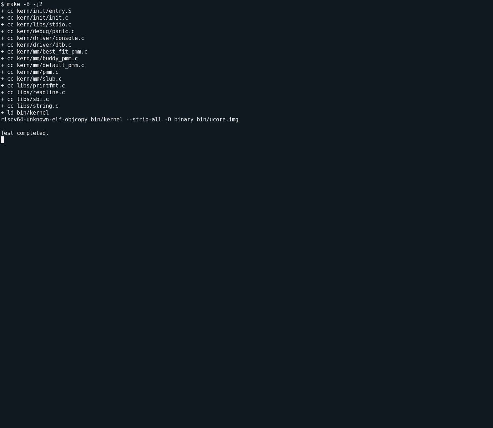
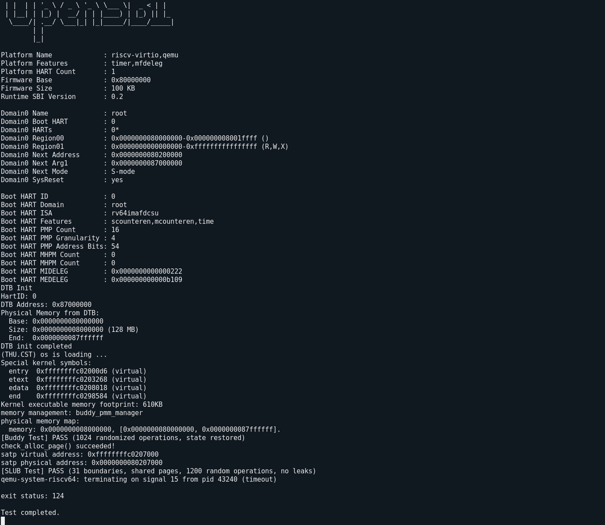
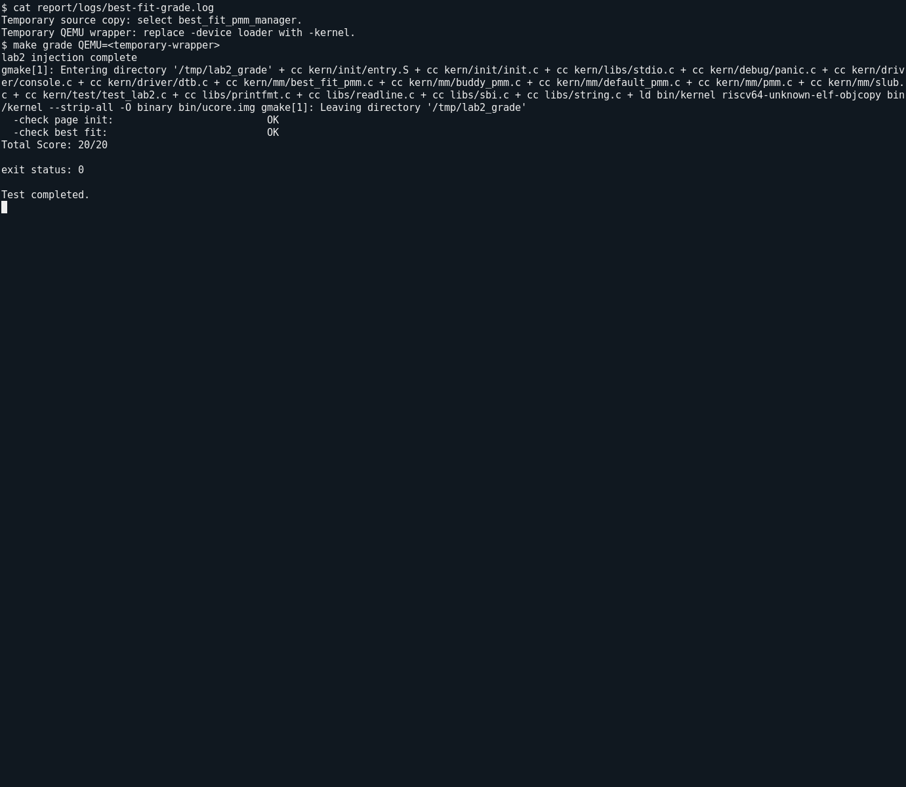
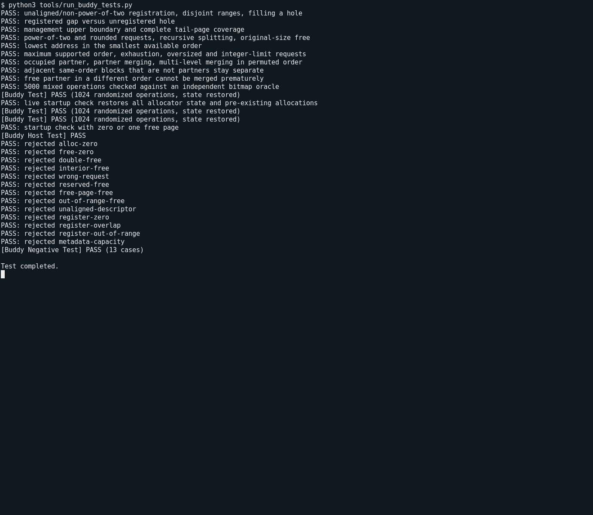
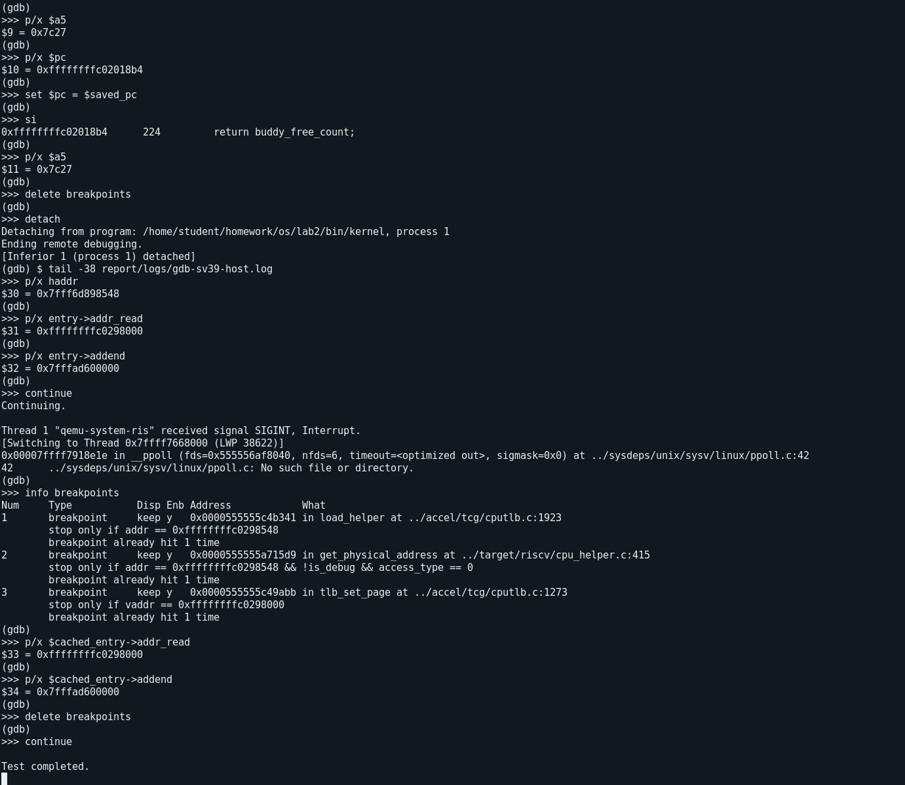

# 操作系统实验报告

## 实验基本信息

| 项目 | 内容 |
|------|------|
| **实验名称** | Lab 2：物理内存和页表 |
| **小组成员** | 2412940-曹皓轩 |
| **完成日期** | 2026-10-14 |

### 小组分工

| 成员 | 负责的练习/模块 |
|------|----------------|
| 2412940-曹皓轩 | 物理内存初始化、Best-Fit、Buddy System、SLUB、GDB 调试 |

---

## 一、实验目的

1. 理解页表的建立和使用方法
2. 理解物理内存的管理方法
3. 理解页面分配算法

---

## 二、实验环境

| 成员 | AI 编程工具 | 底层模型 | 备注 |
|------|------------|---------|------|
| 2412940-曹皓轩 | Codex（终端 Agent） | GPT-6 |  |


---

## 三、实验整体逻辑分析

### 2.1 本章节的逻辑主线

本实验围绕“物理内存如何从启动时的原始地址范围，逐步变成可供内核安全使用的分配资源”展开。内核启动后，首先从设备树读取 DRAM 的基址和长度，再结合 OpenSBI、内核镜像以及 Page 描述符数组的实际布局，划分出保留区和可管理区。只有完整、未被占用且按页对齐的物理页才能进入物理页分配器；这一阶段建立的是后续所有内存操作共同依赖的资源边界和页面状态。

在物理页分配器之上，实验分别实现了 Best-Fit 和 Buddy System。Best-Fit 以按物理地址排列的空闲块链表为基础，解决连续页请求中的块选择、分裂、释放和相邻合并问题；Buddy System 则以阶为单位组织空闲块，通过分裂和伙伴合并维护不同大小的连续页块。两种分配器使用同一套 `Page` 描述符和 `pmm_manager` 接口，因此可以在保持上层调用方式不变的前提下替换底层策略。

SLUB 位于页分配器之上，把物理页进一步组织为面向字节数的对象分配服务。小对象按大小类别共享 slab 页面，大对象直接使用连续页块；对象释放后，空闲槽位、空 slab 页面以及底层物理页依次恢复。这样，实验形成了清晰的分层关系：设备树和内核布局决定资源范围，Page 描述符记录页面状态，页分配器管理连续页面，SLUB 管理任意大小的内核对象。

启动阶段已经建立 Sv39 映射，所以所有初始化和分配代码都必须沿用既有的虚拟地址到物理地址偏移，不能把物理地址、物理页号、Page 指针和内核虚拟地址混为一谈。GDB 调试则从执行路径上验证这一关系：先观察软件 TLB 未命中，再跟踪页表查询、物理地址形成和 TLB 填充，最后通过重复访问及 Bare 模式对比确认缓存命中和恒等映射路径。

### 2.2 功能的逐步实现

1. 完成**功能模块一：物理内存初始化功能**。先确定 DRAM 的有效范围和管理上界，再计算 Page 描述符数组所需空间，依次保留固件、内核和描述符占用的页面，最后把剩余完整页面交给当前 `pmm_manager`。该模块的输出不是一次分配结果，而是整个内存管理系统可依赖的初始状态。
2. 分析已有 First-Fit，明确空闲块链表、`property` 字段、页面标志和相邻合并之间的关系，为后续分配器实现建立共同语义。
3. 完成**Best-Fit 连续页分配**。在同一套接口下增加最小可用块选择、低地址优先、剩余块分裂和释放时双向合并，并用定向测试和随机操作检查空闲页总量及链表状态。
4. 完成**Buddy System 伙伴分配**。把连续页按阶组织，处理非 2 的幂请求的向上取整、大块逐级分裂、释放时的递归伙伴合并和原始申请页数记录，再用多种内存配置验证管理器能在启动流程中工作。
5. 完成**SLUB 对象分配**并连接到底层页分配器。通过大小类别、slab 位图和大对象元数据实现对象复用与页面回收，再对边界、内容保护、资源不足和随机分配进行验证。
6. 最后通过双 GDB 观察 Sv39 页表转换、软件 TLB 填充和 Bare 模式路径，把代码层面的地址计算与处理器执行路径对应起来。

---

## 四、实验内容与实现

### 功能模块一：物理内存初始化功能

**负责人：** 2412940-曹皓轩

#### 模块功能描述

实现 `page_init()` 的核心是把设备树给出的“地址范围”转换成分配器能够理解的“页面状态”。函数先读取 DRAM 基址和长度，并将末端限制在框架允许的物理地址上；随后依据 `end` 确定内核镜像结束位置，按页向上对齐 Page 描述符数组起点，再按照可管理页数和 `sizeof(struct Page)` 计算数组占用的字节数与页面数。OpenSBI、内核镜像、描述符数组以及它们覆盖的部分页面保持保留，描述符数组之后的完整页面才通过当前 `pmm_manager` 注册为空闲区。

这里的关键关系是：`nbase` 表示 DRAM 起始物理页号，`npage` 表示可管理物理页号的排他上界，因此 Page 数组元素数为 `npage - nbase`；`pages[i]` 描述的是从 `nbase + i` 开始的物理页。默认范围 `[0x80000000, 0x88000000)` 对应 `npage = 0x88000`，描述符数量为 `0x8000`，但这些数值只用于核对。实际布局始终由探测结果、内核结束地址、`sizeof(struct Page)` 以及页对齐计算得到，从而保证管理范围变化时地址转换和空闲区边界仍然一致。

#### 实现函数及功能说明

本模块实际完成的核心函数是 `page_init()`。`pmm_init()`、`dtb_init()` 和当前物理内存管理器的 `init_memmap()` 是它所在启动流程中的相关调用方或被调用接口，本模块的实现重点是完成物理内存布局和空闲页注册，而不是重新实现这些外围函数。

| 函数 | 功能说明 |
|------|----------|
| `page_init()` | 读取设备树中的 DRAM 基址和大小，计算 `maxpa`、`npage`、Page 描述符数组和空闲区起点；保留已占用页面，并通过 `init_memmap()` 注册剩余完整页面。 |

`page_init()` 通过 `get_memory_base()` 和 `get_memory_size()` 获取设备树结果，使用 `pa2page()`、`PADDR()` 以及当前管理器的 `init_memmap()` 完成地址转换和空闲区交接；这些函数属于相关调用接口，用于支撑 `page_init()` 的实现。

#### 最终提示词

```text
[PROMPT]
任务：
完成 lab2 实验“功能模块一：物理内存初始化功能”。在 lab2/kern/mm/pmm.c 中实现物理内存探测、Page 描述符布局、已用页面保留和初始空闲页面注册，使当前物理内存管理器获得正确的初始状态。
操作要求：
必须在项目中修改实际文件，不能只输出代码片段。
在 //lab2 function1 YOUR CODE 标记对应位置补全 page_init()，保留实验标记和现有逻辑。
保留已有接口、启动流程、测试代码和构建配置。必要的辅助函数应为本文件内部的 static 函数。
输出要求：
以实验指导书和工程实际代码为依据，使用以下上下文和行为规格完成修改。完成后简要说明修改位置、关键内存布局关系、验证命令和实际结果；无法执行的验证须说明原因，不得声称未经执行的测试已经通过。

[RELY]
1. 初始化上下文
kern_init() 已调用 dtb_init()；进入内核 C 代码前，启动代码已经开启 Sv39 分页。
pmm_init() 中的现有调用关系为：
    init_pmm_manager();
    page_init();
    check_alloc_page();
init_pmm_manager() 已选择并初始化当前管理器。目前使用 default_pmm_manager，本任务应继续通过 pmm_manager 接口注册空闲区。

2. 相关宏与地址布局
以下定义来自工程：
// lab2/kern/mm/mmu.h
#define PGSIZE 4096
#define PGSHIFT 12
#define PPN(la) (((uintptr_t)(la)) >> PGSHIFT)
// lab2/libs/riscv.h
#define DRAM_BASE 0x80000000
// lab2/kern/mm/memlayout.h
#define KERNBASE 0xFFFFFFFFC0200000
#define KMEMSIZE 0x7E00000
#define KERNTOP (KERNBASE + KMEMSIZE)
#define PHYSICAL_MEMORY_END 0x88000000
#define PHYSICAL_MEMORY_OFFSET 0xFFFFFFFF40000000
#define KERNEL_BEGIN_PADDR 0x80200000
#define KERNEL_BEGIN_VADDR 0xFFFFFFFFC0200000
ROUNDUP(a, n) 和 ROUNDDOWN(a, n) 已在 lab2/libs/defs.h 提供，分别用于向上、向下对齐。
本实验的 DRAM 起点为 DRAM_BASE，OpenSBI 占用 [DRAM_BASE, KERNEL_BEGIN_PADDR)，内核镜像从 KERNEL_BEGIN_PADDR 开始。链接符号 extern char end[] 表示内核镜像结束的虚拟地址。

3. Page 描述符及全局状态
struct Page {
    int ref;
    uint64_t flags;
    unsigned int property;
    list_entry_t page_link;
};
// lab2/kern/mm/pmm.c
struct Page *pages;
size_t npage = 0;
uint64_t va_pa_offset;
const size_t nbase = DRAM_BASE / PGSIZE;
const struct pmm_manager *pmm_manager;
pages 是描述符数组的内核虚拟地址，不是物理地址。
npage 是可管理物理页号的排他上界，不是描述符数量。
数组应有 npage - nbase 个描述符：pages[i] 对应物理页号 nbase + i。
已有页面状态宏：
#define PG_reserved 0
#define PG_property 1
#define SetPageReserved(page) ((page)->flags |= (1UL << PG_reserved))
#define PageReserved(page) (((page)->flags >> PG_reserved) & 1)

4. 可直接依赖的接口
uint64_t get_memory_base(void);
uint64_t get_memory_size(void);
static void init_memmap(struct Page *base, size_t n);
static inline struct Page *pa2page(uintptr_t pa);
static inline uintptr_t page2pa(struct Page *page);
static inline void set_page_ref(struct Page *page, int val);
size_t nr_free_pages(void);
get_memory_base() 和 get_memory_size() 返回设备树探测结果。
PADDR(kva) 将内核虚拟地址转换为物理地址，依赖正确设置的 va_pa_offset；对低于 KERNBASE 的地址会调用 panic()。
pa2page(pa) 返回 &pages[PPN(pa) - nbase]，使用前必须保证物理页号属于 [nbase, npage)。
init_memmap() 转发到当前管理器的 init_memmap 方法。其参数 base 是 Page 描述符指针，n 是页数，不是字节数。
当前管理器要求注册页数大于零，且待注册页面原先处于保留状态；它负责建立空闲块并更新页面状态和空闲页计数。
可以使用现有 panic()、cprintf()，无需重新实现这些接口。
KADDR 在当前头文件中被注释，不能把它当作可调用宏。

[GUARANTEE]
必须新增并完整实现的主要接口：
static void page_init(void);
成功返回时，应建立正确的地址转换关系、描述符数组和初始空闲页区间。
get_memory_base()、get_memory_size()、init_memmap()、pa2page() 等属于已有依赖接口，不是本次需要重新实现的交付项。
如需新增辅助函数，只允许在 pmm.c 内部使用，不改变公开接口。

[SPECIFICATION]
page_init
Pre-Condition：
设备树解析流程已执行，可以通过已有接口读取物理内存基址和大小；但读取结果仍可能无效，必须检查。
当前 pmm_manager 已完成初始化，尚未注册本次初始空闲区。
内核正在既有的虚拟地址映射下运行，end 表示内核镜像结束的虚拟地址。
本功能基于实验已有的单段 DRAM、固定起点和线性映射模型。
Post-Condition：
va_pa_offset 等于 PHYSICAL_MEMORY_OFFSET，与启动映射一致。
对有效探测结果，输出实际探测到的物理内存大小和地址范围。内部按左闭右开区间理解内存范围；若打印闭区间末地址，应打印“基址 + 大小 - 1”。
可管理物理内存上界不超过设备树报告的末端和 PHYSICAL_MEMORY_END，且末端不足一页的部分不参与管理。
npage 等于可管理上界对应的物理页号；描述符数量为 npage - nbase。
pages 位于内核镜像结束地址之后的首个按 PGSIZE 对齐的位置，连续存放上述数量的 Page 描述符。
所有描述符在空闲区注册前均处于保留状态；初始化标志时不得依赖描述符所在内存的随机初值。
OpenSBI、内核镜像、描述符数组以及它们涉及的对齐空隙所占页面不属于空闲区。
空闲区仅包含描述符数组之后、可管理上界之前的完整物理页面；由当前管理器接管，页面状态和空闲页计数符合其接口约定。
Case 1：正常内存范围，存在完整空闲页面
设备树报告与本实验布局兼容的有效内存范围，且能够容纳内核和完整描述符数组。成功返回时，各全局变量和地址转换关系正确，所有完整空闲页面均已注册，已用页面保持保留状态。pa2page() 与 page2pa() 的转换在有效范围内相互一致。
Case 2：设备树内存末端超过框架上界
仍然输出真实探测结果，但管理范围限制到框架允许的物理上界。npage、描述符数量和空闲区均依据受限后的范围确定，不得注册上界之外的页面。
Case 3：地址或剩余空间未按页对齐
描述符数组起点和空闲区起点应满足向上按页对齐的布局要求，可管理末端应向下按页对齐。描述符数组末尾所在的部分页面和内存末尾不足一页的部分均不得交给分配器。
Case 4：不存在可用的完整空闲页面
如果内存能够容纳内核及完整描述符数组，但其后不足一个完整页面，允许完成描述符布局并返回；不得调用 init_memmap()，管理器空闲页数保持为零。不得因地址差为负而产生异常大的页数。
Case 5：探测结果无效或布局无法容纳
基址或大小为零、内存末端计算溢出、范围与本实验固定 DRAM 布局不兼容，或受限后的范围无法容纳内核和完整描述符数组时，通过 panic() 终止初始化。不得继续注册空闲区，不得越界写入描述符。
Requirements：
严格区分内核虚拟地址、物理地址、物理页号和 Page 描述符指针。描述符数组自身的物理占用必须纳入保留范围。
地址转换必须与已有启动映射一致，不能用设备树内存基址重新推导出不同的映射偏移。
不硬编码默认内存大小、sizeof(struct Page)、内核结束地址、描述符数量或空闲页数。
保证地址计算、数组大小计算和对齐计算不会产生溢出或下溢。
使用当前管理器提供的接口注册空闲区，不自行维护它的内部链表。
验证要求：
在 lab2 中执行构建，确认新增实现可编译。
在默认内存配置下验证探测信息、页面分配自检及模块一测试。
默认范围为 [0x80000000, 0x88000000)，因此 npage 应为 0x88000，描述符数量应为 0x8000；这些数值仅用于核对，不得写死在实现中。
可以使用现有 make grade。模块一对应的预期输出是 [Test 1] Page Init: PASS。该命令还检查模块二 Best-Fit；应分别报告两部分结果，不得为了通过模块二检查而扩大修改范围。
现有模块一测试主要覆盖默认配置，不能代替异常和边界验证。
对无效探测结果、上界截断、非对齐末端和无完整空闲页等情况，应通过代码审查或独立验证说明是否满足规格。
```

在 `pmm.c` 中完成 `page_init()`，遵循已有线性映射和管理器接口，检查设备树范围、整数溢出、页对齐及描述符空间，并验证默认启动和边界情况。

#### 实现迭代过程

本模块的实现经历了 1 次迭代，过程如下：

---

##### 第一次迭代

**最终结果：**

该模块最终：
- ✅ `page_init()` 根据设备树内存范围和内核布局建立 Page 描述符数组，并通过当前管理器注册初始空闲页
- ✅ 默认内存下的页面初始化测试通过
- ✅ 独立边界验证覆盖有效范围、管理上界截断、非页对齐末端、无完整空闲页和无效布局，共 15 项

**关键改进点总结：**
1. 固定使用启动映射对应的 `va_pa_offset`，并检查设备树范围及地址计算边界
2. 描述符数组起点按页向上对齐，可管理末端按页向下对齐，描述符自身占用的页面保留
3. 仅在存在完整空闲页面时调用 `init_memmap()`；无效范围或描述符空间不足时通过 `panic()` 终止

### Challenge：硬件可用物理内存范围的获取方法

**负责人：** 2412940-曹皓轩

处理器的物理地址空间可能包含设备寄存器、地址空洞和保留区域，因此不能仅凭地址可访问就判断它属于可分配 RAM。本实验通过启动环境传入的设备树获取内存范围：内核保存 DTB 地址，`dtb_init()` 解析 memory 节点的 `reg` 属性，供 `page_init()` 使用。

通用内核还需处理多段 RAM、设备区域和固件保留区。对每一段范围都应检查地址加法溢出、重叠和对齐，并只将完整可用页面交给分配器。直接向未知地址写入测试值可能破坏数据或触发设备操作，不适合作为通用内存探测方法。

### 功能模块二任务一：理解 First-Fit 连续物理内存分配算法

**负责人：** 2412940-曹皓轩

First-Fit 先在按物理地址排序的空闲块链表中顺序扫描，遇到第一个满足请求的块就停止。申请从该块的低地址端取出所需页面；如果块仍有剩余空间，则移动剩余块的起始位置并更新 `property`，否则将原块从链表移除。释放时，新块按照物理地址重新插入链表，再分别检查前驱和后继是否与释放块首尾相接，满足连续条件时合并并更新块头的页数。`PageProperty` 只标记空闲块头，`property` 保存该块包含的连续页面数，普通页面不参与空闲链表的块级描述。

First-Fit 的代码为 Best-Fit 提供了页面状态、链表操作和计数维护的基准语义。两者的主要差异集中在“选择哪个可用块”：First-Fit 以首次命中为停止条件，查找路径短；Best-Fit 则需要扫描全部候选块并比较大小。通过先厘清这组共同语义，可以把后续验证重点放在选择策略差异，而不是重复验证底层页面状态规则。

First-Fit 的函数实现属于工程已有代码，本报告只说明它作为 Best-Fit 的参照：它规定了 `PageProperty`、`property`、空闲链表和页面计数的基本语义，Best-Fit 在此接口约定上替换空闲块选择策略。

### 功能模块二任务二：Best-Fit 连续物理内存分配算法

**负责人：** 2412940-曹皓轩

#### 模块功能描述

Best-Fit 管理器完整实现初始化、空闲区注册、连续页分配、页面释放和空闲页统计，并通过 `pmm_manager` 接入原有启动流程。初始化时建立空闲链表和页数统计；注册页面时清除保留标志、初始化引用计数，并把整个区间作为可管理资源加入链表。分配时遍历所有空闲块，比较每个块的 `property`，选择满足请求的最小块；大小相同时选择物理地址更低的块，使结果稳定且与地址有序链表一致。

选定块后从低地址端分配请求页数：精确匹配时移除整个块，块更大时保留高地址部分并更新新的块头、页数和链表位置。释放时先按物理地址插入，再独立检查前后块的真实物理连续性；只有 `page2ppn(left) + left->property == page2ppn(base)` 或对应的后向关系成立时才合并。这样，链表顺序只承担查找和插入职责，页面地址连续性才决定是否合并，避免把“链表相邻”错误地当成“物理相邻”。`basic_check()` 和 `best_fit_check()` 继续作为公共行为检查，独立测试则补充碎片、失败不改状态和多次回收场景。

#### 实现函数及功能说明

本次在 `best_fit_pmm.c` 中实现了管理器的核心回调和内部辅助函数，并在 `best_fit_pmm_manager` 中完成注册。`basic_check()` 和 `best_fit_check()` 是工程原有的测试函数，本次保留并调用，没有将它们列为新实现内容。

| 函数 | 功能说明 |
|------|----------|
| `best_fit_init()` | 初始化有序空闲链表，并将 `nr_free` 清零。 |
| `best_fit_init_memmap(struct Page *base, size_t n)` | 检查输入页面仍为保留状态，清除旧的标志、引用计数和链表节点，再将整个连续区间注册为空闲块。 |
| `best_fit_insert_block(struct Page *base, size_t n)` | 按物理地址将空闲块插入链表，设置块头的 `property`，增加空闲页计数，并检查前后块是否物理连续以执行合并。 |
| `best_fit_alloc_pages(size_t n)` | 遍历所有空闲块，选择满足请求的最小块；同样大小时保留低地址块。分配后从块的低地址端取页，必要时把剩余部分作为新块插回链表。 |
| `best_fit_free_pages(struct Page *base, size_t n)` | 检查待释放页面未被保留且不属于其他空闲块，清理页面状态后调用 `best_fit_insert_block()` 完成插入和相邻合并。 |
| `best_fit_nr_free_pages()` | 返回 Best-Fit 当前维护的空闲页总数。 |

其中 `best_fit_insert_block()` 是释放路径的核心：插入位置按 Page 指针顺序确定，合并条件则通过 `prev + prev->property == base` 和 `base + base->property == next` 判断真实物理连续性。这样可以同时维护有序链表、块头标志和全局空闲页计数。

#### 最终提示词

```text
[PROMPT]

任务：
完成 lab2 实验“功能模块二：物理内存分配功能”中的任务二，实现完整的 Best-Fit 连续物理内存管理模块，使内核能够按照最佳适应策略分配连续物理页，并正确完成页面初始化、回收、相邻空闲块合并和空闲页统计。

目标文件：
lab2/kern/mm/best_fit_pmm.c：实现分配器内部状态、管理函数和 best_fit_pmm_manager 注册结构。
lab2/kern/mm/pmm.c：修改 init_pmm_manager()，将当前管理器切换为 best_fit_pmm_manager。

操作要求：
必须在项目中修改实际文件，不能只输出代码片段。
在 best_fit_pmm.c 的 //lab2 function2-2 YOUR CODE 标记对应位置补全实现，保留实验标记。
保留 basic_check() 和 best_fit_check() 两个已有测试函数，不修改其内容、断言或调用效果。
保留已完成的 page_init()、已有公共接口、启动流程、First-Fit 实现、测试工具和构建配置。
本次只实现并接入 Best-Fit，不实现 Buddy System、SLUB 或其他扩展功能。
允许添加本模块内部的 static 辅助函数、静态状态和必要宏定义，不引入无关公开接口。

输出要求：
以实验指导书和工程真实代码为依据，使用以下上下文与行为规格完成修改。
完成后简要说明修改位置、Best-Fit 选择规则、空闲块分裂与合并行为，以及实际执行的验证命令和结果。
简要说明算法是否还有改进空间，无需生成完整实验报告。
无法执行的验证须说明原因，不得声称未经执行的测试已经通过。

[RELY]

1. 已有代码和调用关系

lab2/kern/mm/default_pmm.c 提供完整的 First-Fit 实现，可以参考其页面状态、链表维护和计数约定，但分配策略必须满足 Best-Fit 语义。

lab2/kern/mm/best_fit_pmm.c 已提供 basic_check() 和 best_fit_check()，尚未提供管理函数及注册结构。

lab2/kern/mm/best_fit_pmm.h 已声明：
extern const struct pmm_manager best_fit_pmm_manager;

pmm_init() 的现有调用顺序是：
init_pmm_manager();
page_init();
check_alloc_page();

page_init() 通过当前管理器的 init_memmap 接口注册空闲物理页。
check_alloc_page() 调用当前管理器的 check 接口。

2. 真实数据结构

struct Page {
    int ref;
    uint64_t flags;
    unsigned int property;
    list_entry_t page_link;
};

typedef struct {
    list_entry_t free_list;
    unsigned int nr_free;
} free_area_t;

struct pmm_manager {
    const char *name;
    void (*init)(void);
    void (*init_memmap)(struct Page *base, size_t n);
    struct Page *(*alloc_pages)(size_t n);
    void (*free_pages)(struct Page *base, size_t n);
    size_t (*nr_free_pages)(void);
    void (*check)(void);
};

struct Page 的定义和 free_area_t 来自 memlayout.h。
struct pmm_manager 的定义来自 pmm.h。

3. 页面状态与地址关系

PGSIZE 为 4096，页面数量以页为单位。

pages 指向连续的 Page 描述符数组。
同一数组中相邻描述符对应相邻物理页，base + n 表示向后移动 n 个描述符，不是移动 n 字节。
page2pa(page) 可以取得对应物理页的起始地址。

已有页面状态接口：
SetPageReserved(page)
ClearPageReserved(page)
PageReserved(page)
SetPageProperty(page)
ClearPageProperty(page)
PageProperty(page)
set_page_ref(page, val)
page_ref(page)

PageReserved 表示页面被保留，不能作为普通空闲页分配。
PageProperty 表示该描述符为空闲块头，其 property 记录这个块包含的连续空闲页数。
空闲块内部页面和已分配页面不能被标记为空闲块头。
只有空闲块头的 property 才具有空闲块长度语义。

4. 已有链表接口

list_entry_t 为包含 prev 和 next 的双向链表节点。

可以直接使用：
list_init()
list_empty()
list_next()
list_prev()
list_add()
list_add_before()
list_add_after()
list_del()
list_del_init()

list_add(listelm, elm) 将 elm 插入 listelm 之后。
le2page(le, page_link) 可以把链表节点转换为 Page 描述符。

可以使用现有 assert()、panic() 和 cprintf()。

5. 测试状态约定

已有测试直接读取、赋值和保存恢复 free_list 与 nr_free，因此必须在 best_fit_pmm.c 中提供兼容的状态名称和类型。

可以参考 First-Fit 的已有定义：
static free_area_t free_area;
#define free_list (free_area.free_list)
#define nr_free (free_area.nr_free)

free_list 必须是可赋值的 list_entry_t 链表头。
nr_free 必须兼容 unsigned int，表示空闲页总数。

测试会临时清空 free_list、修改 nr_free，再恢复原状态。
其中存在 free_list 已清空但 nr_free 尚未清零的临时状态：此时 alloc_pages() 必须返回 NULL，不能仅凭空闲页计数认定存在可分配块。
不要引入无法随上述两个状态一起保存恢复的额外分配索引或缓存。

[GUARANTEE]

必须实现以下内部接口。本提示词为新增管理函数统一指定名称，框架原本未声明这些函数：

static void best_fit_init(void);
static void best_fit_init_memmap(struct Page *base, size_t n);
static struct Page *best_fit_alloc_pages(size_t n);
static void best_fit_free_pages(struct Page *base, size_t n);
static size_t best_fit_nr_free_pages(void);

必须定义：
const struct pmm_manager best_fit_pmm_manager;

注册结构的 name 为 "best_fit_pmm_manager"，各管理回调绑定到上述对应函数，check 绑定到已有 best_fit_check()。
若注册结构位于测试函数定义之前，应提供必要的静态前向声明，不改变测试函数内容。

必须修改 pmm.c 中已有的：
static void init_pmm_manager(void);

修改后选择 best_fit_pmm_manager，保留原有管理器名称输出和 init 调用。

[SPECIFICATION]

模块共同约束：

空闲链表只记录空闲块头，每个空闲页恰好属于一个空闲块，各空闲块不重叠。
链表按物理地址递增排列，分配策略仍须依据块大小选择最佳候选。
每次正常管理操作完成后，nr_free 等于所有空闲块长度之和。
回收完成后，物理上相邻的空闲块应合并，不能仅因链表节点相邻就合并。
保留页面不能进入空闲块，已经分配的页面不能继续作为空闲块参与分配。
管理器使用已有 Page 描述符维护自身状态，不依赖尚未建立的动态内存分配服务。

1. best_fit_init

Pre-Condition：
管理器首次初始化，尚未注册空闲页面。

Post-Condition：
free_list 是有效的空双向循环链表。
nr_free 为零。
管理器可以接受后续空闲区注册，不依赖静态内存之外的随机初值。

2. best_fit_init_memmap

Pre-Condition：
管理器已经初始化。
n 大于零，base 指向有效描述符。
区间 [base, base + n) 对应可管理的连续物理页。
该区间所有页面均处于保留状态，且不与已注册空闲区重叠。

Post-Condition：
该区间全部页面解除保留状态，引用计数为零。
页面标志和空闲块信息正确初始化，不能保留随机初值或旧状态。
新增页面纳入空闲链表，nr_free 增加 n。
链表继续按物理地址递增排列，原有空闲区不丢失。
如果新注册区间与已有空闲块物理相邻，应形成合并后的空闲块。

Case 1：首次注册
形成覆盖整个注册区间的空闲块，块头的 PageProperty 有效，property 表示区间页数。

Case 2：已有其他空闲区
保留原有区间，将新增区间纳入管理，正确处理插入位置以及可能出现的相邻合并。

Requirements：
n 为零时应通过断言拒绝。
检查待注册页面的保留状态，保持与 page_init() 的接口约定一致。

3. best_fit_alloc_pages

Pre-Condition：
n 大于零。
管理器已经初始化，空闲块描述有效。

Post-Condition：
成功时返回恰好 n 个连续物理页的起始描述符。
选择所有长度不小于 n 的空闲块中长度最小的一块；多个候选长度相同时选择物理地址最低的一块。
从所选空闲块的低地址端分配。
已分配区间不再属于空闲链表，所有页面均非保留且不具有空闲块头标志。
剩余空闲块的信息正确，nr_free 减少 n。
失败时返回 NULL，链表、页面状态和空闲页计数保持不变。

Case 1：存在恰好满足请求的块
分配整块，不产生长度为零的剩余空闲块。

Case 2：最佳候选大于请求
分配其前 n 页，剩余连续页面构成正确的空闲块，长度为原长度减 n。

Case 3：空闲资源不足或碎片无法满足请求
当链表为空、n 超过空闲页总数，或虽然总空闲页足够但没有长度不小于 n 的连续块时，返回 NULL。

Case 4：区分 Best-Fit 与 First-Fit
当可选块长度分别为 2 页和 1 页，请求 1 页时必须选择 1 页块，即使 2 页块地址更低或更早出现在链表中。

Requirements：
n 为零时应通过断言拒绝。
不能因 nr_free 非零就忽略链表实际为空的情况。
必须覆盖全部可能的更优候选，不能在发现第一个足够大的块后直接返回；发现最优的精确匹配时可以结束查找。

4. best_fit_free_pages

Pre-Condition：
n 大于零。
区间 [base, base + n) 是有效的连续物理页。
待释放页面当前均已分配，既不是保留页，也不属于已有空闲块。
允许释放已分配连续区间的一部分，不要求与此前某次分配的大小完全一致。

Post-Condition：
该区间纳入空闲管理，页面引用计数为零。
nr_free 恰好增加 n，合并操作不额外增加计数。
空闲链表保持物理地址顺序。
所有可以通过本次回收连接起来的相邻空闲区形成一个连续块。
合并后只有最终块头具有 PageProperty，旧块头不再作为独立空闲块存在。

Case 1：链表为空或没有相邻空闲块
建立覆盖释放区间的空闲块。

Case 2：仅前方或仅后方物理相邻
与对应邻块合并，块头位置和块长度反映合并后的范围。

Case 3：前后两侧均物理相邻
三个区间合并为一个完整空闲块，不能遗漏任一侧。

Case 4：链表相邻但物理地址不连续
保持为不同空闲块，不跨越已分配或保留页面进行合并。

Requirements：
n 为零时应通过断言拒绝。
按照已有框架约定检查待释放页面不是保留页和空闲块头。
重复释放和非法地址不属于合法调用，不得将其描述为正常支持的行为。

5. best_fit_nr_free_pages

Pre-Condition：
管理器已经初始化。

Post-Condition：
返回 nr_free 表示的当前空闲页总数，不是空闲块数量。
调用不改变链表、页面状态或计数。

6. best_fit_pmm_manager 与 init_pmm_manager

Pre-Condition：
Best-Fit 管理函数已经实现，已有 best_fit_check() 保持不变。

Post-Condition：
best_fit_pmm_manager 的全部回调具有正确签名和有效实现。
init_pmm_manager() 设置 pmm_manager 为 &best_fit_pmm_manager，输出名称并初始化管理器。
之后 page_init()、alloc_pages()、free_pages()、nr_free_pages() 和 check_alloc_page() 均使用 Best-Fit 管理器。
此前完成的物理内存初始化功能继续正常工作。

验证要求：

在 lab2 中执行 make -j2，确认整个项目可以编译链接。
执行现有 make grade，默认内存配置下应得到：
[Test 1] Page Init: PASS
[Test 2] Best-Fit: PASS

确认启动输出显示：
memory management: best_fit_pmm_manager
check_alloc_page() succeeded!

不得只根据 Test 2 的 PASS 判断算法正确，因为该测试仅验证管理器是否切换；必须确认已有 best_fit_check() 的算法断言实际执行并通过。

补充验证精确匹配、剩余块分裂、同长度候选选择、空链表、空闲总量不足、碎片导致分配失败，以及回收时前向、后向和双向合并。额外验证在独立测试环境中进行，不修改原有测试函数。

若当前 QEMU 与 OpenSBI 无法通过项目已有启动参数进入内核，可以在临时验证环境使用 -kernel bin/ucore.img 启动，明确报告实际命令和原因，保留项目构建配置。
```

阅读已有 `pmm_manager` 和 First-Fit 实现，在 Best-Fit 文件中完成管理器回调；覆盖最小可用块选择、分裂、失败不改状态以及释放时双向相邻合并，并以定向和随机测试验证。

#### 实现迭代过程

本模块的实现经历了 1 次迭代，过程如下：

---

##### 第一次迭代

**最终结果：**

该模块最终：
- ✅ Best-Fit 按地址维护空闲链表，选择最小可用块并在释放时合并物理连续的相邻块
- ✅ 定向测试覆盖精确匹配、候选块选择、分裂、空闲块不足、碎片及单侧和双侧合并
- ✅ 独立随机测试执行 10000 次分配与释放操作
- ✅ 在 Best-Fit 配置的临时副本中运行评分，Page Init 和 Best-Fit 两项通过，总分 20/20

**关键改进点总结：**
1. 明确最小可用块选择规则；大小相同时优先使用低地址块
2. 按物理地址维护空闲链表，并依据页面地址连续性执行合并
3. 保持提交工程的默认管理器为 Buddy System，Best-Fit 评分在临时配置中完成

### 功能模块二任务三：Buddy System 伙伴系统分配算法

**负责人：** 2412940-曹皓轩

#### 模块功能描述

Buddy System 按阶维护空闲块，阶 `k` 表示包含 `2^k` 个连续物理页的块。初始化时，注册区间被拆分为满足绝对物理页号对齐要求的若干块，并尽量合并到较高阶；分配时将请求页数向上取整到最小可容纳阶，从高阶空闲块开始逐级二分，直到得到目标阶块。释放时依据绝对物理页号和块大小计算伙伴位置，只有伙伴与当前块同阶、仍处于空闲状态且没有越过管理边界时才合并，合并后继续向更高阶检查。

实现新增 `buddy_pmm.c` 和 `buddy_pmm.h`，通过 `pmm_manager` 复用原有初始化、分配、释放和统计接口。模块内部元数据记录每个活动分配块的起始页、实际阶数和原始申请页数：实际阶数用于定位和合并，原始页数用于遵守底层接口的释放约定。每次分裂、分配、释放和合并都同步维护 Page 标志、阶信息、空闲链表和总空闲页数；启动自检与独立模型测试分别检查这些状态是否覆盖完整、互不重叠且能够恢复到初始总量。

#### 实现函数及功能说明

本次 Buddy System 的核心实现集中在管理器回调函数，测试模型和校验函数属于验证部分，不作为主要实现函数展开。地址下标、阶数计算和链表插入/删除由模块内部辅助函数配合完成。

| 函数 | 功能说明 |
|------|----------|
| `buddy_init()` | 清零页面状态表，初始化各阶空闲链表、空闲页计数和最大阶数。 |
| `buddy_init_memmap(struct Page *base, size_t n)` | 注册一段连续页面，按照绝对物理页号对齐规则拆分成若干伙伴块，并调用合并逻辑形成尽可能大的空闲块。 |
| `buddy_alloc_pages(size_t n)` | 计算目标阶，寻找可用的高阶块并逐级分裂，返回目标块起始 Page，同时记录实际阶数和原始申请页数。 |
| `buddy_free_pages(struct Page *base, size_t n)` | 根据分配记录确认释放参数，恢复页面状态，增加空闲页计数，并从当前阶开始递归合并伙伴块。 |
| `buddy_nr_free_pages()` | 返回所有阶空闲块包含的页面总数。 |
| `buddy_check()` | 调用已实现的管理器检查逻辑，执行定向分配释放、非法请求、不同释放顺序和随机操作，确认测试结束后状态恢复。 |

上述核心函数由 `buddy_request_order()`、`buddy_block_size()`、`buddy_link_block()`、`buddy_unlink_block()` 和 `buddy_merge_block()` 等内部辅助函数支撑：前两者负责请求取整和块大小计算，后者负责空闲块链表维护与伙伴合并。`buddy_check()` 使用这些函数完成管理器状态验证。

#### 最终提示词

```text
第一份 prompt：实现并接入 Buddy System

[PROMPT]

任务：
完成 lab2 实验“功能模块二：物理内存分配功能”中的任务三，从零实现 Buddy System 伙伴系统分配模块，并接入现有物理内存管理框架。

模块应支持空闲区初始化、按阶分配连续物理页、大块分裂、页面释放、伙伴递归合并和空闲页统计。

目标文件：
新增 lab2/kern/mm/buddy_pmm.c，实现伙伴系统内部状态、管理函数和管理器注册。
新增 lab2/kern/mm/buddy_pmm.h，声明 buddy_pmm_manager。
修改 lab2/kern/mm/pmm.c，包含新头文件，并在 init_pmm_manager() 中选择 buddy_pmm_manager。

操作要求：
必须在项目中修改实际文件，不能只输出代码片段。
保留已完成的 page_init()、First-Fit、Best-Fit、公共接口和已有测试。
不修改 struct Page、struct pmm_manager、启动流程或构建配置。
新增管理函数和辅助函数设为 static；头文件仅公开管理器声明。
本次实现伙伴系统及基本状态检查，完整测试由第二份 prompt 完成。
不实现 SLUB、用户态内存分配或其他无关功能。

输出要求：
以工程真实代码为依据实现功能，说明阶数定义、块对齐规则、非 2 的幂请求的处理方式和释放约定。
完成后报告修改文件、实际验证命令及结果。不能声称未经执行的测试已经通过。

[RELY]

1. 初始化流程

pmm_init() 依次调用：
init_pmm_manager();
page_init();
check_alloc_page();

init_pmm_manager() 负责选择并初始化管理器。
page_init() 已完成物理内存布局，通过当前管理器的 init_memmap 注册空闲页面。
check_alloc_page() 调用当前管理器的 check。

现有管理器为 best_fit_pmm_manager，本任务需要切换为 buddy_pmm_manager。

2. 真实数据结构

struct Page {
    int ref;
    uint64_t flags;
    unsigned int property;
    list_entry_t page_link;
};

struct pmm_manager {
    const char *name;
    void (*init)(void);
    void (*init_memmap)(struct Page *base, size_t n);
    struct Page *(*alloc_pages)(size_t n);
    void (*free_pages)(struct Page *base, size_t n);
    size_t (*nr_free_pages)(void);
    void (*check)(void);
};

3. 页面和地址关系

PGSIZE 为 4096，PGSHIFT 为 12。
DRAM_BASE 为 0x80000000。
PHYSICAL_MEMORY_END 为 0x88000000。

pages 指向物理页描述符数组。
nbase 为 DRAM 起始物理页号。
npage 为可管理物理页号的排他上界。
有效描述符范围为 [pages, pages + npage - nbase)。

page2ppn(page) 返回物理页号。
page2pa(page) 返回页面起始物理地址。
pa2page(pa) 将有效物理地址转换为描述符。

相邻 Page 描述符对应相邻物理页。
不能将 Page 描述符指针、物理地址、物理页号和页数混用。

4. 可用资源

可以使用已有页面状态宏：
SetPageReserved、ClearPageReserved、PageReserved。
SetPageProperty、ClearPageProperty、PageProperty。

可以使用 page_ref()、set_page_ref()、le2page()、list_entry_t，以及 list.h 中的双向链表接口。
可以使用 assert()、panic()、cprintf() 和现有整数类型。

PageProperty 表示空闲块头。
本模块约定空闲块头的 property 保存块包含的页数，即 2 的幂，不保存阶数。
其他页面不得被标记为空闲块头。

允许使用模块内部静态元数据记录注册范围和已分配块信息。其容量应根据框架可管理范围确定，不能写死默认空闲页数。
新增静态元数据属于内核镜像，由已有 page_init() 的内核保留逻辑覆盖，不得依赖尚未建立的动态内存分配服务。

[GUARANTEE]

必须实现：

static void buddy_init(void);
static void buddy_init_memmap(struct Page *base, size_t n);
static struct Page *buddy_alloc_pages(size_t n);
static void buddy_free_pages(struct Page *base, size_t n);
static size_t buddy_nr_free_pages(void);
static void buddy_check(void);

必须定义：
const struct pmm_manager buddy_pmm_manager;

buddy_pmm.h 中必须声明：
extern const struct pmm_manager buddy_pmm_manager;

管理器 name 为 "buddy_pmm_manager"。
各回调绑定到对应函数，check 绑定到 buddy_check。

必须修改已有 init_pmm_manager()，选择 buddy_pmm_manager，保留名称输出和初始化调用。

[SPECIFICATION]

模块共同约束：

阶数 k 对应包含 2^k 个连续物理页的块。
各阶维护自己的空闲块集合。

块对齐和伙伴关系统一以绝对物理页号为基准。
阶数 k 的块起始物理页号必须是 2^k 的整数倍。
两个块只有在阶数相同、物理页号构成伙伴关系且均为空闲状态时才能合并。

不能把普通相邻块直接当作伙伴。
不能跨越已分配页、保留页、未注册页面或管理上界合并。
伙伴地址位于有效范围内，也不代表对应块一定可合并。

每个注册页面恰好属于某个空闲块或某个已分配块。
空闲块不重叠，同一个块不能重复出现在链表中。
只有空闲块头具有 PageProperty。
空闲页总数等于所有阶空闲块页数之和。

最大阶数须与框架可管理范围和元数据容量一致。
所有阶数计算、取整和移位须避免溢出或非法移位。

1. buddy_init

Pre-Condition：
管理器尚未注册空闲页面。

Post-Condition：
各阶空闲集合为空，空闲页总数为零。
所有内部元数据处于确定的初始状态。
不能读取尚未由 page_init() 建立的 pages 数组。

2. buddy_init_memmap

Pre-Condition：
管理器已经初始化。
n 大于零，描述符区间有效。
所有待注册页面均处于保留状态。
新增区间不与已有注册区间重叠。

Post-Condition：
恰好注册输入区间的全部页面，不遗漏头部或尾部页面。
页面解除保留状态，引用计数为零。
注册区间表示为满足物理对齐要求的若干伙伴块。
空闲页总数增加 n，原有注册范围保持有效。
能够合并的空闲伙伴最终合并到支持的最大可达阶数。

Case 1：区间大小为 2 的幂且起点满足对应对齐
允许将其表示为对应阶的完整块。

Case 2：区间起点未满足大块对齐，或者大小不是 2 的幂
仍须覆盖区间内全部页面，不能简单向下取整大小或丢弃边缘页面。

Case 3：多次注册不连续区间
分别管理各区间，不能跨越未注册空洞合并。
如果后续注册填补空洞并形成完整伙伴，允许正确合并。

Requirements：
n 为零时通过断言拒绝。
注册前检查页面保留状态。
建立元数据前确认容量足够，不能越界写入。

3. buddy_alloc_pages

Pre-Condition：
管理器已初始化。
n 大于零。

Post-Condition：
请求向上取整为能够容纳 n 页的最小 2 的幂块。
成功时返回该块的起始描述符，实际分配页数按取整后的块大小计算。
返回块满足对应阶的物理对齐，页面连续且不属于任何空闲集合。
所有分配页面均非保留，且不具有 PageProperty，引用计数为零。
记录足以识别已分配块及原始请求的信息。
失败时返回 NULL，管理状态保持不变。

Case 1：目标阶存在空闲块
从目标阶分配；同阶存在多个候选时选择物理地址最低的块。

Case 2：目标阶为空，但更高阶存在空闲块
使用最小可用高阶的块，形成所需大小的分配块。
没有交付给调用者的剩余页面继续作为合法空闲块管理。

Case 3：请求不是 2 的幂
例如请求 3 页时实际分配 4 页，空闲页计数减少 4。
请求 5 页时实际分配 8 页，空闲页计数减少 8。

Case 4：无法满足请求
包括空闲总量不足、没有可用目标阶或更高阶块，以及请求超过最大支持块大小。
返回 NULL，不改变链表、页面状态、元数据或计数。

Requirements：
n 为零时通过断言拒绝。
极大的 n 应安全返回 NULL，不能因向上取整或移位溢出而分配错误大小。

4. buddy_free_pages

Pre-Condition：
base 为某次成功分配返回的块起点。
n 必须与该次分配的原始请求相同。
本任务不支持释放块内部子区间。
块尚未被释放。

Post-Condition：
释放整块实际占用的页面，而不是仅释放原始请求的 n 页。
所有释放页面引用计数归零。
空闲页计数增加实际块大小，合并不额外改变计数。
如果对应伙伴为空闲同阶块，则合并到能够达到的最高支持阶。
最终只保留合并后块头的空闲块标志和块大小信息。

Case 1：伙伴不存在、未注册、已分配或不属于同阶空闲块
当前块保持为独立空闲块。

Case 2：伙伴满足合并条件
形成更高一阶块；如新伙伴仍满足条件，继续合并。

Case 3：非 2 的幂请求的回收
alloc_pages(3) 得到 4 页块后，free_pages(base, 3) 必须回收完整 4 页。
alloc_pages(5) 与 free_pages(base, 5) 同理回收完整 8 页。

Requirements：
n 为零、重复释放、非块起点释放或请求大小不匹配时，通过断言或 panic 拒绝。
不得把保留页面或未注册页面纳入空闲集合。

5. buddy_nr_free_pages

Pre-Condition：
管理器已初始化。

Post-Condition：
返回当前实际空闲页总数，不是空闲块数量。
调用不修改任何状态。

6. buddy_check 与管理器接入

Pre-Condition：
page_init() 已完成空闲区注册。

Post-Condition：
buddy_check() 至少检查各阶块大小、物理对齐、页面状态和空闲页计数的一致性。
检查不能破坏原有分配器状态。
完成后内核可以继续分配和释放页面。

pmm_manager 指向 buddy_pmm_manager。
现有页面分配接口通过伙伴系统执行。
page_init() 的已用页面保留逻辑保持有效。

验证要求：
执行 make -j2，确认完整项目编译链接通过。
启动内核，确认输出包含：
memory management: buddy_pmm_manager
check_alloc_page() succeeded!

原有 Best-Fit 检查专门要求选择 best_fit_pmm_manager，切换到伙伴系统后不能以该检查的 PASS 作为目标，也不能修改它伪造通过。
原有 First-Fit 和 Best-Fit 自检允许任意大小及部分区间释放，不适合作为伙伴系统自检，不能直接复用。

如果现有 QEMU 启动参数无法进入内核，可以在临时环境使用 -kernel bin/ucore.img 验证，并报告实际命令。
完整行为测试由第二份 prompt 补充。


第二份 prompt：设计并执行 Buddy System 测试

[PROMPT]

任务：
针对第一份 prompt 已生成并接入的 Buddy System 分配器，设计并实现完整测试，验证初始化、分配、分裂、释放、伙伴合并、计数、边界和异常行为。

目标文件：
在 lab2/kern/mm/buddy_pmm.c 中扩展 buddy_check()，加入必要的 static 测试辅助函数。
需要隔离初始化或异常测试时，可新增独立测试文件，但不得让独立测试干扰正常内核启动。

操作要求：
必须修改实际文件，不能只给测试思路或代码片段。
先阅读伙伴系统实际实现和第一份 prompt 的行为约定，再编写测试。
保留 First-Fit、Best-Fit 及其原有测试，保留 page_init()、公共接口、启动流程和构建配置。
不能通过删除断言、跳过测试或修改预期结果掩盖算法缺陷。
发现实现不符合第一份规格时，应定位并修复伙伴系统内部缺陷，再执行相关测试。
测试结束后必须恢复测试前的可分配状态，不能泄漏页面或破坏真实内存管理信息。

输出要求：
报告测试修改位置、各类测试覆盖的行为、关键预期结果和实际运行结果。
简要说明这些测试为什么能检验伙伴系统正确性。
区分实际执行的测试、代码审查和未完成的验证，不得虚报通过。

[RELY]

1. 已有模块

第一份 prompt 已新增：
lab2/kern/mm/buddy_pmm.c
lab2/kern/mm/buddy_pmm.h

已有接口：
static void buddy_init(void);
static void buddy_init_memmap(struct Page *base, size_t n);
static struct Page *buddy_alloc_pages(size_t n);
static void buddy_free_pages(struct Page *base, size_t n);
static size_t buddy_nr_free_pages(void);
static void buddy_check(void);

已有注册结构：
const struct pmm_manager buddy_pmm_manager;

内部元数据和阶数上限以实际实现为准，测试前须核对，不能假设不存在的变量或接口。

2. 必须遵循的行为约定

阶数 k 的块包含 2^k 页。
块对齐和伙伴关系以绝对物理页号为基准。
非 2 的幂请求向上取整，例如请求 3 页实际占用 4 页。
释放参数使用原始请求值，释放整个实际块，不支持部分释放。
同阶多个候选优先低物理地址。
空闲页计数按实际占用页数变化。

只有空闲、同阶、互为伙伴且全部页面已注册的块可以合并。
普通相邻块不一定是伙伴。

3. 可用资源

可以使用既有 Page 描述符、页面状态宏、地址转换接口、链表接口、assert() 和 cprintf()。
独立测试环境可以提供必要的接口替身，但必须执行实际伙伴系统实现，不能重新写一个替代算法作为被测对象。

正常启动中的 buddy_check() 由 check_alloc_page() 调用。
正常测试完成后，应输出明确的通过信息，例如：
[Buddy Test] PASS

[GUARANTEE]

必须扩展：
static void buddy_check(void);

允许增加模块内部 static 测试函数和状态验证函数。
必须保证 buddy_pmm_manager.check 仍然绑定到有效的 buddy_check()。

必须为初始化布局和致命异常路径提供独立验证方式。
具体测试函数名可自行设计，但须说明每个函数检查的行为。

[SPECIFICATION]

1. 测试环境与状态恢复

Pre-Condition：
内核中的伙伴管理器已完成真实空闲区注册。
测试已了解实际内部状态结构。

Post-Condition：
正常测试释放所有测试分配块。
真实空闲页数量、空闲范围和合法块结构恢复到测试前状态。
不得把内核、描述符数组或测试元数据占用页面注册为空闲页。

Requirements：
需要人为构造空闲区布局时，使用独立测试实例或完整隔离的测试环境。
不能只保存链表头和计数，却遗漏伙伴系统的其他元数据。
预期触发 panic 的异常测试必须独立运行或由测试环境捕获，不能中断正常启动后的其余测试。

2. 初始化布局测试

Pre-Condition：
使用确定的有效描述符区间和已初始化的独立管理器状态。

Post-Condition：
所有输入页面恰好被注册一次，空闲页数等于区间长度。
块大小、阶数和物理对齐正确。

Case 1：
注册满足对应对齐的 2 的幂区间。

Case 2：
注册大小不是 2 的幂、起点不满足大块对齐的区间，验证没有丢失头尾页面。

Case 3：
注册多个不连续区间，验证空洞没有被纳入管理，也没有发生跨空洞合并。

Case 4：
后续注册填补空洞，验证新形成的合法空闲伙伴可以合并。

3. 分配与分裂测试

Pre-Condition：
测试环境具有确定的空闲块布局。

Post-Condition：
返回地址、实际占用页数、页面状态和空闲页变化符合规格。
多个分配块的实际占用范围不能重叠。

Case 1：
分别请求 1、2、4、8 页，验证对应块大小和物理对齐。

Case 2：
分别请求 3、5、9 页，验证实际占用为 4、8、16 页，并核对计数变化。

Case 3：
只有高阶空闲块时请求较小块，验证分裂后的剩余页面仍可分配，没有丢失或重复。

Case 4：
构造多个同阶候选，验证选择最低物理地址。

Case 5：
分配最大支持阶的块，验证上界计算和移位有效。

4. 释放与合并测试

Pre-Condition：
待释放块来自合法分配。

Post-Condition：
计数恢复准确，合并后的块大小、起点、链表归属和页面标志一致。

Case 1：
释放一个块，而其伙伴仍被占用，验证不会提前合并。

Case 2：
释放两个同阶伙伴，验证可以再次分配合并后的高阶块。

Case 3：
以不同顺序释放从大块分裂出的多个子块，验证多级合并后恢复原块。

Case 4：
构造同阶且物理相邻、但不互为伙伴的两个块，验证不会错误合并。

Case 5：
申请 3 页后以原始参数 3 释放，验证完整回收 4 页；对请求 5 页和 9 页作同类检查。

5. 资源不足与异常测试

Pre-Condition：
正常失败场景和非法调用分别在适合的测试环境执行。

Post-Condition：
正常资源不足返回 NULL，分配器状态不变。
非法调用按第一份规格被拒绝，不出现越界访问或状态破坏。

Case 1：
空闲集合为空时分配。

Case 2：
请求实际取整后的块大于空闲总量。

Case 3：
空闲总量足够，但不存在可分配的目标阶或更高阶块。

Case 4：
请求超过最大支持大小，以及接近整数上限的请求，验证安全失败。

Case 5：
独立验证零页请求、重复释放、非块起点释放、释放大小不匹配和保留页释放。

6. 状态一致性与随机测试

Pre-Condition：
使用固定随机种子，并维护独立的页面占用记录和活动分配记录。

Post-Condition：
每次操作后，分配器与独立模型描述的实际占用范围一致。
测试结束后回收全部活动分配，恢复初始空闲页数。

Requirements：
至少执行 1000 次混合分配与释放操作。
独立模型按实际块大小记录占用，不能只记录原始请求页数。
验证块不重叠、已分配页面不在空闲集合中、保留和未注册页面不可分配。
验证每个空闲块只出现一次，所属阶与大小一致，并且满足物理对齐。
验证不存在仍可合并的同阶空闲伙伴。
验证所有阶空闲块页数之和等于 buddy_nr_free_pages()。
随机验证不能代替前述有确定预期结果的定向测试。

验证要求：
执行 make -j2，确认项目编译链接通过。
启动内核，确认伙伴测试实际执行，并出现：
memory management: buddy_pmm_manager
[Buddy Test] PASS
check_alloc_page() succeeded!

独立测试应分别报告布局、边界、异常和随机测试结果。
有条件时使用地址检查和未定义行为检查工具验证独立测试。
原有 Best-Fit 身份检查不适用于当前伙伴管理器，不修改它伪造 PASS。
如使用临时环境或替代启动参数，说明实际命令及原因。
```

新增 Buddy System 管理器并接入现有物理内存框架，保留已有公共接口；实现按阶初始化、分配分裂、释放合并和统计，再以独立状态模型覆盖边界、异常及随机操作。

#### 实现迭代过程

本模块的实现经历了 1 次迭代，过程如下：

---

##### 第一次迭代

**最终结果：**

该模块最终：
- ✅ Buddy System 按阶管理空闲块，实现分裂、释放和伙伴合并
- ✅ 启动自检执行 1024 次随机分配和释放，并恢复测试前状态
- ✅ 独立定向测试及 5000 次随机操作通过；13 项负向测试均触发预期拒绝路径
- ✅ 64、128、256 MiB 内存配置下启动自检通过

**关键改进点总结：**
1. 按绝对物理页号计算伙伴位置，并限制合并条件为同阶、空闲且互为伙伴
2. 记录分配块阶数及原始申请页数，保证释放遵循底层接口约定
3. 用独立状态模型覆盖非对齐区间、非 2 的幂区间、分裂、耗尽、多种释放顺序和随机操作

请求向上取整到 2 的幂可能产生内部碎片；同阶空闲块的查找也仍需遍历链表。

### Challenge：任意大小的内存单元 SLUB 分配算法

**负责人：** 2412940-曹皓轩

#### 模块功能描述

在 `slub.c` 和 `slub.h` 中实现 `slub_init()`、`kmalloc()`、`kfree()` 和 `slub_check()`。SLUB 把字节级对象请求转换为两条路径：16、32、64、128、256、512、1024、2048 字节等 2 的幂类别由 slab 页面承载，超过最大类别的请求则根据元数据、对齐空间和有效载荷长度申请连续页块。小对象通过共享页面提高页面利用率，大对象路径则保证跨页请求拥有完整的连续空间。

每个 slab 保存所属类别、槽位容量、当前使用数和分配位图；对象起始地址按 16 字节对齐，且有效容量计算会扣除 slab 元数据和对齐空隙。分配时优先复用已有可用槽，类别没有可用槽时才向页分配器申请新页；释放时清除对应位图，最后一个活动对象释放后将整个 slab 页面归还。大对象元数据记录底层实际申请的原始页数和对象范围，`kfree()` 按该记录释放整块页面，从而使 SLUB 的页面占用能够回到测试前状态。

#### 实现函数及功能说明

本次 SLUB 的主要实现函数是公开接口和 slab 生命周期函数；大小类别、位图和链表校验函数属于支撑这些接口的内部辅助逻辑。

| 函数 | 功能说明 |
|------|----------|
| `slub_init()` | 初始化各类别的 partial/full 链表、大对象链表和页面归属表，并设置 SLUB 已就绪标志。 |
| `slub_new_slab()` | 通过 `alloc_pages()` 取得底层页面，建立 slab 元数据；小对象加入对应类别的 partial 链表，大对象加入 `slub_large` 链表，并记录每个页面的 slab 归属。 |
| `kmalloc(size_t size)` | 将请求映射到最小可容纳的大小类别，优先复用 partial slab 的空闲槽；大对象则计算元数据和对齐开销后申请连续页面。 |
| `slub_destroy_slab()` | 从链表和页面归属表中移除空 slab，并通过 `free_pages()` 归还其占用的底层页面。 |
| `kfree(void *ptr)` | 根据对象地址定位所属 slab，区分小对象槽位和大对象页面块，更新位图及链表状态；当 slab 变空时回收页面。 |
| `slub_check()` | 执行大小边界、共享页面、槽位复用、跨页大对象、随机分配释放和资源回收检查，并确认空闲页数恢复。 |

`slub_header_size()`、`slub_class_size()`、`slub_data()`、`slub_slot_used()` 和 `slub_mark_slot()` 负责对象布局与位图操作；`slub_validate_list()`、`slub_validate()` 和 `slub_test_pattern()` 服务于内部一致性检查。核心调用链是 `kmalloc()` 通过 `slub_new_slab()` 获取页面，`kfree()` 在 slab 变空时调用 `slub_destroy_slab()`，最终将页面交还给 Buddy System。

#### 最终提示词

```text
第一份 prompt：实现简化 SLUB 对象分配模块

[PROMPT]
任务：在 lab2 的页分配器之上实现简化 SLUB，提供任意正字节数的内核对象分配和释放。新增 kern/mm/slub.c、kern/mm/slub.h，并在 kern/init/init.c 的 pmm_init() 完成后初始化和检查对象分配器。
操作要求：必须修改真实文件；保留已有物理页管理器和公共接口；对象分配器通过 alloc_pages()/free_pages() 取得和归还页面。允许简化并发和每 CPU 缓存，但不能把每个小对象都退化为独占整页。
输出要求：说明对象大小类别、对齐、slab 状态变化和页面回收规则，报告实际构建及验证结果。

[RELY]
现有 pmm.h 提供 alloc_pages(size_t n)、free_pages(struct Page *base, size_t n)、nr_free_pages()、page2pa() 和 pa2page()。
PGSIZE 为 4096；线性映射偏移为 va_pa_offset。page2pa(page) + va_pa_offset 可得到已分配页面的内核虚拟地址；当前工程不能直接使用被注释的 KADDR。
当前 Buddy 分配器将请求页数向上取整到 2 的幂，释放必须传入原始页数请求，且只能整块释放。
可使用 list.h、Page 描述符、assert、panic、memset。元数据不能通过尚未建立的对象分配接口递归申请。

[GUARANTEE]
void slub_init(void);
void *kmalloc(size_t size);
void kfree(void *ptr);
void slub_check(void);
其他函数和状态限于模块内部。公开声明位于 slub.h。

[SPECIFICATION]
slub_init：
Pre-Condition：pmm_init() 已完成。
Post-Condition：大小类别和 slab 管理状态有效，没有活动对象；不能破坏原有物理内存状态。

kmalloc：
Pre-Condition：对象分配器已初始化。
Post-Condition：成功返回至少能保存 size 字节且按 16 字节对齐的地址，各活动对象实际占用范围互不重叠；失败返回 NULL，并保持已有对象和计数不变。
Case 1：size 为零，返回 NULL。
Case 2：小对象选择能够容纳请求的最小类别，例如 16、32、64、128、256、512、1024、2048 字节；同类别的多个对象共用 slab 页面，优先复用已有可用对象槽。
Case 3：当前类别没有可用槽时，从页分配器取得新页面；对象容量必须排除 slab 元数据和对齐空隙，不能覆盖管理信息。
Case 4：超过最大缓存类别的对象使用连续页块，页数须覆盖元数据、对齐和请求长度；保存向页分配器申请时使用的原始页数。
Case 5：资源不足或大小、加法、对齐计算溢出时安全失败；已取得但未交付的资源必须回收。
Requirements：区分空 slab、部分使用 slab 和满 slab；不修改用户尚未释放对象的数据；大小类别不能限制“任意正字节数”的接口含义。

kfree：
Pre-Condition：ptr 为 NULL，或此前成功分配且尚未释放的对象起点。
Post-Condition：NULL 不产生副作用；合法对象释放后可重新分配。
Case 1：小对象归还对应 slab 的空闲槽，并正确更新剩余数量和 slab 状态。
Case 2：最后一个活动对象被释放后，将空 slab 页面归还底层页分配器，以便直接验证无页面泄漏。
Case 3：大对象按记录的原始页数请求归还整块页面，不能将内部对象地址误当作物理页描述符。
Requirements：对重复释放、内部地址和不属于对象分配器的地址，通过有效元数据检查后拒绝；不能在验证归属前任意解引用传入地址。

slub_check：
Pre-Condition：SLUB 已初始化。
Post-Condition：基本分配和回收检查通过，释放全部测试对象后物理空闲页数恢复；详细测试由第二份提示词补充。

第二份 prompt：设计并执行 SLUB 测试

[PROMPT]
任务：为第一份提示词实现的 SLUB 编写测试，验证不同大小对象、页面共享、内容保护、回收、异常和资源不足行为。
操作要求：扩展实际 slub_check()，必要时新增独立测试程序；保持已有物理内存测试不变。致命异常测试在独立环境运行，正常启动测试结束后恢复内存状态。
输出要求：报告各测试的预期结果与实际结果，并说明如何识别越界、重叠、状态丢失和页面泄漏。

[RELY]
先阅读实际 slub.c、slub.h 和物理页管理接口。已有接口为 slub_init()、kmalloc(size_t)、kfree(void *)、slub_check()。具体 slab 结构和类别配置以实现为准，不假设不存在的字段。
小对象共用 slab 页面，大对象使用页块。对象至少 16 字节对齐，释放最后一个对象后回收对应 slab 页面。底层 Buddy 释放时使用原始申请页数。

[GUARANTEE]
扩展 void slub_check(void)，增加必要的内部测试函数。需要隔离的错误路径采用独立进程或独立内核运行，不能跳过错误检查来得到 PASS。

[SPECIFICATION]
Pre-Condition：页分配器和 SLUB 已初始化，测试已记录初始空闲页数量和活动对象。
Post-Condition：所有断言通过，既有对象未被修改；释放测试对象后空闲页数和管理状态恢复。
Case 1：测试零字节和各类别边界，包括类别大小减一、等于类别大小和加一，以及 2049 字节、跨页对象；检查容量和对齐。
Case 2：分配多个小对象，验证它们能够共享物理页面，且地址区间互不重叠。
Case 3：向不同对象写入不同模式，穿插分配和释放，检查所有未释放对象的数据保持不变。
Case 4：填满一个 slab，再分配触发扩展；释放部分对象验证槽位复用，释放全部对象验证页面回收。
Case 5：分配 3 页附近的不同字节数对象，覆盖底层取整与元数据占用；检查释放时按原始页数归还，没有尾页泄漏。
Case 6：在独立环境构造内存不足和超大请求，验证返回 NULL，未交付资源得到回收，原有对象可继续使用。
Case 7：kfree(NULL) 无副作用；重复释放、内部指针和外部指针在独立负向测试中被拒绝。
Case 8：固定随机种子执行至少 1000 次混合大小分配与释放，用独立记录保存每个活动对象的请求、范围和内容模式；每步检查不重叠与内容完整性。
Requirements：不能只验证返回值非空；同时验证对象层与物理页层资源守恒。测试源码必须执行实际 SLUB 实现。先构建，再运行；仅在真实验证通过后输出 [SLUB Test] PASS。
```

在已有页面分配器上实现任意正大小的对象分配和释放；小对象应共享页面，大对象应通过连续页块处理；检查对齐、溢出、耗尽、重复释放及最终页面回收，并用独立测试验证数据完整性和资源守恒。

#### 实现迭代过程

本模块的实现经历了 1 次迭代，过程如下：

---

##### 第一次迭代

**最终结果：**

该模块最终：
- ✅ 小对象通过 slab 页面分配，大对象通过连续页块分配；对象归属表用于在读取 slab 元数据前验证地址
- ✅ 测试覆盖 31 个大小边界、多个对象共享页面、满 slab 扩展、槽位复用、跨页对象、内存不足及释放回收
- ✅ 1200 次随机分配与释放检查活动对象区间不重叠且内容保持不变；10 项负向测试覆盖重复释放、内部地址和外部地址
- ✅ 64、128、256 MiB 配置下 SLUB 自检通过，释放测试对象后物理空闲页数恢复

**关键改进点总结：**
1. 在访问 slab 元数据前检查释放地址的范围和页面归属
2. 分别检查对象层分配行为和页面层资源守恒，确认小对象共享页面且空 slab 归还底层页面
3. 使用边界、随机和负向用例检查内容完整性、地址重叠及错误释放

### 分支任务：GDB 调试页表查询过程

**负责人：** 2412940-曹皓轩

#### 1. 调用路径和关键分支

调试目标是内核对 `0xffffffffc0298548` 的 8 字节加载，该地址对应变量
`buddy_free_count`。QEMU 中观察到的调用路径为：

```text
load_helper
  -> tlb_fill
     -> riscv_cpu_tlb_fill
        -> get_physical_address
           -> tlb_set_page
  -> load_memop
```

`load_helper()` 先用 `tlb_hit()` 检查当前页是否已有缓存映射。实际观察到
`tlb_addr = 0xffffffffffffffff`，因此进入 `tlb_fill()`。`get_physical_address()`
成功返回后，`tlb_set_page()` 将转换结果写入软件 TLB，控制权返回
`load_helper()`，最后由 `load_memop()` 完成数据读取。这证明了访存的顺序是
“先查 TLB，未命中后查页表，成功后填充 TLB”。

#### 2. 页表遍历过程

`env->satp = 0x8000000000080207`，其中 MODE 为 8，表示 Sv39；PPN 为
`0x80207`，根页表物理地址为 `0x80207000`。GDB 观察到 `levels = 3`、
`ptidxbits = 9`、`ptesize = 8`，说明每级使用 9 位 VPN 索引、每个 PTE 占
8 字节。`get_physical_address()` 的循环在每一级完成以下动作：

1. 从虚拟地址中提取当前级 VPN 索引；
2. 计算 `pte_addr = base + idx * ptesize` 并读取 PTE；
3. 检查 `PTE_V` 和权限位；
4. 无 `R/W/X` 时把 PTE 作为下一级页表地址继续循环，具有叶节点权限时结束遍历；
5. 根据 PTE 的 PPN、虚拟地址中的页内偏移和访问权限生成物理地址。

本次实际单步得到 `idx = 0x1ff`、`pte_addr = 0x80207ff8`、
`pte = 0x200000cf`、`ppn = 0x80000`。该 PTE 是有效叶节点，最终得到：

```text
虚拟地址 0xffffffffc0298548 -> 物理地址 0x80298548
prot = 7，返回值 = 0
```

结果也符合内核线性映射：`0xffffffffc0298548 - 0xffffffff40000000 =
0x80298548`。因此通过 GDB 验证了一个具体访存地址如何经过 QEMU 的 Sv39
页表查询转换为物理地址。

#### 3. QEMU 中的 TLB 查找代码

QEMU 的软件 TLB 查找位于 `accel/tcg/cputlb.c` 的 `load_helper()`。它根据
`mmu_idx` 和虚拟地址计算索引，读取 `CPUTLBEntry`，再用 `tlb_hit()` 判断
当前项是否覆盖目标虚拟页。未命中时调用 `tlb_fill()`，再由 RISC-V 后端的
`riscv_cpu_tlb_fill()` 调用 `get_physical_address()`。转换成功后，
`tlb_set_page()` 将页对齐的映射写入 TLB。

在本次调试中，首次访问命中 `load_helper()` 断点时 `tlb_addr` 为无效值；
随后命中 `get_physical_address()` 和 `tlb_set_page()` 断点。第二次访问同一
地址时没有再次命中这两个断点，证明软件 TLB 的缓存路径确实生效。

#### 4. QEMU TLB 与真实 CPU TLB 的区别

二者的逻辑作用相同：都缓存虚拟页号到物理页帧号的映射，访问命中时跳过
页表遍历，未命中时重新进行地址转换。区别在于真实 CPU 使用硬件 TLB，查找
和替换由处理器电路完成；QEMU 使用 `CPUTLBEntry`、索引计算、条件判断和
`tlb_set_page()` 等 C 代码模拟这一过程。

为对比关闭分页的情况，调试了启动早期 `sd a0,0(t0)` 对 `0x80208000` 的
存储访问。此时 `satp = 0`、`vm = 0`，QEMU 进入 Bare 分支，直接令
`*physical = addr`，实际观察到 `0x80208000 -> 0x80208000`，然后仍将
恒等映射写入软件 TLB。Bare 模式没有 SATP 根页表和 PTE 遍历，这也是它与
Sv39 路径的主要差异。

#### 5. 调试中的细节和收获

双 GDB 调试时，RISC-V GDB 控制客体内核，普通 GDB 控制 QEMU 进程。主机
GDB 命中断点会暂停整个模拟器，客体 GDB 的单步必须等待 QEMU 继续运行；
因此需要交替使用两个会话。源码断点停在某一行时，还要用 `next`、`until`
或寄存器值确认该行是否已经执行，不能只看当前源码行。

本次还观察到页表项的页对齐映射与实际访问地址的页内偏移是分开的：
`tlb_set_page()` 写入的是 `0xffffffffc0298000 -> 0x80298000`，而实际加载
地址的偏移 `0x548` 在最终内存访问时保留。这个过程把“页表转换”和“页内
偏移拼接”具体展示出来。

#### 6. AI 辅助调试过程

调试前使用大模型确认了两个 GDB 的职责、带调试信息 QEMU 的构建方式以及
条件断点的设置方法。随后根据实验指导书中的调用路径，在 QEMU 源码中定位
`load_helper()`、`get_physical_address()` 和 `tlb_set_page()`，再用实际日志
校正断点位置和参数。调试中出现 QEMU 因 SIGPIPE 停止的问题后，通过设置
`handle SIGPIPE nostop noprint pass` 解决；遇到源码行与寄存器状态不同步时，
通过单步和变量打印确认真实执行顺序。最终日志显示：

```text
[Dual GDB] Sv39 walk, TLB fill, and warm load PASS
[Dual GDB] Bare identity translation and software TLB fill PASS
```

这次调试的结论不是只依赖模型解释，而是用 QEMU 源码断点、GDB 变量值和
实际地址转换结果完成了验证。

#### 7. 可复现的完整调试过程与截图位置

下面的流程按照实验指导书的双重 GDB 思路整理，目标是让一次具体的内核访存依次经过“查 TLB、遍历 Sv39 页表、填充软件 TLB、再次访问命中”四个阶段，并额外对比关闭分页后的 Bare 模式。调试时需要三个终端：终端 1 启动 QEMU，终端 2 调试 QEMU 本身，终端 3 使用 RISC-V GDB 调试 ucore。

##### 7.1 准备带调试信息的 QEMU

实验指导书要求使用带调试信息的 QEMU 源码版本。进入 QEMU 4.1.1 源码目录执行：

```bash
make distclean
./configure --target-list=riscv64-softmmu --enable-debug
make -j$(nproc)
```

编译完成后不要执行 `sudo make install`。直接使用源码目录下生成的
`riscv64-softmmu/qemu-system-riscv64`，这样不会替换系统原有 QEMU。假设这个文件的绝对路径记为：

```text
/path/to/qemu-4.1.1/riscv64-softmmu/qemu-system-riscv64
```

当前工程的 `Makefile` 支持通过命令行变量覆盖 QEMU 路径，因此不需要永久修改 Makefile。先在 ucore 工程目录编译内核：

```bash
cd /path/to/OS_2026/code
make clean
make -j2
```

##### 7.2 三个终端的启动顺序

**终端 1：启动暂停的 QEMU。** 使用调试版 QEMU，并让 QEMU 在第一条客体指令执行前暂停：

```bash
cd /path/to/OS_2026/code
make QEMU=/path/to/qemu-4.1.1/riscv64-softmmu/qemu-system-riscv64 debug
```

此时终端 1 通常没有继续输出，因为 Makefile 中的 `debug` 目标包含 `-s -S`：`-s` 在 1234 端口开启客体 GDB stub，`-S` 让客体 CPU 保持暂停。

**终端 2：附加到 QEMU 进程。** 新开一个终端查找进程并启动宿主机 GDB：

```bash
pgrep -af qemu-system-riscv64
gdb /path/to/qemu-4.1.1/riscv64-softmmu/qemu-system-riscv64
```

在宿主机 GDB 中执行：

```gdb
set pagination off
set breakpoint pending on
attach <上一步查到的QEMU进程PID>
handle SIGPIPE nostop noprint pass
continue
```

这里使用普通的宿主机 `gdb`，因为调试目标是运行在本机上的 QEMU 进程；它与终端 3 的 `riscv64-unknown-elf-gdb` 不是同一个调试目标。此处必须先执行 `continue`，解除宿主机 GDB 对 QEMU 进程的暂停；QEMU 虽然继续运行，但由于启动参数含有 `-S`，客体 CPU 仍保持暂停，正好等待终端 3 连接。

**终端 3：连接客体内核。** 在工程目录执行：

```bash
cd /path/to/OS_2026/code
make gdb
```

该命令使用 `riscv64-unknown-elf-gdb` 加载 `bin/kernel`，并连接 QEMU 的 `localhost:1234`。如果 `tools/gdbinit` 中的 `break kern_init` 生效，终端 3 会停在 `kern_init`；如果没有自动停下，手动执行：

```gdb
break kern_init
continue
```

此时可以在终端 3 截取第一张图。截图应同时包含：终端 2 已经附加 QEMU、终端 3 已连接 `localhost:1234`，并且客体停在 `kern_init` 或内核启动代码中。这张图用于证明双重 GDB 调试环境建立成功。

##### 7.3 在客体 GDB 中确定要观察的访存地址

为了避免把地址写死，先在终端 3 中获取本次编译结果的真实地址。当前工程的 Buddy System 中有全局静态变量 `buddy_free_count`，它会在 `buddy_check()` 和 `buddy_nr_free_pages()` 路径中被读取，适合作为 Sv39 数据访存目标。在终端 3 执行：

```gdb
print/x &buddy_free_count
disassemble /m buddy_nr_free_pages
```

找到 `return buddy_free_count` 对应的加载指令，记录该加载指令的地址，并观察下一条指令：

```gdb
x/i <加载指令地址>
x/4i <加载指令地址>
break *<加载指令地址>
```

在当前报告已有的一次运行中，目标数据虚拟地址为 `0xffffffffc0298548`，所在页的起始地址为 `0xffffffffc0298000`；实际地址可能因代码长度、编译器布局或修改内容发生变化，因此应以终端 3 的 `print/x &buddy_free_count` 输出为准。此时截取第二张图，内容应包含变量虚拟地址、对应的加载指令和客体断点位置。

如果编译器把 `buddy_free_count` 优化进其他函数，使用下面的替代路径：

```gdb
break buddy_check
continue
disassemble /m buddy_check
```

在反汇编中选择一个明确读取内核高地址数据的 `ld` 指令作为目标。关键要求是：该指令必须是数据加载或存储，而不是只改变寄存器的算术指令，这样终端 2 才能观察到 QEMU 的 MMU 数据访存路径。

##### 7.4 在 QEMU GDB 中设置 TLB 和页表断点

终端 3 连接并停在 `kern_init` 后，先在终端 3 确定目标访存地址和加载指令。此时回到终端 2，使用 `Ctrl-C` 暂停正在运行的 QEMU 宿主进程，重新获得宿主机 GDB 提示符：

```gdb
Ctrl-C
```

如果终端 2 因 QEMU 收到客体 GDB 的暂停信号已经自动回到提示符，则不必再次执行 `Ctrl-C`。然后在终端 2 设置三个关键断点。将 `<VA>` 替换为终端 3 得到的目标虚拟地址，将 `<PAGE_VA>` 替换为该地址按页对齐后的结果：

```gdb
break load_helper
condition 1 addr == <VA>

break get_physical_address
condition 2 addr == <VA> && access_type == 0

break tlb_set_page
condition 3 vaddr == <PAGE_VA>
```

当前一次运行使用的示例命令如下：

```gdb
break load_helper
condition 1 addr == 0xffffffffc0298548
break get_physical_address
condition 2 addr == 0xffffffffc0298548 && access_type == 0
break tlb_set_page
condition 3 vaddr == 0xffffffffc0298000
```

`load_helper()` 位于 QEMU 的 `accel/tcg/cputlb.c`，负责普通访存的 TLB 快速路径；`get_physical_address()` 位于 RISC-V 地址转换代码中，负责 Sv39 页表遍历；`tlb_set_page()` 负责把转换结果写入 QEMU 的软件 TLB。不同 QEMU 4.1.1 打包版本的源码行号可能不同，所以报告中使用函数名和条件断点，不依赖固定行号。

如果某个条件断点提示参数名不存在，先删除该断点并设置无条件断点查看真实参数：

```gdb
delete 1
break load_helper
continue
info args
info locals
```

根据 `info args` 中实际显示的参数名重新设置 `condition`。常见版本中 `load_helper()` 和 `get_physical_address()` 使用 `addr`，`tlb_set_page()` 使用 `vaddr`；最终以本机 QEMU 源码的调试信息为准。

##### 7.5 观察第一次访问：TLB 未命中

在终端 3 继续执行客体：

```gdb
continue
```

终端 2 应首先停在 `load_helper()`。在终端 2 输入：

```gdb
backtrace 5
info args
info locals
print/x addr
print/x entry->addr_read
```

如果当前版本没有 `entry` 这个局部变量，就使用 `info locals` 中显示的 TLB 项变量；重点观察目标虚拟页对应的 `addr_read` 是否为无效值（常见输出为 `0xffffffffffffffff`）。无效值表示当前虚拟页没有可用的 TLB 读映射，QEMU 将进入 `tlb_fill()`，再调用 RISC-V 后端的 `riscv_cpu_tlb_fill()` 和 `get_physical_address()`。

此时截取第三张图。截图至少要包含 `load_helper()` 的源码位置、目标 `addr`、TLB 项的无效状态和调用栈。它对应实验指导书要求的“先查 TLB，并观察 TLB miss”。

继续到页表翻译断点：

```gdb
continue
```

##### 7.6 观察 Sv39 三级页表遍历

终端 2 停在 `get_physical_address()` 后，先记录函数参数和关键局部变量：

```gdb
backtrace 6
info args
info locals
print/x addr
print/x env->satp
print levels
print ptidxbits
print ptesize
```

对于当前工程，`satp` 的高 4 位 MODE 应为 8，表示 Sv39；低位 PPN 给出根页表物理页号。报告已有一次运行得到 `env->satp = 0x8000000000080207`，根页表物理地址为 `0x80207000`，但你应以本次 GDB 输出为准。

在 `get_physical_address()` 的页表遍历循环处使用 `next` 单步。每次循环重点记录以下变量：

```gdb
print/x idx
print/x pte_addr
print/x pte
print/x ppn
next
```

每一级的含义是：从虚拟地址提取当前级 VPN 索引，用 `pte_addr = base + idx * ptesize` 定位 PTE，读取 PTE 后检查 `PTE_V` 和权限位。如果 `R/W/X` 全为 0，当前 PTE 是下一级页表的指针；如果权限位中至少有一个有效，当前 PTE 就是叶节点，遍历结束。对 Sv39 来说，三级索引分别对应 VPN[2]、VPN[1]、VPN[0]，每级索引 9 位，PTE 大小 8 字节。

当看到有效叶节点、`ppn` 已经确定并且代码即将计算物理地址时截取第四张图。截图应包含 `satp`、当前级索引、PTE 地址、PTE 原始值和最终叶节点信息。当前已有运行中的示例为 `pte_addr = 0x80207ff8`、`pte = 0x200000cf`、`ppn = 0x80000`。

在函数即将返回或返回后记录：

```gdb
print/x *physical
print/x prot
print/x ret
```

对于示例目标，预期转换关系是：

```text
VA 0xffffffffc0298548 -> PA 0x80298548
```

页内偏移 `0x548` 不参与页号转换，而是从虚拟地址原样拼接到物理页基址 `0x80298000` 后面。也可以用内核线性映射再次核对：

```text
0xffffffffc0298548 - 0xffffffff40000000 = 0x80298548
```

##### 7.7 观察 TLB 回填

在终端 2 继续执行到 `tlb_set_page()`：

```gdb
continue
```

在断点处执行：

```gdb
backtrace 5
info args
info locals
print/x vaddr
print/x paddr
print/x $cached_entry->addr_read
print/x $cached_entry->addend
```

不同源码版本的局部变量名称可能不同，使用 `info locals` 找到实际的缓存项变量。这里应看到页对齐的映射，例如：

```text
virtual page: 0xffffffffc0298000
physical page: 0x0000000080298000
```

注意这里显示的是页基址，不是完整的 `0xffffffffc0298548 -> 0x80298548`。页内偏移 `0x548` 会在真正的加载指令执行时重新拼接。此时截取第五张图，截图应包含 `tlb_set_page()`、虚拟页基址、物理页基址和软件 TLB 缓存项。

##### 7.8 观察第二次访问的 TLB 命中

让终端 2 和终端 3 继续运行，使同一虚拟页再次被访问：

```gdb
# 终端2
continue

# 终端3：回到目标加载指令后再次执行
continue
```

第二次访问如果使用同一虚拟页，应再次进入 `load_helper()`，但不再进入 `get_physical_address()` 和 `tlb_set_page()`。在终端 2 的 `load_helper()` 断点处执行：

```gdb
print/x addr
print/x entry->addr_read
backtrace 5
```

此时 `entry->addr_read` 应覆盖目标页，调用路径直接走 TLB 命中和实际内存访问。截取第六张图，截图应体现第二次访问仍有 `load_helper()`，但页表遍历和 TLB 回填断点没有再次命中。该图对应实验指导书要求的“比较 TLB miss 与 warm load”。

##### 7.9 Bare 模式对比

最后对比分页关闭时的路径。终端 3 可以从 `kern_entry` 开始观察启动代码中 `csrw satp` 之前的访存，或者在启动早期选择一条确定的物理地址存储指令。终端 3 执行：

```gdb
delete
break kern_entry
continue
disassemble /m kern_entry
```

找到 `csrw satp` 之前的 `sd` 指令后，在该指令地址设置断点并单步：

```gdb
break *<csrw satp之前的访存指令地址>
continue
x/i $pc
info registers satp
si
```

此时 `satp` 为 0，QEMU 的地址转换函数会进入 Bare 分支，直接执行 `*physical = addr`，不会读取根页表，也不会执行 Sv39 的三级索引循环。若访问地址是 `0x80208000`，预期观察到：

```text
satp = 0
vm = 0
VA 0x80208000 -> PA 0x80208000
```

截取第七张图，内容应包含 `satp=0`、Bare 分支源码位置和虚拟地址等于物理地址的结果。最后在报告中用一段话比较：真实 CPU 使用硬件 TLB 和硬件页表遍历，而 QEMU 用 `CPUTLBEntry`、C 代码条件判断和 `tlb_set_page()` 模拟相同的逻辑；Bare 模式则绕过 SATP 和页表遍历。

##### 7.10 截图清单

建议最终保留以下七张截图，截图中的终端提示符、命令和关键输出应清晰可读：

| 截图 | 应包含的内容 | 对应证明 |
|------|--------------|----------|
| 1 | 三终端建立，终端 3 停在 `kern_init` | 双重 GDB 环境建立成功 |
| 2 | 客体 GDB 中的目标虚拟地址、加载指令和断点 | 确定被观察的访存 |
| 3 | `load_helper()`、TLB 项无效值和调用栈 | TLB 未命中 |
| 4 | `get_physical_address()` 中的 `satp`、索引、PTE 和叶节点 | Sv39 三级页表遍历 |
| 5 | `tlb_set_page()` 中的虚拟页基址和物理页基址 | 软件 TLB 回填 |
| 6 | 第二次访问时 TLB 项有效且未重新进入页表遍历 | TLB 命中 |
| 7 | `satp=0` 的 Bare 分支和恒等地址转换 | 分页开启与关闭的路径差异 |

如果某一步停在系统库源码、`SIGPIPE` 或 `poll()`，先确认终端 2 已执行 `handle SIGPIPE nostop noprint pass`，再用 `continue` 回到设置的条件断点。不要把系统库停顿截图作为实验结果，实验截图应以 QEMU 的 `load_helper()`、`get_physical_address()`、`tlb_set_page()` 和 Bare 分支源码为主体。

#### 8. 是否需要把默认分配器改成 Best-Fit

**进行 GDB 页表调试时不需要把默认分配方式改成 Best-Fit。** 当前工程的 `pmm.c` 已将默认管理器设置为 `buddy_pmm_manager`，而 `kern_init()` 在 `pmm_init()` 完成后还会初始化并检查 SLUB；保持 Buddy System 可以直接复用当前能够启动和运行 SLUB 的配置。页表查询、TLB 查找和地址转换发生在 QEMU 的模拟 MMU 中，与物理页分配器选择 Best-Fit 还是 Buddy System 没有直接关系。

Best-Fit 只在完成 Best-Fit 任务和评分时切换。实验指导书明确要求 Best-Fit 任务完成后在 `pmm.c` 的 `init_pmm_manager()` 中选择 `best_fit_pmm_manager`，否则运行的仍是 First-Fit 或当前默认管理器；因此可以采用下面的分工：

1. **Best-Fit 评分阶段：** 临时将 `pmm_manager = &best_fit_pmm_manager;`，运行 `make grade` 或对应 Best-Fit 测试，确认 `Page Init` 和 `Best-Fit` 结果。
2. **Buddy、SLUB 和 GDB 阶段：** 恢复为 `pmm_manager = &buddy_pmm_manager;`，重新编译后执行上述调试流程。
3. **报告说明：** 明确写出 Best-Fit 评分使用独立配置，默认启动、Buddy、SLUB 和 GDB 调试使用 Buddy 配置；不需要为了 GDB 调试再次切换分配器。

切换管理器只影响内核初始化时页面如何组织和分配，不改变 `satp`、启动页表、Sv39 索引和 QEMU 的 `load_helper()` 调用路径。因此，GDB 调试报告中的地址转换证据应以当前可启动的 Buddy 配置为准。

---

## 五、测试与验证

### 编译与运行

项目构建命令：

```bash
cd lab2
make -j2
```

内核启动命令：

```bash
make qemu
```

启动输出依次给出物理内存管理器名称、页面分配自检、页表信息以及 Buddy 和 SLUB 自检结果。这里的验证链条是连续的：管理器名称确认实际接入的实现，页面自检确认初始化后的空闲页状态，Buddy 自检确认分裂/合并和计数逻辑，SLUB 自检确认对象分配建立在可用页块之上。内核完成初始化后进入主循环，因此以启动日志中这些自检项的实际输出作为集成验证依据。

Best-Fit 评分在 Best-Fit 配置的临时副本中执行：

```text
check page init:  OK
check best fit:   OK
Total Score: 20/20
```

### 测试结果



图中显示项目执行 `make -j2` 后完成编译和链接，并生成可启动的内核镜像。该结果确认物理内存初始化、Best-Fit、Buddy System、SLUB 以及相关测试代码都能够通过当前工程的编译配置。



启动截图展示了默认 Buddy System 配置下的集成运行结果。日志中的管理器名称确认当前接入的是 `buddy_pmm_manager`，随后执行页面分配检查、Buddy 自检和 SLUB 自检，说明从物理页初始化到对象分配的调用链已经完整运行。



Best-Fit 评分在切换到 Best-Fit 管理器的临时配置中执行。截图中的 `check page init: OK` 和 `check best fit: OK` 分别对应物理内存初始化和 Best-Fit 管理器检查，最终得到 `Total Score: 20/20`。默认工程仍使用 Buddy System，因此该评分与默认启动配置分开验证。



Buddy 独立测试覆盖了初始化布局、按阶分配、块分裂、不同释放顺序、伙伴递归合并、资源耗尽和非法请求。测试包含 5000 次随机操作以及 13 项负向测试，随机操作结束后空闲页计数恢复到初始状态；同时在 64、128、256 MiB 内存配置下完成内核启动自检。


SLUB 独立测试覆盖 31 个大小边界，包括类别边界、跨页大对象和资源不足场景；同时验证多个小对象共享 slab 页面、槽位复用、对象内容保护和空 slab 页面回收。1200 次随机分配释放和 10 项负向测试完成后，活动对象内容保持正确，底层空闲页数恢复。



双 GDB 调试截图记录了 Sv39 页表查询、软件 TLB 填充、重复访问以及 Bare 模式恒等映射路径。调试结果同时观察到页表转换和 TLB 命中过程，日志中的两条验证路径均显示 `PASS`，从执行路径上对应了报告中的地址转换分析。

---

## 六、实验总结与收获

### 对操作系统的理解

| 知识点 | 实验中的体现 | 与 OS 原理的关系和差异 |
|--------|--------------|------------------------|
| 物理内存发现 | 设备树提供 DRAM 范围 | 本实验使用固定起点的单段内存；通用系统还要处理多段 RAM 和保留区域 |
| 页帧管理 | Page 描述符记录页面状态 | 描述符本身占用物理内存，必须从可分配页面中排除 |
| 连续页分配 | First-Fit、Best-Fit 和 Buddy | 选择策略影响查找成本和碎片，Buddy 还会因按阶取整产生内部碎片 |
| 对象分配 | SLUB 将一页切分为多个对象槽 | 小对象可以共享页面，空 slab 页面最终归还页分配器 |
| 虚拟地址转换 | Sv39、satp、页表项和软件 TLB | 页表决定客体虚实转换，QEMU 软件 TLB 缓存转换以加快模拟 |

本实验的验证重点集中在物理内存发现、页帧管理、连续页分配、SLUB 对象分配和 Sv39 地址转换；按需分页、缺页异常、页面置换、交换空间、写时复制、用户地址空间、多核 TLB 同步、NUMA 与内存热插拔等机制可在此分层结构之上继续展开。

### AI 协作开发的经验

先核对工程中的结构体、宏和调用关系，再描述实现目标，能减少接口假设错误。对内存管理代码，测试需要同时检查页面状态、对象范围、内容完整性和空闲计数；只验证分配返回非空不足以证明实现正确。遇到启动或调试问题时，结合实际输出和断点观察定位原因，比根据预期输出推断更可靠。
