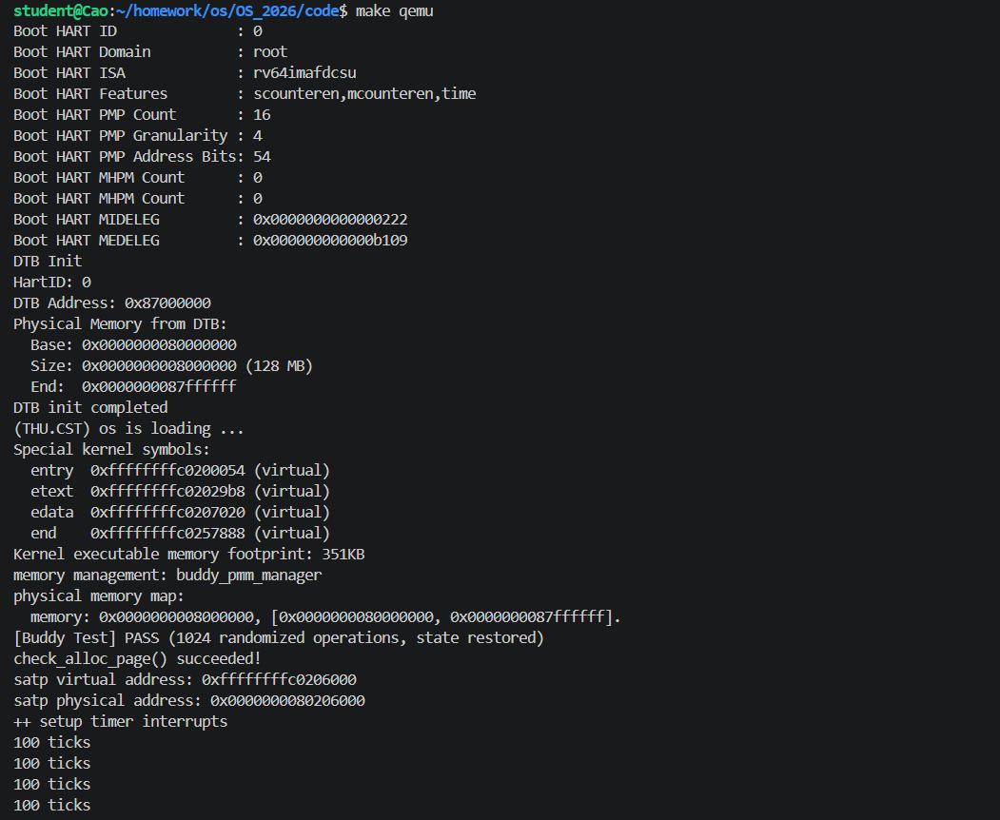

# 操作系统实验报告

## 实验基本信息

| 项目 | 内容 |
|------|------|
| **实验名称** | Lab 4：进程管理 |
| **小组成员** | 2412940-曹皓轩 |
| **完成日期** | 2026-11-10 |

### 小组分工

| 成员 | 负责的练习/模块 |
|------|----------------|
| 2412940-曹皓轩 | 虚拟内存页操作、进程创建与初始化、调度与上下文切换、测试与报告 |

---

## 一、实验目的

1. 理解虚拟地址、页表项、物理页引用计数和 TLB 的关系，实现页映射的建立、更新与撤销。
2. 理解 PCB、内核栈、Trap frame 和 context 的分工，完成内核线程创建与首次运行现场构造。
3. 实现可运行线程的轮转选择和 RISC-V 上下文切换，贯通 idle 到 init 的执行链。

---

## 二、实验环境

| 成员 | AI 编程工具 | 底层模型 | 备注 |
|------|------------|---------|------|
| 2412940-曹皓轩 | Codex（桌面 Agent） | GPT-6 | WSL Ubuntu 22.04、RISC-V 64 位、QEMU |

---

## 三、实验整体逻辑分析

### 2.1 本章节的逻辑主线

本实验围绕“地址空间准备—线程创建—线程调度执行”展开。启动后，`pmm_init` 初始化物理页分配器并验证页表映射；`idt_init` 建立 Trap 入口，`vmm_init` 检查虚拟内存区域结构；随后 `proc_init` 把当前执行现场包装为 idle，并创建 init 内核线程。开启时钟与中断后，`cpu_idle` 检查 `need_resched`，经 `schedule → proc_run → switch_to` 把 CPU 交给 init。

新线程第一次运行时没有真实的旧执行现场，因此创建阶段预先构造 `context` 和 `trapframe`：`switch_to` 恢复的返回地址指向 `forkret`，后者经 `forkrets → __trapret` 恢复 Trap frame，再由 `sret` 进入 `kernel_thread_entry`，最终调用线程函数。内存管理负责线程所需的 PCB 与栈，调度管理负责分配 CPU，两条路径在新线程首次执行时汇合。

### 2.2 功能的逐步实现

1. 实现 `page_insert`、`page_remove`，维护映射、引用计数和 TLB 的一致性。
2. 初始化 PCB、内核栈和首次运行现场，完成 idle/init 的创建及线程登记。
3. 实现可运行线程轮转选择和寄存器上下文切换，让 init 真正运行。
4. 通过页表自检、VMA 自检及三个评分项目验证完整执行链。

---

## 四、实验内容与实现

### 功能模块一：虚拟内存页操作

**负责人：** 2412940-曹皓轩

#### 模块功能描述

需要实现 `page_insert` 和 `page_remove`，并用内部函数 `page_remove_pte` 统一处理有效映射撤销。最终代码如下：

```c
static void page_remove_pte(pde_t *pgdir, uintptr_t la, pte_t *ptep)
{
    if (*ptep & PTE_V) {
        struct Page *page = pte2page(*ptep);
        if (page_ref_dec(page) == 0) {
            free_page(page);
        }
        *ptep = 0;
        tlb_invalidate(pgdir, la);
    }
}

int page_insert(pde_t *pgdir, struct Page *page, uintptr_t la, uint32_t perm)
{
    pte_t *ptep = get_pte(pgdir, la, 1);
    if (ptep == NULL) {
        return -E_NO_MEM;
    }
    page_ref_inc(page);
    if (*ptep & PTE_V) {
        if (pte2page(*ptep) == page) {
            page_ref_dec(page);
        } else {
            page_remove_pte(pgdir, la, ptep);
        }
    }
    *ptep = pte_create(page2ppn(page), perm);
    tlb_invalidate(pgdir, la);
    return 0;
}

void page_remove(pde_t *pgdir, uintptr_t la)
{
    pte_t *ptep = get_pte(pgdir, la, 0);
    if (ptep != NULL) {
        page_remove_pte(pgdir, la, ptep);
    }
}
```

`page_insert` 首先请求目标 PTE；若分配页表失败，返回 `-E_NO_MEM`，此时尚未增加目标物理页引用。成功取得 PTE 后先增加新页引用，再处理旧映射。同页重复插入时抵消这次增加，因此可更新权限而不改变引用计数；映射不同物理页时，撤销旧映射并在其引用归零时释放旧页。最后写入新 PTE，刷新对应地址的 TLB。

先增加新引用再处理旧映射，使同页重映射时不会把仍要使用的物理页释放。`page_remove` 使用 `create=0` 查找 PTE，避免删除操作反而申请页表；无页表或无有效映射时直接返回，因此重复删除具有幂等性。

#### 最终提示词

见 `prompt.md` 的“功能模块一”。Spec 按映射前后状态编写，明确区分空映射、同页重映射、异页替换和页表申请失败；Prompt 限定标记位置、真实接口及测试不可修改。

#### 实现迭代过程

实现把“减少引用—按需释放物理页—清空 PTE—刷新 TLB”放入同一内部函数，避免替换和删除两条路径维护不同规则。评分中的同页权限更新、替换旧页、共享页引用和重复删除均通过；本模块未观察到 AI 生成逻辑导致的测试失败。

### 功能模块二：进程创建及初始化

**负责人：** 2412940-曹皓轩

#### 模块功能描述

本模块实现 `alloc_proc`、`copy_mm`、`copy_thread`、`do_fork`、`kernel_thread` 和 `proc_init`：

```c
static struct proc_struct *alloc_proc(void)
{
    struct proc_struct *proc = kmalloc(sizeof(struct proc_struct));
    if (proc != NULL) {
        memset(proc, 0, sizeof(*proc));
        proc->state = PROC_UNINIT;
        proc->pid = -1;
        proc->pgdir = boot_pgdir_pa;
        list_init(&proc->list_link);
        list_init(&proc->hash_link);
    }
    return proc;
}

static int copy_mm(uint32_t clone_flags, struct proc_struct *proc)
{
    assert(current->mm == NULL);
    return 0;
}

static void copy_thread(struct proc_struct *proc, uintptr_t esp, struct trapframe *tf)
{
    proc->tf = (struct trapframe *)(proc->kstack + KSTACKSIZE - sizeof(struct trapframe));
    *proc->tf = *tf;
    proc->tf->gpr.a0 = 0;
    proc->tf->gpr.sp = esp ? esp : (uintptr_t)proc->tf;
    proc->context.ra = (uintptr_t)forkret;
    proc->context.sp = (uintptr_t)proc->tf;
}

int do_fork(uint32_t clone_flags, uintptr_t stack, struct trapframe *tf)
{
    if (nr_process >= MAX_PROCESS) {
        return -E_NO_FREE_PROC;
    }
    struct proc_struct *proc = alloc_proc();
    if (proc == NULL) {
        return -E_NO_MEM;
    }
    int ret = -E_NO_MEM;
    proc->parent = current;
    if (setup_kstack(proc) != 0) {
        goto bad_proc;
    }
    if ((ret = copy_mm(clone_flags, proc)) != 0) {
        goto bad_stack;
    }
    copy_thread(proc, stack, tf);
    bool intr_flag;
    local_intr_save(intr_flag);
    proc->pid = get_pid();
    hash_proc(proc);
    list_add_before(&proc_list, &proc->list_link);
    nr_process++;
    local_intr_restore(intr_flag);
    wakeup_proc(proc);
    return proc->pid;

bad_stack:
    put_kstack(proc);
bad_proc:
    kfree(proc);
    return ret;
}

int kernel_thread(int (*fn)(void *), void *arg, uint32_t clone_flags)
{
    struct trapframe tf;
    memset(&tf, 0, sizeof(tf));
    tf.gpr.s0 = (uintptr_t)fn;
    tf.gpr.s1 = (uintptr_t)arg;
    tf.status = (read_csr(sstatus) | SSTATUS_SPP | SSTATUS_SPIE) & ~SSTATUS_SIE;
    tf.epc = (uintptr_t)kernel_thread_entry;
    return do_fork(clone_flags | CLONE_VM, 0, &tf);
}

void proc_init(void)
{
    list_init(&proc_list);
    for (int i = 0; i < HASH_LIST_SIZE; i++) {
        list_init(&hash_list[i]);
    }
    idleproc = alloc_proc();
    if (idleproc == NULL) {
        panic("cannot allocate idleproc.\n");
    }
    idleproc->pid = 0;
    idleproc->state = PROC_RUNNABLE;
    idleproc->kstack = (uintptr_t)bootstack;
    idleproc->need_resched = 1;
    set_proc_name(idleproc, "idle");
    nr_process++;
    current = idleproc;
    int pid = kernel_thread(init_main, "Hello world!!", 0);
    if (pid <= 0 || (initproc = find_proc(pid)) == NULL) {
        panic("cannot create initproc.\n");
    }
    set_proc_name(initproc, "init");
}
```

`alloc_proc` 为 PCB 分配空间并整体清零，再设置 `PROC_UNINIT`、无效 PID `-1`、内核页表物理地址以及独立链表节点。清零保证 `runs`、`need_resched`、`mm`、`tf`、`flags` 和上下文寄存器处于明确初态。

`kernel_thread` 把函数入口放入 `s0`、参数放入 `s1`，将 `epc` 设置为 `kernel_thread_entry`；`SPP=1` 使 `sret` 返回 S 态，`SPIE=1` 使返回后允许中断，构造现场时清除 `SIE`。`copy_thread` 把 Trap frame 放在新线程内核栈顶部，子线程返回值 `a0=0`，栈指针指向该现场；`context.ra=forkret` 则安排第一次 `switch_to` 返回后的路径。

`do_fork` 按“进程数检查—PCB—栈—地址空间—现场—登记—唤醒”组织创建过程。内核栈申请失败时释放 PCB；地址空间准备失败时先释放栈，再释放 PCB。资源准备完毕才在关中断区域分配 PID、加入哈希表和全局链表并增加进程数，随后唤醒线程。当前阶段全部为内核线程，`copy_mm` 检查父线程没有用户 `mm`，保留空实现接口并共享内核页表。

`proc_init` 初始化链表和 PID 哈希桶，将当前执行现场作为 idle：PID 为 0、复用 `bootstack`、状态为 runnable、设置调度标志。然后把 `current` 指向 idle，创建 PID 为 1 的 init，设置名字为 `init`。idle 不加入普通进程链表，调度器在找不到 runnable 线程时单独选择它。

#### 最终提示词

见 `prompt.md` 的“功能模块二”。Spec 以线程创建后的 PCB 字段、资源归属、登记结构和首次运行路径为后置条件，并明确列出分配失败的清理要求。Prompt 要求保留已有辅助函数与 `do_exit`，不扩展用户地址空间复制。

#### 实现迭代过程

实现以 `forkret → forkrets → __trapret → kernel_thread_entry` 为依据反推 Trap frame 和 context 字段，保证创建结果能够被调度代码直接消费。测试检查了 idle 的 PID、栈与状态，init 的 PID、父线程、上下文和 runnable 状态，均通过。本模块未观察到 AI 生成逻辑导致的测试失败。

### 功能模块三：进程调度与上下文切换

**负责人：** 2412940-曹皓轩

#### 模块功能描述

`cpu_idle` 和 `proc_run` 的实现如下：

```c
void cpu_idle(void)
{
    while (1) {
        if (current->need_resched) {
            schedule();
        }
    }
}

void proc_run(struct proc_struct *proc)
{
    if (proc != current) {
        bool intr_flag;
        local_intr_save(intr_flag);
        struct proc_struct *prev = current;
        current = proc;
        // Sv39 uses MODE=8 and the physical root page number in satp.
        write_csr(satp, ((uintptr_t)8 << 60) | (proc->pgdir >> RISCV_PGSHIFT));
        flush_tlb();
        switch_to(&prev->context, &proc->context);
        local_intr_restore(intr_flag);
    }
}
```

`cpu_idle` 持续检查当前线程的调度标志。`proc_run` 先判断目标是否为当前线程；确需切换时保存中断状态并关中断，保留旧 PCB、更新 `current`、写入目标页表物理页号和 Sv39 模式、刷新 TLB，再调用 `switch_to`。当旧线程以后被调度回来时，从这个调用点之后继续，并恢复进入临界区前的中断状态。

调度器实现如下：

```c
void schedule(void)
{
    bool intr_flag;
    local_intr_save(intr_flag);
    current->need_resched = 0;
    list_entry_t *last = current == idleproc ? &proc_list : &current->list_link;
    list_entry_t *le = last;
    struct proc_struct *next = NULL;
    do {
        le = list_next(le);
        if (le != &proc_list) {
            struct proc_struct *proc = le2proc(le, list_link);
            if (proc->state == PROC_RUNNABLE) {
                next = proc;
                break;
            }
        }
    } while (le != last);
    if (next == NULL) {
        next = idleproc;
    }
    next->runs++;
    if (next != current) {
        proc_run(next);
    }
    local_intr_restore(intr_flag);
}
```

`schedule` 先清除当前线程的 `need_resched`。当前为 idle 时从链表头开始，否则从当前节点后继开始，跳过表头，并且最多绕链表一圈。只选择 `PROC_RUNNABLE` 节点；若没有可运行节点，使用 idle。选中线程后增加 `runs`，目标不同才执行切换。这里按链表循环选择线程，体现轮转思想；本实验通过空闲循环或显式调用进入调度，并未实现基于时间片的强制抢占。

底层上下文切换代码如下：

```asm
#include <riscv.h>

.text
.globl switch_to
switch_to:
    STORE ra, 0*REGBYTES(a0)
    STORE sp, 1*REGBYTES(a0)
    STORE s0, 2*REGBYTES(a0)
    STORE s1, 3*REGBYTES(a0)
    STORE s2, 4*REGBYTES(a0)
    STORE s3, 5*REGBYTES(a0)
    STORE s4, 6*REGBYTES(a0)
    STORE s5, 7*REGBYTES(a0)
    STORE s6, 8*REGBYTES(a0)
    STORE s7, 9*REGBYTES(a0)
    STORE s8, 10*REGBYTES(a0)
    STORE s9, 11*REGBYTES(a0)
    STORE s10, 12*REGBYTES(a0)
    STORE s11, 13*REGBYTES(a0)
    LOAD ra, 0*REGBYTES(a1)
    LOAD sp, 1*REGBYTES(a1)
    LOAD s0, 2*REGBYTES(a1)
    LOAD s1, 3*REGBYTES(a1)
    LOAD s2, 4*REGBYTES(a1)
    LOAD s3, 5*REGBYTES(a1)
    LOAD s4, 6*REGBYTES(a1)
    LOAD s5, 7*REGBYTES(a1)
    LOAD s6, 8*REGBYTES(a1)
    LOAD s7, 9*REGBYTES(a1)
    LOAD s8, 10*REGBYTES(a1)
    LOAD s9, 11*REGBYTES(a1)
    LOAD s10, 12*REGBYTES(a1)
    LOAD s11, 13*REGBYTES(a1)
    ret
```

`a0` 和 `a1` 分别指向旧、新 `struct context`。按照结构体顺序保存和恢复 `ra`、`sp`、`s0` 到 `s11`，每槽为 `REGBYTES=8` 字节，共 112 字节。恢复新 `ra` 后执行 `ret`，便转移到新线程保存的返回位置。普通函数调用边界只要求保留被调用者保存寄存器；完整中断现场则由 Trap frame 负责，二者保存范围不同。

#### 最终提示词

见 `prompt.md` 的“功能模块三”。Spec 描述遍历起点、遍历终止、idle 回退、临界区中断恢复及寄存器槽位对应关系。Prompt 将调度策略、进程切换和汇编寄存器迁移分配给各自接口，防止在汇编中混入调度逻辑。

#### 实现迭代过程

实现采用与 `struct context` 完全一致的汇编槽位，并在 `proc_run` 中按当前 Sv39 地址空间写入页表寄存器。评分代码创建两个额外线程，通过多轮显式调度确认它们都能运行并恢复执行；最终调度测试通过，init 也运行到预期输出。

---

## 五、测试与验证

编译并在 QEMU 中运行后，内核依次通过 `check_alloc_page`、`check_pgdir`、`check_boot_pgdir`、`kmalloc_init`、`check_vma_struct` 和 `check_vmm`，随后建立线程并完成 idle 到 init 的切换。

实验提供的评分程序检查结果如下：

| 测试项目 | 验证内容 | 结果 |
|------|------|------|
| PMM | 同页重复映射、权限更新、异页替换、引用计数与重复删除 | 10/10 |
| Process Create | idle/init 字段、线程状态、父线程和首次运行上下文 | 10/10 |
| Schedule | 两个附加线程轮转执行，以及 init 预期输出 | 10/10 |
| 合计 | 三项评分全部通过 | 30/30 |

**测试截图：**

下图为实际评分输出的可视化，原始文本保存在 `grade.log`。


下图为未注入测试代码的内核运行输出可视化，原始文本保存在 `qemu.log`。init 输出自己的 PID、名称以及线程参数，验证新线程已沿首次运行恢复路径进入目标函数。其返回后，框架已有 `do_exit` 输出 `process exit!!` 并进入调试监视器；当前实验未实现完整进程退出和回收。



---

## 六、实验总结与收获

### 对操作系统的理解

| 实验知识点 | 对应 OS 原理 | 联系和差异 |
|------|------|------|
| PTE、引用计数与 TLB 同步 | 分页、共享页和地址翻译缓存一致性 | 修改内存中的页表后，还需要使硬件缓存失效；实验使用单核本地 TLB 刷新，多核还需要跨核同步。 |
| PCB、内核栈、context、trapframe | 进程表示与处理器现场 | PCB 管理线程资源，context 供函数调用边界切换，trapframe 供中断返回；线程对象与 CPU 现场各有职责。 |
| 内核线程共享页表 | 进程与线程的资源共享 | 实验中的线程共享内核地址空间；一般用户进程还需要独立地址空间与权限隔离。 |
| runnable 链表轮转 | CPU 调度策略 | 实验按链表循环选取线程，调度点由空闲循环或显式调用提供；时间片抢占还需要定时器驱动调度。 |
| 保存并恢复中断状态 | 临界区互斥与原子性 | 单核关中断避免本核被打断，不能直接代替多核自旋锁。 |

扩展练习中，`local_intr_save` 先检查 `sstatus.SIE` 并记录是否原来开中断，必要时清除 SIE；`local_intr_restore` 只在进入时开中断的情况下重新开启。因此嵌套临界区不会由内层提前开中断。进程切换的关键更新需要这类保护，保证 `current`、页表和实际执行现场保持一致。

Sv32 使用两级页表、每级 10 位索引；Sv39 使用三级页表、每级 9 位索引；Sv48 使用四级页表、每级 9 位索引，三者普通页内偏移均为 12 位。`get_pte` 中两段相似代码分别处理 Sv39 的两个上层目录：检查有效位、按需分配下层页表、清零、登记引用并写入目录项。它们结构相似，是多级页表逐层下降的重复操作，使用的索引层级不同。

`get_pte` 把查找和分配集中在一个接口中，用 `create` 控制行为，便于调用者直接请求目标 PTE；纯查找时传 0，不产生分配副作用。若要支持更多分页模式或细化分配失败回滚，可以拆成纯查找与逐层创建两个内部过程，明确各自副作用。本实验保留现有接口。

OS 原理中重要而本实验尚未实现的内容包括用户态地址空间隔离、系统调用、按需调页、页面置换、写时复制、时间片抢占、多核调度，以及进程退出后的父进程等待与资源回收。它们分别扩展当前建立的内存、Trap、线程和调度接口。

### AI 协作开发的经验

Spec 应描述代码执行前后的可验证状态，而不是只写“实现进程管理”。页操作模块需要明确引用计数变化；线程创建需要明确栈与现场归属、失败清理和登记时机；调度模块需要明确链表遍历边界、寄存器偏移和中断恢复规则。Prompt 则把这些约束绑定到工程中的真实函数、结构和标记位置。

本次通过原有自检和评分，验证了映射更新、线程创建及实际调度执行。对 AI 生成代码的检查应落实到引用计数、状态变化和上下文恢复这些具体行为，并通过执行结果确认。

---
