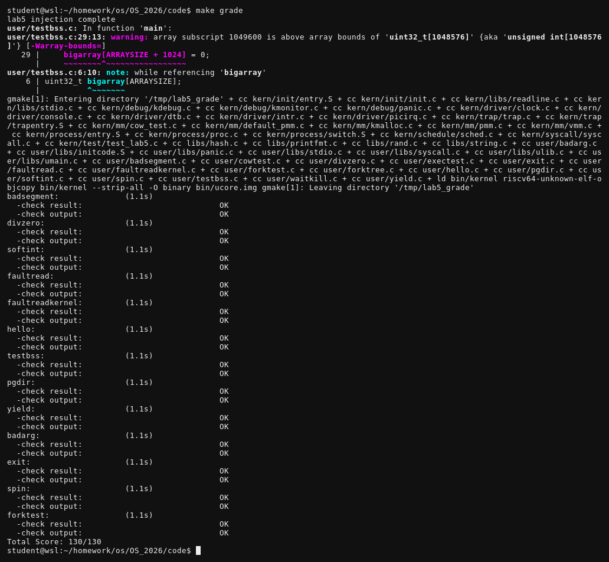
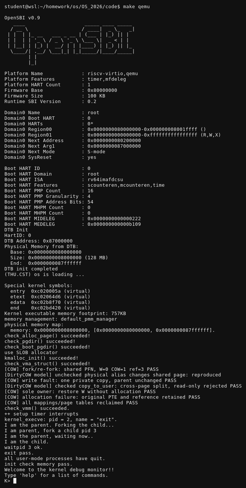

# 操作系统实验报告

## 实验基本信息

| 项目 | 内容 |
|------|------|
| **实验名称** | Lab 4：进程管理 |
| **小组成员** | 2412940-曹皓轩 |
| **完成日期** | 2026-11-10 |

### 小组分工

| 成员 | 负责的练习/模块 |
|------|----------------|
| 2412940-曹皓轩 | 虚拟内存页操作、进程创建与初始化、调度与上下文切换、测试与报告 |

---

## 一、实验目的

1. 理解虚拟地址、页表项、物理页引用计数和 TLB 的关系，实现页映射的建立、更新与撤销。
2. 理解 PCB、内核栈、Trap frame 和 context 的分工，完成内核线程创建与首次运行现场构造。
3. 实现可运行线程的轮转选择和 RISC-V 上下文切换，贯通 idle 到 init 的执行链。

---

## 二、实验环境

| 成员 | AI 编程工具 | 底层模型 | 备注 |
|------|------------|---------|------|
| 2412940-曹皓轩 | Codex | GPT-6 |  |

---

## 三、实验整体逻辑分析

### 2.1 本章节的逻辑主线

本实验先准备线程运行需要的内存和中断环境，再创建线程，最后通过调度器切换执行。启动后，`pmm_init` 初始化物理页分配器并检查页表映射，`idt_init` 设置 Trap 入口，`vmm_init` 检查虚拟内存区域结构。接着，`proc_init` 将当前执行现场设为 idle 线程，并创建 init 内核线程。开启时钟和中断后，`cpu_idle` 检查 `need_resched`，依次调用 `schedule`、`proc_run` 和 `switch_to`，让 init 开始运行。

新线程第一次运行时还没有可恢复的执行现场，需要在创建时填写 `context` 和 `trapframe`。`context.ra` 指向 `forkret`，因此 `switch_to` 恢复上下文后会先执行 `forkret`。它调用 `forkrets`，再由 `__trapret` 恢复 Trap frame，执行 `sret` 后进入 `kernel_thread_entry`，最终调用线程函数。创建阶段填写的寄存器值，决定了调度后从哪里执行、使用哪一块栈，以及向线程函数传递什么参数。

### 2.2 功能的逐步实现

1. 实现 `page_insert`、`page_remove`，维护映射、引用计数和 TLB 的一致性。
2. 初始化 PCB、内核栈和首次运行现场，完成 idle/init 的创建及线程登记。
3. 实现可运行线程轮转选择和寄存器上下文切换，使 init 开始执行。
4. 通过页表自检、VMA 自检及三个评分项目验证完整执行链。

---

## 四、实验内容与实现

### 功能模块一：虚拟内存页操作

**负责人：** 2412940-曹皓轩

#### 模块功能描述

`page_insert` 负责建立或更新页映射，`page_remove` 负责撤销映射。两者通过内部函数 `page_remove_pte` 处理旧映射的引用计数和物理页释放。代码如下：

```c
static void page_remove_pte(pde_t *pgdir, uintptr_t la, pte_t *ptep)
{
    if (*ptep & PTE_V) {
        struct Page *page = pte2page(*ptep);
        if (page_ref_dec(page) == 0) {
            free_page(page);
        }
        *ptep = 0;
        tlb_invalidate(pgdir, la);
    }
}

int page_insert(pde_t *pgdir, struct Page *page, uintptr_t la, uint32_t perm)
{
    pte_t *ptep = get_pte(pgdir, la, 1);
    if (ptep == NULL) {
        return -E_NO_MEM;
    }
    page_ref_inc(page);
    if (*ptep & PTE_V) {
        if (pte2page(*ptep) == page) {
            page_ref_dec(page);
        } else {
            page_remove_pte(pgdir, la, ptep);
        }
    }
    *ptep = pte_create(page2ppn(page), perm);
    tlb_invalidate(pgdir, la);
    return 0;
}

void page_remove(pde_t *pgdir, uintptr_t la)
{
    pte_t *ptep = get_pte(pgdir, la, 0);
    if (ptep != NULL) {
        page_remove_pte(pgdir, la, ptep);
    }
}
```

`page_insert` 先调用 `get_pte` 查找或创建目标页表项。如果无法取得 PTE，就返回 `-E_NO_MEM`。取得 PTE 后先增加新物理页的引用计数，再检查原映射：如果映射的仍是同一页，就抵消刚增加的引用，只更新权限；如果映射的是另一页，就减少旧页引用，在引用归零时释放旧页。最后写入新 PTE，并刷新对应地址的 TLB。

先增加引用、再检查旧映射，可以避免同页重映射时误释放该页。`page_remove` 查找 PTE 时传入 `create=0`，因此不会为删除操作分配页表。目标地址没有页表或有效映射时直接返回，重复删除也不会再次减少引用计数。

#### 最终提示词

完整提示词见 `prompt.md` 的功能模块一。Spec 分别规定了空地址建立映射、同页更新权限、异页替换和页表分配失败时的结果，重点写清引用计数如何变化。Prompt 指定修改位置和可用函数，并要求保留框架测试。

#### 实现迭代过程

本模块的代码实现经历了 1 次迭代。

##### 第一次迭代

根据提示词补全 `page_insert` 和 `page_remove`，并用 `page_remove_pte` 处理旧映射的撤销。实现时先增加新页引用，再判断原映射是否指向同一页；同页重映射时抵消新增引用，替换其他页时减少旧页引用。撤销映射后清空 PTE，并刷新对应地址的 TLB。

**最终结果：**

经过 1 次实现迭代，该模块：

- 编译通过。
- 通过页表自检和 PMM 评分测试，得分为 10/10。
- 同页权限更新、异页替换、共享页引用计数和重复删除的测试结果符合预期。

### 功能模块二：进程创建及初始化

**负责人：** 2412940-曹皓轩

#### 模块功能描述

本模块实现 `alloc_proc`、`copy_mm`、`copy_thread`、`do_fork`、`kernel_thread` 和 `proc_init`：

```c
static struct proc_struct *alloc_proc(void)
{
    struct proc_struct *proc = kmalloc(sizeof(struct proc_struct));
    if (proc != NULL) {
        memset(proc, 0, sizeof(*proc));
        proc->state = PROC_UNINIT;
        proc->pid = -1;
        proc->pgdir = boot_pgdir_pa;
        list_init(&proc->list_link);
        list_init(&proc->hash_link);
    }
    return proc;
}

static int copy_mm(uint32_t clone_flags, struct proc_struct *proc)
{
    assert(current->mm == NULL);
    return 0;
}

static void copy_thread(struct proc_struct *proc, uintptr_t esp, struct trapframe *tf)
{
    proc->tf = (struct trapframe *)(proc->kstack + KSTACKSIZE - sizeof(struct trapframe));
    *proc->tf = *tf;
    proc->tf->gpr.a0 = 0;
    proc->tf->gpr.sp = esp ? esp : (uintptr_t)proc->tf;
    proc->context.ra = (uintptr_t)forkret;
    proc->context.sp = (uintptr_t)proc->tf;
}

int do_fork(uint32_t clone_flags, uintptr_t stack, struct trapframe *tf)
{
    if (nr_process >= MAX_PROCESS) {
        return -E_NO_FREE_PROC;
    }
    struct proc_struct *proc = alloc_proc();
    if (proc == NULL) {
        return -E_NO_MEM;
    }
    int ret = -E_NO_MEM;
    proc->parent = current;
    if (setup_kstack(proc) != 0) {
        goto bad_proc;
    }
    if ((ret = copy_mm(clone_flags, proc)) != 0) {
        goto bad_stack;
    }
    copy_thread(proc, stack, tf);
    bool intr_flag;
    local_intr_save(intr_flag);
    proc->pid = get_pid();
    hash_proc(proc);
    list_add_before(&proc_list, &proc->list_link);
    nr_process++;
    local_intr_restore(intr_flag);
    wakeup_proc(proc);
    return proc->pid;

bad_stack:
    put_kstack(proc);
bad_proc:
    kfree(proc);
    return ret;
}

int kernel_thread(int (*fn)(void *), void *arg, uint32_t clone_flags)
{
    struct trapframe tf;
    memset(&tf, 0, sizeof(tf));
    tf.gpr.s0 = (uintptr_t)fn;
    tf.gpr.s1 = (uintptr_t)arg;
    tf.status = (read_csr(sstatus) | SSTATUS_SPP | SSTATUS_SPIE) & ~SSTATUS_SIE;
    tf.epc = (uintptr_t)kernel_thread_entry;
    return do_fork(clone_flags | CLONE_VM, 0, &tf);
}

void proc_init(void)
{
    list_init(&proc_list);
    for (int i = 0; i < HASH_LIST_SIZE; i++) {
        list_init(&hash_list[i]);
    }
    idleproc = alloc_proc();
    if (idleproc == NULL) {
        panic("cannot allocate idleproc.\n");
    }
    idleproc->pid = 0;
    idleproc->state = PROC_RUNNABLE;
    idleproc->kstack = (uintptr_t)bootstack;
    idleproc->need_resched = 1;
    set_proc_name(idleproc, "idle");
    nr_process++;
    current = idleproc;
    int pid = kernel_thread(init_main, "Hello world!!", 0);
    if (pid <= 0 || (initproc = find_proc(pid)) == NULL) {
        panic("cannot create initproc.\n");
    }
    set_proc_name(initproc, "init");
}
```

`alloc_proc` 分配 PCB 后先整体清零，再设置 `PROC_UNINIT`、PID 初值 `-1`、内核页表物理地址，并初始化两个链表节点。清零后，`runs`、`need_resched`、`flags` 和上下文寄存器为 0，`mm`、`tf` 等指针为空。

`kernel_thread` 将线程函数放入 `s0`，参数放入 `s1`，并让 `epc` 指向 `kernel_thread_entry`。`SPP=1` 使 `sret` 返回 S 态，`SPIE=1` 使返回后允许中断，构造现场时则清除 `SIE`。`copy_thread` 将 Trap frame 放在新线程内核栈顶部，设置 `a0=0`，并将栈指针指向该现场。`context.ra` 设置为 `forkret`，供第一次上下文切换后使用。

`do_fork` 先检查进程数，再依次申请 PCB、内核栈，准备地址空间和执行现场。栈申请失败时释放 PCB；地址空间准备失败时先释放栈，再释放 PCB。资源准备完成后，函数在关中断期间分配 PID，将线程加入哈希表和全局链表，增加进程数，最后调用 `wakeup_proc`。本实验创建的是共享内核页表的内核线程，`copy_mm` 检查父线程的 `mm` 为空后返回。

`proc_init` 初始化进程链表和 PID 哈希桶，并把当前执行现场设为 idle 线程。idle 的 PID 为 0，复用 `bootstack`，状态设为 `PROC_RUNNABLE`，同时设置 `need_resched`。随后令 `current` 指向 idle，创建 PID 为 1、名称为 `init` 的内核线程。idle 不加入普通进程链表，调度器找不到可运行线程时会直接选中它。

#### 最终提示词

完整提示词见 `prompt.md` 的功能模块二。Spec 列出 PCB 的初值、内核栈和执行现场的位置，以及创建失败时需要释放的资源。Prompt 要求使用已有辅助函数完成线程创建，并保留 `do_exit` 的原有实现。

#### 实现迭代过程

本模块的代码实现经历了 1 次迭代。

##### 第一次迭代

根据提示词补全 PCB 初始化、内核栈申请、线程现场构造和进程登记。构造现场时，将 `context.ra` 设为 `forkret`，将 `context.sp` 指向新线程的 Trap frame，再将 `tf->epc` 设为 `kernel_thread_entry`。创建过程中的资源申请失败时，按申请顺序的逆序释放已取得的资源；完成现场准备后再登记 PID、加入链表并唤醒线程。

**最终结果：**

经过 1 次实现迭代，该模块：

- 编译通过。
- 通过 Process Create 评分测试，得分为 10/10。
- idle 的 PID、内核栈和状态，以及 init 的 PID、父线程、上下文和可运行状态均通过检查。

### 功能模块三：进程调度与上下文切换

**负责人：** 2412940-曹皓轩

#### 模块功能描述

`cpu_idle` 和 `proc_run` 的实现如下：

```c
void cpu_idle(void)
{
    while (1) {
        if (current->need_resched) {
            schedule();
        }
    }
}

void proc_run(struct proc_struct *proc)
{
    if (proc != current) {
        bool intr_flag;
        local_intr_save(intr_flag);
        struct proc_struct *prev = current;
        current = proc;
        // Sv39 uses MODE=8 and the physical root page number in satp.
        write_csr(satp, ((uintptr_t)8 << 60) | (proc->pgdir >> RISCV_PGSHIFT));
        flush_tlb();
        switch_to(&prev->context, &proc->context);
        local_intr_restore(intr_flag);
    }
}
```

`cpu_idle` 在循环中检查调度标志，标志置位时调用 `schedule`。`proc_run` 在目标线程与当前线程不同时执行切换：先保存中断状态并关闭中断，再更新 `current`，写入 Sv39 模式和目标页表物理页号，刷新 TLB，最后调用 `switch_to`。旧线程以后再次被调度时，会从 `switch_to` 返回后的语句继续执行，并恢复原来的中断状态。

调度器实现如下：

```c
void schedule(void)
{
    bool intr_flag;
    local_intr_save(intr_flag);
    current->need_resched = 0;
    list_entry_t *last = current == idleproc ? &proc_list : &current->list_link;
    list_entry_t *le = last;
    struct proc_struct *next = NULL;
    do {
        le = list_next(le);
        if (le != &proc_list) {
            struct proc_struct *proc = le2proc(le, list_link);
            if (proc->state == PROC_RUNNABLE) {
                next = proc;
                break;
            }
        }
    } while (le != last);
    if (next == NULL) {
        next = idleproc;
    }
    next->runs++;
    if (next != current) {
        proc_run(next);
    }
    local_intr_restore(intr_flag);
}
```

`schedule` 先清除当前线程的 `need_resched`。当前线程为 idle 时，从进程链表头部开始查找；否则从当前节点的后继开始，最多遍历一圈，跳过表头，只选择 `PROC_RUNNABLE` 节点。没有找到时选中 idle。选定线程后增加其 `runs`，若目标与当前线程不同，就调用 `proc_run`。这种查找顺序使可运行线程按链表顺序轮流执行；本实验通过空闲循环或显式调用触发调度。

底层上下文切换代码如下：

```asm
#include <riscv.h>

.text
.globl switch_to
switch_to:
    STORE ra, 0*REGBYTES(a0)
    STORE sp, 1*REGBYTES(a0)
    STORE s0, 2*REGBYTES(a0)
    STORE s1, 3*REGBYTES(a0)
    STORE s2, 4*REGBYTES(a0)
    STORE s3, 5*REGBYTES(a0)
    STORE s4, 6*REGBYTES(a0)
    STORE s5, 7*REGBYTES(a0)
    STORE s6, 8*REGBYTES(a0)
    STORE s7, 9*REGBYTES(a0)
    STORE s8, 10*REGBYTES(a0)
    STORE s9, 11*REGBYTES(a0)
    STORE s10, 12*REGBYTES(a0)
    STORE s11, 13*REGBYTES(a0)
    LOAD ra, 0*REGBYTES(a1)
    LOAD sp, 1*REGBYTES(a1)
    LOAD s0, 2*REGBYTES(a1)
    LOAD s1, 3*REGBYTES(a1)
    LOAD s2, 4*REGBYTES(a1)
    LOAD s3, 5*REGBYTES(a1)
    LOAD s4, 6*REGBYTES(a1)
    LOAD s5, 7*REGBYTES(a1)
    LOAD s6, 8*REGBYTES(a1)
    LOAD s7, 9*REGBYTES(a1)
    LOAD s8, 10*REGBYTES(a1)
    LOAD s9, 11*REGBYTES(a1)
    LOAD s10, 12*REGBYTES(a1)
    LOAD s11, 13*REGBYTES(a1)
    ret
```

`a0` 指向旧线程的 `context`，`a1` 指向新线程的 `context`。汇编按照结构体字段顺序保存和恢复 `ra`、`sp`、`s0` 到 `s11`，每个字段占 8 字节，共 112 字节。恢复新线程的 `ra` 后执行 `ret`，就会跳到该线程保存的返回位置。`switch_to` 在函数调用处切换，因此保存被调用者保存寄存器；中断发生时的完整寄存器现场由 Trap frame 保存。

#### 最终提示词

完整提示词见 `prompt.md` 的功能模块三。Spec 写明链表从哪里开始遍历、何时结束，以及找不到可运行线程时如何选择 idle。汇编部分按 `struct context` 列出寄存器偏移。Prompt 分别要求 `schedule` 选择线程、`proc_run` 切换当前线程和页表、`switch_to` 保存与恢复寄存器。

#### 实现迭代过程

本模块的代码实现经历了 1 次迭代。

##### 第一次迭代

根据提示词补全空闲循环、调度器、进程切换和 `switch_to` 汇编。调度器从当前线程的后继开始查找可运行线程，找不到时选择 idle。`proc_run` 在关中断期间更新 `current`、按 Sv39 格式切换页表，再调用 `switch_to`。汇编按 `struct context` 的字段顺序保存和恢复 `ra`、`sp`、`s0` 到 `s11`。

**最终结果：**

经过 1 次实现迭代，该模块：

- 编译通过。
- 通过 Schedule 评分测试，得分为 10/10。
- 评分程序创建的两个额外线程均能经过调度运行并恢复执行。
- init 线程打印了预期的 PID、名称和 `Hello world!!`，完成从 idle 到 init 的切换。

### 扩展练习 Challenge

**负责人：** 2412940-曹皓轩

#### Challenge 1：`local_intr_save` 与 `local_intr_restore` 如何实现开关中断？

`local_intr_save` 和 `local_intr_restore` 通过操作 `sstatus` 寄存器中的 `SSTATUS_SIE` 位实现中断状态的保存、关闭和恢复。代码如下：

```c
static inline bool __intr_save(void) {
    if (read_csr(sstatus) & SSTATUS_SIE) {
        intr_disable();
        return 1;
    }
    return 0;
}

static inline void __intr_restore(bool flag) {
    if (flag) {
        intr_enable();
    }
}

#define local_intr_save(x) \
    do {                   \
        x = __intr_save(); \
    } while (0)
#define local_intr_restore(x) __intr_restore(x);
```

`__intr_save` 先读取 `SSTATUS_SIE`。如果该位为 1，调用 `intr_disable()` 清除该位，并返回 `true`；如果该位为 0，则返回 `false`。临界区结束后，`__intr_restore` 只在保存值为 `true` 时调用 `intr_enable()` 设置 `SSTATUS_SIE`。因此，恢复的是进入临界区前的状态。

`intr_enable` 和 `intr_disable` 的实现是：

```c
void intr_enable(void) { set_csr(sstatus, SSTATUS_SIE); }
void intr_disable(void) { clear_csr(sstatus, SSTATUS_SIE); }
```

`set_csr` 使用 `csrrs` 设置 SIE，`clear_csr` 使用 `csrrc` 清除 SIE。嵌套调用时，外层保存的状态为 `true`，内层保存的状态为 `false`；内层恢复时不会提前开启中断，外层恢复时才重新开启中断。

#### Challenge 2：不同分页模式及 `get_pte()` 的设计分析

##### 1. Sv32、Sv39、Sv48 的区别

三种模式都使用多级页表，4 KiB 页的页内偏移均为 12 位。区别如下：

| 项目 | Sv32 | Sv39 | Sv48 |
|------|------|------|------|
| 处理器模式 | RV32 | RV64 | RV64 |
| 虚拟地址宽度 | 32 位 | 39 位 | 48 位 |
| 页表级数 | 2 级 | 3 级 | 4 级 |
| 页表项大小 | 4 字节 | 8 字节 | 8 字节 |
| 每页表项数 | 1024 | 512 | 512 |
| 4 KiB 页地址划分 | 10+10+12 | 9+9+9+12 | 9+9+9+9+12 |

Sv32 的页表项为 4 字节，每页包含 1024 个页表项；Sv39 和 Sv48 的页表项为 8 字节，每页包含 512 个页表项。页表级数增加后，可表示的虚拟地址范围也随之扩大。

本实验使用 Sv39，虚拟地址的划分如下：

```text
PDX1(la)：位 38–30，根页表索引
PDX0(la)：位 29–21，中间页表索引
PTX(la)： 位 20–12，末级页表索引
PGOFF(la)：位 11–0，页内偏移
```

##### 2. 为什么 `get_pte()` 中的两段代码相似？

`get_pte()` 中的两段代码如下：

```c
pde_t *pdep1 = &pgdir[PDX1(la)];
if (!(*pdep1 & PTE_V))
{
    struct Page *page;
    if (!create || (page = alloc_page()) == NULL)
    {
        return NULL;
    }
    set_page_ref(page, 1);
    uintptr_t pa = page2pa(page);
    memset(KADDR(pa), 0, PGSIZE);
    *pdep1 = pte_create(page2ppn(page), PTE_U | PTE_V);
}

pde_t *pdep0 = &((pte_t *)KADDR(PDE_ADDR(*pdep1)))[PDX0(la)];
if (!(*pdep0 & PTE_V))
{
    struct Page *page;
    if (!create || (page = alloc_page()) == NULL)
    {
        return NULL;
    }
    set_page_ref(page, 1);
    uintptr_t pa = page2pa(page);
    memset(KADDR(pa), 0, PGSIZE);
    *pdep0 = pte_create(page2ppn(page), PTE_U | PTE_V);
}
```

两段代码分别处理 Sv39 页表的两个层级。第一段使用 `PDX1(la)` 从根页表找到中间页表，第二段使用 `PDX0(la)` 从中间页表找到末级页表。每一段都执行相同的操作：检查目录项的 `PTE_V` 位；目录项无效且 `create=0` 时返回 `NULL`；目录项无效且 `create=1` 时分配并清零下一级页表，设置引用计数，并把页表地址写入目录项。两段代码的相似性由多级页表逐级查找的结构决定。

##### 3. 查找和分配放在同一个 `get_pte()` 中是否合适？

`get_pte()` 通过 `create` 参数控制是否分配缺失的下级页表。以下节选为第一级目录项无效时的处理代码：

```c
pde_t *pdep1 = &pgdir[PDX1(la)];
if (!(*pdep1 & PTE_V))
{
    struct Page *page;
    if (!create || (page = alloc_page()) == NULL)
    {
        return NULL;
    }
    set_page_ref(page, 1);
    uintptr_t pa = page2pa(page);
    memset(KADDR(pa), 0, PGSIZE);
    *pdep1 = pte_create(page2ppn(page), PTE_U | PTE_V);
}
```

当 `create=0` 时，`!create` 为真，逻辑或运算短路，不会执行 `alloc_page()`，函数直接返回 `NULL`；当 `create=1` 时，才尝试分配下一级页表。下一级目录项的处理方式相同。

删除映射的 `page_remove()` 传入 `0`，避免为不存在的映射分配页表：

```c
void page_remove(pde_t *pgdir, uintptr_t la)
{
    pte_t *ptep = get_pte(pgdir, la, 0);
    if (ptep != NULL) {
        page_remove_pte(pgdir, la, ptep);
    }
}
```

建立映射的 `page_insert()` 传入 `1`，允许按需创建页表。其获取页表项的代码如下：

```c
pte_t *ptep = get_pte(pgdir, la, 1);
if (ptep == NULL) {
    return -E_NO_MEM;
}
```

本实验中将查找和分配放在同一个函数中是合适的。`create=0` 用于读取或删除映射，`create=1` 用于建立映射。这样多级页表遍历逻辑只需实现一次，调用者通过参数选择是否允许分配。

---

## 五、测试与验证

编译并在 QEMU 中运行后，内核依次通过 `check_alloc_page`、`check_pgdir`、`check_boot_pgdir`、`kmalloc_init`、`check_vma_struct` 和 `check_vmm`，随后建立线程并完成 idle 到 init 的切换。

实验提供的评分程序检查结果如下：

| 测试项目 | 验证内容 | 结果 |
|------|------|------|
| PMM | 同页重复映射、权限更新、异页替换、引用计数与重复删除 | 10/10 |
| Process Create | idle/init 字段、线程状态、父线程和首次运行上下文 | 10/10 |
| Schedule | 两个附加线程轮转执行，以及 init 预期输出 | 10/10 |
| 合计 | 三项评分全部通过 | 30/30 |

**测试截图：**

下图根据实际评分日志生成，对应文本保存在 `grade.log`，三项测试得分均为 10/10。



下图根据普通内核运行日志生成，对应文本保存在 `qemu.log`。init 打印了 PID、名称和传入参数，说明调度器已切换到新线程并执行线程函数。init 返回后，框架中的 `do_exit` 调用 `panic`，打印 `process exit!!` 并进入调试监视器。



---

## 六、实验总结与收获

### 对操作系统的理解

| 实验知识点 | 对应 OS 原理 | 联系和差异 |
|------|------|------|
| PTE、引用计数与 TLB 同步 | 分页、共享页和地址翻译缓存一致性 | 修改内存中的页表后，还需要使硬件缓存失效；实验使用单核本地 TLB 刷新，多核还需要跨核同步。 |
| PCB、内核栈、context、trapframe | 进程表示与处理器现场 | PCB 管理线程资源，context 供函数调用边界切换，trapframe 供中断返回；线程对象与 CPU 现场各有职责。 |
| 内核线程共享页表 | 进程与线程的资源共享 | 实验中的线程共享内核地址空间；一般用户进程还需要独立地址空间与权限隔离。 |
| runnable 链表轮转 | CPU 调度策略 | 实验按链表循环选取线程，调度点由空闲循环或显式调用提供；时间片抢占还需要定时器驱动调度。 |
| 保存并恢复中断状态 | 临界区互斥与原子性 | 单核关中断避免本核被打断，不能直接代替多核自旋锁。 |

本实验之外，OS 原理中还包括用户态地址空间隔离、系统调用、按需调页、页面置换、写时复制、时间片抢占、多核调度，以及进程退出后的等待和资源回收。用户进程需要独立的地址空间和系统调用入口；按需调页、页面置换和写时复制依赖缺页异常处理；时间片抢占需要时钟中断触发调度；进程回收则要记录退出状态，并由父进程等待后释放资源。

### AI 协作开发的经验

写 Spec 时，我把要求落实到具体字段和执行结果上。页映射要写清引用计数如何变化，线程创建要确定 Trap frame 在栈中的位置和创建失败后的清理顺序，调度要确定链表遍历的起点、终点和寄存器偏移。相比笼统地要求完成一个模块，这些条件更容易检查，也能让生成的代码与现有框架对应。

检查生成代码时，我重点核对了同页重映射是否误减引用、线程创建失败是否释放已申请资源，以及汇编保存顺序是否与结构体一致。随后结合自检和评分结果确认这些代码能够完成页映射、线程创建与调度。

---
