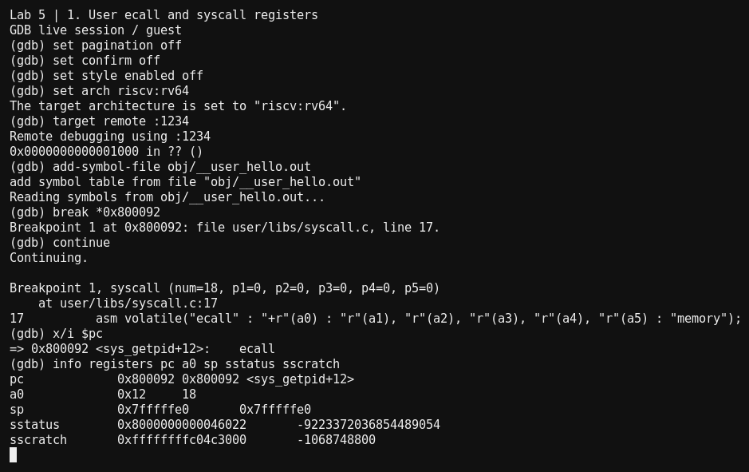
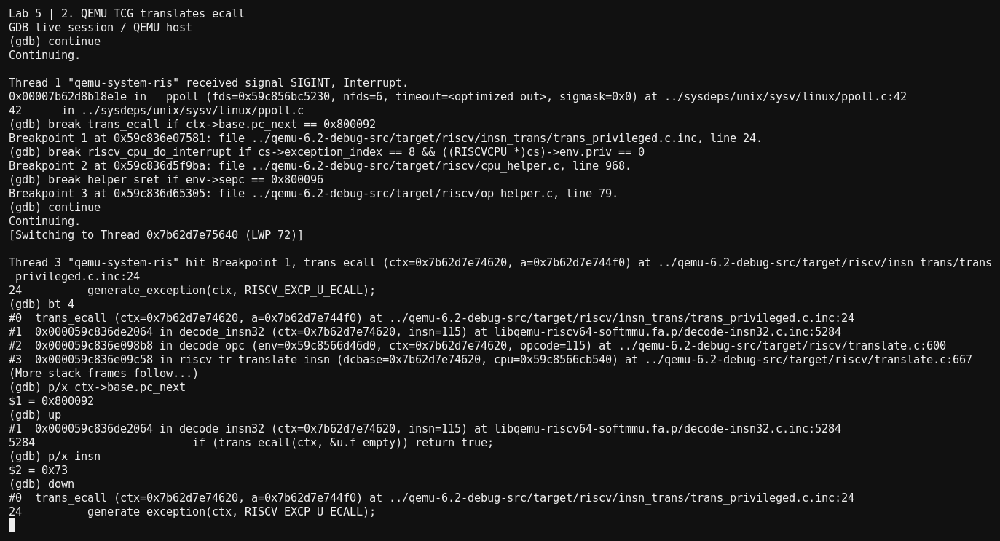
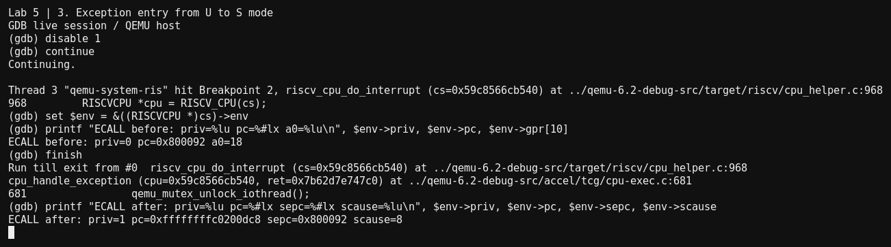
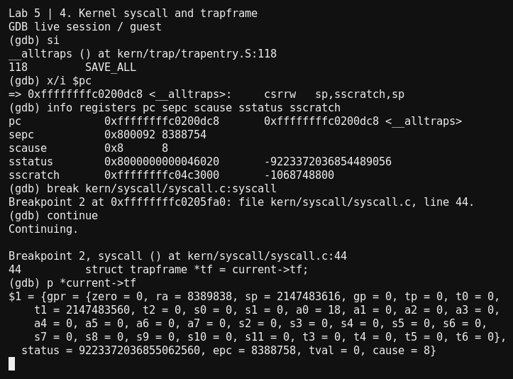
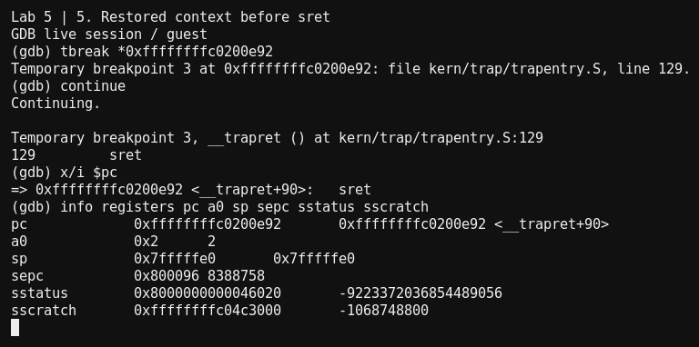
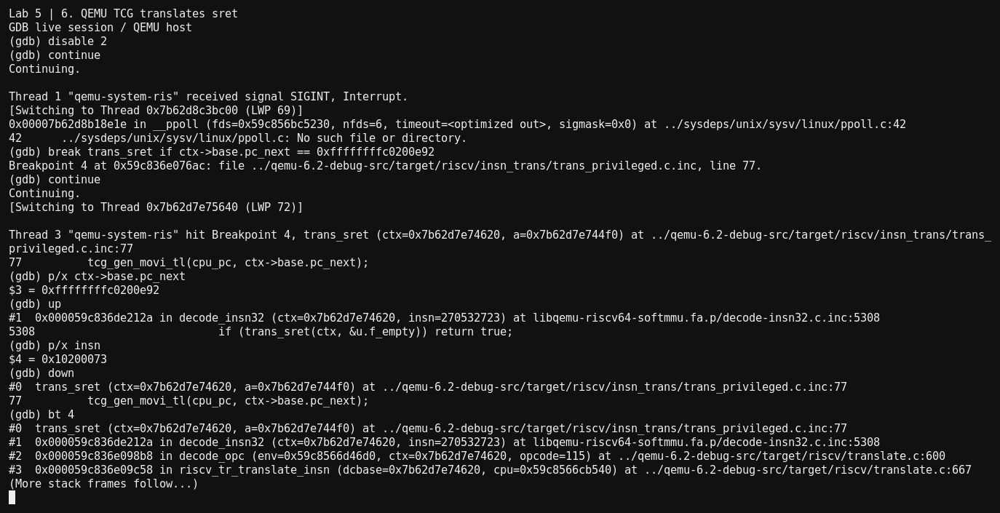
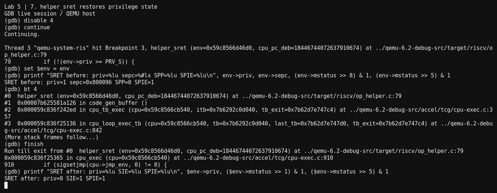
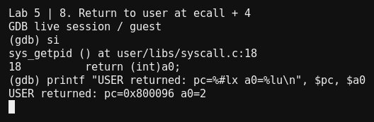
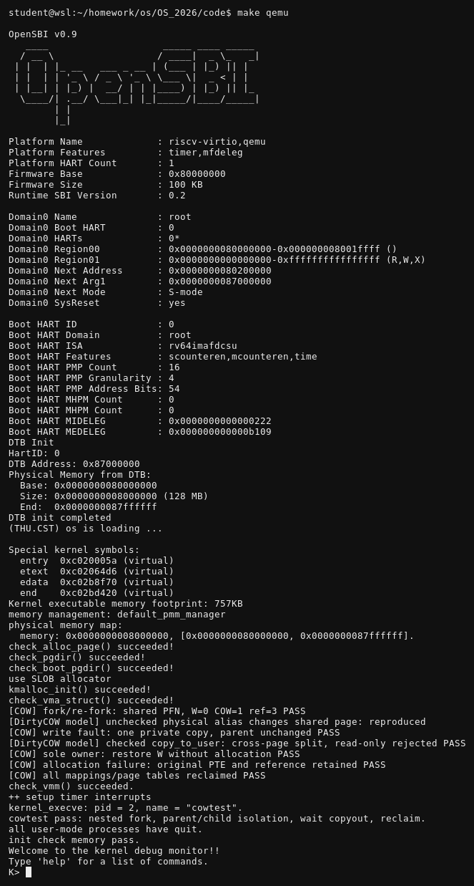

# 操作系统实验报告

## 实验基本信息

| 项目 | 内容 |
|------|------|
| **实验名称** | Lab 5：用户程序 |
| **小组成员** | 2412940-曹皓轩 |
| **完成日期** | 2026-11-24 |

### 小组分工

| 成员 | 负责的练习/模块 |
|------|----------------|
| 2412940-曹皓轩 | 所有内容 |

---

## 一、实验目的

1. 建立用户态系统调用入口，理解寄存器传参、异常现场保存、内核分发和返回用户态的完整过程。
2. 装载 ELF 用户程序，完成 fork、exec、wait、exit、yield、kill，使用户进程能够创建、执行、调度和回收。
3. 实现写时复制，将进程地址空间的逻辑独立性与物理页共享结合起来，验证写缺页、引用计数和内核写入路径。
4. 使用两层 GDB 同时观察 ucore 与 QEMU，理解 ecall、sret 在模拟器中的翻译和执行。

---

## 二、实验环境

| 成员 | AI 编程工具 | 底层模型 | 备注 |
|------|------------|---------|------|
| 2412940-曹皓轩 | Codex | GPT-6.2 |  |

---

## 三、实验整体逻辑分析

### 2.1 本章节的逻辑主线

本实验围绕用户进程的生命周期展开。内核先完成内存、中断和调度初始化，创建 idle 与 init。init 创建 `user_main` 内核线程，后者选择链接进内核的用户 ELF，调用 `kernel_execve` 装入独立用户地址空间，再通过 `forkrets → __trapret → sret` 进入 U 态。

用户程序需要服务时，在 a0 放系统调用号、a1–a5 放参数并执行 ecall。处理器保存异常信息并跳到 `__alltraps`；汇编切换内核栈、保存寄存器，C 代码分发到相应 `do_*` 函数。处理结果写回 trapframe 的 a0，异常返回恢复用户栈和寄存器，从 ecall 后的指令继续。

fork 为子进程建立独立 PCB、内核栈、trapframe 和页表；COW 让父子暂时共享用户物理页，写入时再分离。exit 释放用户地址空间并留下僵尸态，wait 回收内核栈和 PCB。父进程先退出时，子进程由 init 接管。这样，用户进程从装载到回收都有对应的内核路径。

### 2.2 功能的逐步实现

1. 接通系统调用 ABI、分发表和异常返回，建立用户态访问内核服务的入口。
2. 建立 idle、init、user_main 启动链，解析 ELF 并设置进入 U 态的 trapframe。
3. 完成进程复制、VMA 与页映射复制，再把默认 fork 策略扩展为 COW。
4. 完成退出、等待、让出和终止，结合时钟抢占、进程树和资源回收形成完整生命周期。
5. 运行框架评分、COW 与 exec 测试，用双重 GDB 核对处理器状态的实际变化。

---

## 四、实验内容与实现

### 功能模块一：用户态系统调用

**负责人：** 2412940-曹皓轩

#### 模块功能描述

用户态系统调用的分发与参数包装代码如下：

```c
void syscall(void)
{
    struct trapframe *tf = current->tf;
    uint64_t num = tf->gpr.a0;
    uint64_t args[] = {tf->gpr.a1, tf->gpr.a2, tf->gpr.a3,
                       tf->gpr.a4, tf->gpr.a5};
    tf->gpr.a0 = (num < NUM_SYSCALLS && syscalls[num] != NULL)
        ? syscalls[num](args) : -E_INVAL;
}

static int sys_fork(uint64_t a[]) {
    return do_fork(0, current->tf->gpr.sp, current->tf);
}

static int sys_wait(uint64_t a[]) { return do_wait((int)a[0], (int *)a[1]); }

static int sys_exec(uint64_t a[]) {
    return do_execve((const char *)a[0], a[1], (unsigned char *)a[2], a[3]);
}
```

用户库使用相同的寄存器约定，代码如下：

```c
static inline int
syscall(int64_t num, uint64_t p1, uint64_t p2, uint64_t p3, uint64_t p4, uint64_t p5)
{
    register uint64_t a0 asm("a0") = num;
    register uint64_t a1 asm("a1") = p1;
    register uint64_t a2 asm("a2") = p2;
    register uint64_t a3 asm("a3") = p3;
    register uint64_t a4 asm("a4") = p4;
    register uint64_t a5 asm("a5") = p5;
    asm volatile("ecall" : "+r"(a0) : "r"(a1), "r"(a2), "r"(a3), "r"(a4), "r"(a5) : "memory");
    return (int)a0;
}
```

涉及函数包括 `exception_handler`、`syscall`、`sys_exit`、`sys_fork`、`sys_wait`、`sys_exec`、`sys_yield`、`sys_kill`、`sys_getpid`、`sys_putc`、`sys_pgdir`，以及用户库系统调用封装和 `RESTORE_ALL`。

`exception_handler` 对 `CAUSE_USER_ECALL` 执行以下逻辑：

```c
case CAUSE_USER_ECALL:
    tf->epc += 4;
    syscall();
    break;
```

ecall 固定为 4 字节。异常保存的 epc 指向 ecall 本身，因此要在返回前加 4。系统调用分发从 `current->tf` 取编号和五个参数，检查编号范围及对应函数指针，合法时调用包装函数，非法时返回 `-E_INVAL`。返回值写回 `tf->gpr.a0`，由汇编恢复到用户寄存器。

Trap frame 的双栈入口与 U 态返回分支如下：

```asm
csrrw sp, sscratch, sp
bnez sp, _save_context
_restore_kernel_sp:
    csrr sp, sscratch
_save_context:
    addi sp, sp, -36 * REGBYTES
```

```asm
LOAD t0, 32*REGBYTES(sp)
andi t1, t0, SSTATUS_SPP
bnez t1, _restore_context
addi t1, sp, 36*REGBYTES
csrw sscratch, t1
_restore_context:
    LOAD t1, 33*REGBYTES(sp)
    csrw sstatus, t0
    csrw sepc, t1
    LOAD x2, 2*REGBYTES(sp)
    sret
```

| 系统调用 | 内核动作 |
|------|------|
| exit | `do_exit(error_code)` |
| fork | 传入用户 sp 和当前 trapframe，调用 `do_fork` |
| wait | `do_wait(pid, code_store)` |
| exec | `do_execve(name, len, binary, size)` |
| yield / kill | `do_yield()` / `do_kill(pid)` |
| getpid | 返回 `current->pid` |
| putc | 交给 `cputchar` 输出一个字符 |
| pgdir | 输出当前地址空间的有效根页表项及物理地址 |

用户库采用固定五参数和 a0–a5 寄存器约束，ecall 的输出约束直接读回 a0。这样编译器知道寄存器的输入输出关系，也避免读取不存在的可变参数。用户侧还补充了 `exec` 和 `sys_exec`，使 ELF 替换能够从 U 态调用。

用户进程有用户栈和内核栈。U 态运行期间 `sscratch` 保存内核栈顶；陷入时 `csrrw sp, sscratch, sp` 取得内核栈，并把用户 sp 暂存在 sscratch。保存现场后 sscratch 清零，允许内核内部再次陷入时沿用当前内核栈。返回前根据 trapframe 的 SPP 判断目标：SPP=0 时把展开后的内核栈顶重新写入 sscratch，最后恢复用户 sp；SPP=1 时恢复内核现场。

#### 最终提示词

完整提示词见 [prompt.md](prompt.md) 的模块一。Spec 把 ABI 写成可检查的约定：编号在 a0、参数在 a1–a5、返回值在 a0、epc 增加 4、非法编号返回错误。Prompt 指定现有分发表和处理函数，并要求补全双栈返回。

#### 实现迭代过程

本模块的代码实现经历了 1 次迭代。

##### 第一次迭代

根据提示词补全用户 ecall 处理、九个系统调用包装和分发表，使调用号、参数与返回值沿 Trap frame 传递。用户库采用固定五参数和 a0–a5 寄存器约束，未使用参数显式传 0，返回值通过 a0 传回。返回 U 态前恢复用户 sp，并把内核栈顶写回 sscratch。

**最终结果：**

该模块：

- 编译通过。
- 通过框架 [Test Syscall] PASS 检查，覆盖 getpid、epc 前移和非法编号。
- make grade 中的 hello、pgdir 等用户程序通过。
- GDB 中 getpid 的 a0 从调用号 18 变为 PID 2，返回到 ecall+4。

### 功能模块二：创建与加载第一个用户进程

**负责人：** 2412940-曹皓轩

#### 模块功能描述

PCB、首次执行现场和 init 等待循环的实现如下：

```c
static struct proc_struct *
alloc_proc(void)
{
    struct proc_struct *proc = kmalloc(sizeof(struct proc_struct));
    if (proc != NULL)
    {
        memset(proc, 0, sizeof(*proc));
        proc->state = PROC_UNINIT;
        proc->pid = -1;
        proc->pgdir = boot_pgdir_pa;
        list_init(&proc->list_link);
        list_init(&proc->hash_link);
    }
    return proc;
}

static void
copy_thread(struct proc_struct *proc, uintptr_t esp, struct trapframe *tf)
{
    proc->tf = (struct trapframe *)(proc->kstack + KSTACKSIZE - sizeof(struct trapframe));
    *proc->tf = *tf;
    proc->tf->gpr.a0 = 0;
    proc->tf->gpr.sp = esp ? esp : (uintptr_t)proc->tf;
    proc->context.ra = (uintptr_t)forkret;
    proc->context.sp = (uintptr_t)proc->tf;
}

static int init_main(void *arg)
{
    size_t free_before = nr_free_pages();
    int pid = kernel_thread(user_main, NULL, 0);
    assert(pid > 0);
    while (do_wait(0, NULL) == 0) schedule();
    cprintf("all user-mode processes have quit.\n");
    assert(nr_process == 2 && initproc->cptr == NULL);
    assert(nr_free_pages() == free_before);
    cprintf("init check memory pass.\n");
    while (1) kmonitor(NULL);
}
```

内核线程与启动链的代码如下：

```c
int
kernel_thread(int (*fn)(void *), void *arg, uint32_t clone_flags)
{
    struct trapframe tf;
    memset(&tf, 0, sizeof(tf));
    tf.gpr.s0 = (uintptr_t)fn;
    tf.gpr.s1 = (uintptr_t)arg;
    tf.status = (read_csr(sstatus) | SSTATUS_SPP | SSTATUS_SPIE) & ~SSTATUS_SIE;
    tf.epc = (uintptr_t)kernel_thread_entry;
    return do_fork(clone_flags | CLONE_VM, 0, &tf);
}

void
proc_init(void)
{
    list_init(&proc_list);
    for (int i = 0; i < HASH_LIST_SIZE; i++)
    {
        list_init(&hash_list[i]);
    }
    idleproc = alloc_proc();
    if (idleproc == NULL)
    {
        panic("cannot allocate idleproc.\n");
    }
    idleproc->pid = 0;
    idleproc->state = PROC_RUNNABLE;
    idleproc->kstack = (uintptr_t)bootstack;
    idleproc->need_resched = 1;
    set_proc_name(idleproc, "idle");
    nr_process++;
    current = idleproc;
    int pid = kernel_thread(init_main, "Hello world!!", 0);
    if (pid <= 0 || (initproc = find_proc(pid)) == NULL)
    {
        panic("cannot create initproc.\n");
    }
    set_proc_name(initproc, "init");
}

static int user_main(void *arg)
{
#ifdef TEST
    KERNEL_EXECVE2(TEST, TESTSTART, TESTSIZE);
#else
    KERNEL_EXECVE(exit);
#endif
    panic("kernel_execve failed");
}
```

ELF 装载与进入用户态的代码如下：

```c
static int load_icode(unsigned char *binary, size_t size)
{
    if (size < sizeof(struct elfhdr)) return -E_INVAL_ELF;
    struct elfhdr *elf = (void *)binary;
    if (elf->e_magic != ELF_MAGIC || elf->e_phentsize != sizeof(struct proghdr) ||
        elf->e_phoff > size || elf->e_phnum > (size - elf->e_phoff) / sizeof(struct proghdr))
        return -E_INVAL_ELF;
    struct mm_struct *mm = mm_create();
    if (mm == NULL) return -E_NO_MEM;
    int ret = setup_pgdir(mm);
    if (ret != 0) goto bad_mm;
    struct proghdr *ph = (void *)(binary + elf->e_phoff);
    for (int i = 0; i < elf->e_phnum; i++, ph++) {
        if (ph->p_type != ELF_PT_LOAD || ph->p_memsz == 0) continue;
        ret = -E_INVAL_ELF;
        if (ph->p_filesz > ph->p_memsz || ph->p_offset > size ||
            ph->p_filesz > size - ph->p_offset ||
            ph->p_va < USERBASE || ph->p_va >= USTACKTOP - USTACKSIZE ||
            ph->p_memsz > USTACKTOP - USTACKSIZE - ph->p_va) goto bad_map;
        uint32_t flags = 0, perm = PTE_U;
        if (ph->p_flags & ELF_PF_R) { flags |= VM_READ; perm |= PTE_R; }
        if (ph->p_flags & ELF_PF_W) { flags |= VM_WRITE; perm |= PTE_R | PTE_W; }
        if (ph->p_flags & ELF_PF_X) { flags |= VM_EXEC; perm |= PTE_X; }
        if ((ret = mm_map(mm, ph->p_va, ph->p_memsz, flags, NULL)) != 0) goto bad_map;
        uintptr_t end = ph->p_va + ph->p_memsz;
        for (uintptr_t va = ROUNDDOWN(ph->p_va, PGSIZE); va < end; va += PGSIZE) {
            struct Page *page = pgdir_alloc_page(mm->pgdir, va, perm);
            ret = -E_NO_MEM;
            if (page == NULL) goto bad_map;
            uintptr_t lo = va > ph->p_va ? va : ph->p_va;
            uintptr_t hi = va + PGSIZE < ph->p_va + ph->p_filesz
                ? va + PGSIZE : ph->p_va + ph->p_filesz;
            if (lo < hi) memcpy(page2kva(page) + lo - va,
                               binary + ph->p_offset + lo - ph->p_va, hi - lo);
        }
    }
    struct vma_struct *entry = find_vma(mm, elf->e_entry);
    ret = -E_INVAL_ELF;
    if (entry == NULL || !(entry->vm_flags & VM_EXEC)) goto bad_map;
    if ((ret = mm_map(mm, USTACKTOP - USTACKSIZE, USTACKSIZE,
                      VM_READ | VM_WRITE | VM_STACK, NULL)) != 0) goto bad_map;
    for (int i = 1; i <= 4; i++) {
        ret = -E_NO_MEM;
        if (pgdir_alloc_page(mm->pgdir, USTACKTOP - i * PGSIZE,
                             PTE_U | PTE_R | PTE_W) == NULL) goto bad_map;
    }
    mm_count_inc(mm);
    current->mm = mm;
    current->pgdir = PADDR(mm->pgdir);
    lsatp(current->pgdir);
    asm volatile("fence.i" ::: "memory");
    struct trapframe *tf = current->tf;
    memset(tf, 0, sizeof(*tf));
    tf->gpr.sp = USTACKTOP;
    tf->epc = elf->e_entry;
    tf->status = (read_csr(sstatus) | SSTATUS_SPIE | SSTATUS_SUM) &
                 ~(SSTATUS_SPP | SSTATUS_SIE);
    return 0;
bad_map:
    exit_mmap(mm);
    put_pgdir(mm);
bad_mm:
    mm_destroy(mm);
    return ret;
}

static int kernel_execve(const char *name, unsigned char *binary, size_t size)
{
    int ret = do_execve(name, strlen(name), binary, size);
    if (ret == 0) forkrets(current->tf);
    return ret;
}
```

替换当前程序映像的代码如下：

```c
int do_execve(const char *name, size_t len, unsigned char *binary, size_t size)
{
    char local_name[PROC_NAME_LEN + 1] = {0};
    if (len > PROC_NAME_LEN) len = PROC_NAME_LEN;
    if (!copy_from_user(current->mm, local_name, name, len, 0)) return -E_INVAL;
    unsigned char *snapshot = NULL;
    struct mm_struct *old = current->mm;
    if (old != NULL) {
        if (size < sizeof(struct elfhdr) ||
            !user_mem_check(old, (uintptr_t)binary, size, 0)) return -E_INVAL;
        snapshot = kmalloc(size);
        if (snapshot == NULL) return -E_NO_MEM;
        if (!copy_from_user(old, snapshot, binary, size, 0)) {
            kfree(snapshot); return -E_INVAL;
        }
        binary = snapshot;
        lsatp(boot_pgdir_pa);
        current->mm = NULL;
        current->pgdir = boot_pgdir_pa;
        if (mm_count_dec(old) == 0) {
            exit_mmap(old); put_pgdir(old); mm_destroy(old);
        }
    }
    int ret = load_icode(binary, size);
    if (snapshot != NULL) kfree(snapshot);
    if (ret != 0 && old != NULL) do_exit(ret);
    if (ret == 0) set_proc_name(current, local_name);
    return ret;
}
```

等待和回收子进程的代码如下：

```c
int do_wait(int pid, int *code_store)
{
    if (code_store != NULL &&
        !user_mem_check(current->mm, (uintptr_t)code_store, sizeof(int), 1)) return -E_INVAL;
    while (1) {
        bool intr_flag;
        local_intr_save(intr_flag);
        struct proc_struct *child = current->cptr, *zombie = NULL;
        bool found = 0;
        for (; child != NULL; child = child->optr) {
            if (pid == 0 || child->pid == pid) {
                found = 1;
                if (child->state == PROC_ZOMBIE) { zombie = child; break; }
            }
        }
        if (zombie != NULL) {
            if (code_store != NULL && !copy_to_user(current->mm, code_store,
                                                    &zombie->exit_code, sizeof(int))) {
                local_intr_restore(intr_flag);
                return -E_INVAL;
            }
            unhash_proc(zombie);
            remove_links(zombie);
            local_intr_restore(intr_flag);
            put_kstack(zombie);
            kfree(zombie);
            return 0;
        }
        if (!found) { local_intr_restore(intr_flag); return -E_BAD_PROC; }
        current->state = PROC_SLEEPING;
        current->wait_state = WT_CHILD;
        local_intr_restore(intr_flag);
        schedule();
        if (current->flags & PF_EXITING) do_exit(-E_KILLED);
    }
}
```

涉及函数包括 `alloc_proc`、`kernel_thread`、`copy_thread`、`proc_init`、`init_main`、`user_main`、`kernel_execve`、`do_execve`、`load_icode` 和 `do_wait`。

`alloc_proc` 清零整个 PCB，因此新增的退出码、等待状态和父子指针具有一致初值，再设置 UNINIT、pid=-1、内核页表和链表头。`proc_init` 建立 idle/current，并创建 PID=1 的 init。init 创建 PID=2 的 user_main，随后循环 wait，等待全部用户进程及被托管的后代结束。

`kernel_thread` 在临时 trapframe 中把线程函数放入 s0、参数放入 s1，把 epc 设为 `kernel_thread_entry`，设置 SPP=1、SPIE=1。`copy_thread` 把 trapframe 放到子进程内核栈顶部，设置 a0=0，并让 `context.ra=forkret`、`context.sp=proc->tf`。内核线程首次调度后通过通用返回路径开始执行。

`load_icode` 的装载工作如下：

| 阶段 | 实现与状态 |
|------|------|
| ELF 检查 | 核对 magic、程序头大小、程序头表边界、段的文件范围和用户地址范围 |
| 地址空间 | 创建 mm 和根页表，复制内核映射，按 PT_LOAD 建立有权限的 VMA |
| 页面内容 | 页面先清零，再复制文件中与该页相交的字节，BSS 自然保持为零 |
| 用户栈 | 映射 1 MiB 栈区，最低页作保护区，预分配栈顶四页，其余合法栈页按需分配 |
| 运行现场 | sp=USTACKTOP，epc=ELF 入口，SPP=0、SPIE=1，切换 satp 并执行 fence.i |
| 出错清理 | 撤销已建立映射，释放页表和 VMA/mm |

`kernel_execve` 调用 `do_execve` 准备现场，成功后调用 `forkrets(current->tf)`，由 `__trapret` 执行 sret。直接调用 do_execve 只能完成映像和现场的准备；主动进入异常返回路径才会让处理器从 S 态切到 U 态。

用户态 exec 的名称和 ELF 位于旧用户地址空间中，因此先检查并复制到内核缓冲区，再切换内核页表、释放旧 mm，最后装载新映像。新增 exectest 构造一个可执行 ELF：新程序输出字符 E 后以 42 退出，父进程通过 wait 收到 42，从而验证用户 exec 确实开始执行了新入口。该测试使用 8193 字节镜像，同时验证内核大块分配能容纳向上取整后的缓冲区。

`do_wait` 在临界区检查直接子进程。找到僵尸时，先通过 `copy_to_user` 回填退出码，再从 PID 哈希和父子链中移除，释放内核栈和 PCB；有子进程但尚未退出时，设置 SLEEPING/WT_CHILD 后调度；没有匹配子进程时返回 `-E_BAD_PROC`。退出码地址先按用户 VMA 检查，避免非法指针影响回收。

#### 最终提示词

完整提示词见 `prompt.md` 的功能模块二。Spec 明确了 PID、ELF/BSS 内容、栈布局、SPP/SPIE 和 wait 的三种结果。Prompt 将准备用户现场与实际进入 U 态作为两个连续步骤，并把失败清理、用户指针和旧 mm 生命周期纳入要求。

#### 实现迭代过程

本模块的代码实现经历了 1 次迭代。

##### 第一次迭代

根据提示词完成 ELF 检查、段装载、BSS 清零、用户栈与 Trap frame，并通过 forkrets 进入异常返回。exec 先保存旧用户空间中的名称和 ELF，再销毁旧 mm，init 循环等待并回收用户进程。启动时通过 -kernel bin/ucore.img 加载镜像，分页后衔接到 .Lpaging_ready 的高地址并装载完整栈指针。按 kva2page 接口完成指针转换，find_order 按 PAGE_SIZE << order >= size 向上选择分配阶数，满足 exec 镜像的内存需求。

**最终结果：**

该模块：

- 编译通过。
- 通过框架 [Test Process Create] PASS，idle/init 的状态和执行现场符合要求。
- make qemu 启动默认 exit 程序，完成用户执行和 init 内存检查。
- make grade 中的 hello、testbss、badarg、exit 通过；补充 exectest 验证 ELF 替换和退出码 42。

### 功能模块三：复制用户进程

**负责人：** 2412940-曹皓轩

#### 模块功能描述

子进程创建和地址空间选择的代码如下：

```c
int
do_fork(uint32_t clone_flags, uintptr_t stack, struct trapframe *tf)
{
    if (nr_process >= MAX_PROCESS)
    {
        return -E_NO_FREE_PROC;
    }
    struct proc_struct *proc = alloc_proc();
    if (proc == NULL)
    {
        return -E_NO_MEM;
    }
    int ret = -E_NO_MEM;
    proc->parent = current;
    if (setup_kstack(proc) != 0)
    {
        goto bad_proc;
    }
    if ((ret = copy_mm(clone_flags, proc)) != 0)
    {
        goto bad_stack;
    }
    copy_thread(proc, stack, tf);
    bool intr_flag;
    local_intr_save(intr_flag);
    proc->pid = get_pid();
    hash_proc(proc);
    set_links(proc);
    local_intr_restore(intr_flag);
    wakeup_proc(proc);
    return proc->pid;

bad_stack:
    put_kstack(proc);
bad_proc:
    kfree(proc);
    return ret;
}

static int
copy_mm(uint32_t clone_flags, struct proc_struct *proc)
{
    struct mm_struct *old = current->mm, *mm = old;
    if (old == NULL) return 0;
    if (!(clone_flags & CLONE_VM)) {
        if ((mm = mm_create()) == NULL) return -E_NO_MEM;
        int ret = setup_pgdir(mm);
        if (ret == 0) {
            lock_mm(old);
            ret = dup_mmap(mm, old);
            unlock_mm(old);
        }
        if (ret != 0) {
            if (mm->pgdir != NULL) { exit_mmap(mm); put_pgdir(mm); }
            mm_destroy(mm);
            return ret;
        }
    }
    mm_count_inc(mm);
    proc->mm = mm;
    proc->pgdir = PADDR(mm->pgdir);
    return 0;
}
```

VMA 复制代码如下：

```c
int dup_mmap(struct mm_struct *to, struct mm_struct *from)
{
    list_entry_t *le = &from->mmap_list;
    while ((le = list_next(le)) != &from->mmap_list) {
        struct vma_struct *vma = le2vma(le, list_link);
        int ret = mm_map(to, vma->vm_start, vma->vm_end - vma->vm_start,
                         vma->vm_flags, NULL);
        if (ret != 0) return ret;
#ifdef LAB5_EAGER_COPY
        bool share = 0;
#else
        bool share = 1;
#endif
        ret = copy_range(to->pgdir, from->pgdir, vma->vm_start, vma->vm_end, share);
        if (ret != 0) return ret;
    }
    return 0;
}
```

核心函数为 `do_fork`、`copy_mm`、`dup_mmap`、`copy_range`。

`do_fork` 按 PCB、内核栈、地址空间、运行现场的顺序准备子进程，完成后在关中断区间分配 PID、加入哈希表并通过 `set_links` 登记父子和兄弟关系，然后唤醒子进程。创建失败按逆序释放已申请资源。与 Lab 4 相比，登记进程时使用 set_links，使后续 wait 和孤儿接管能沿 cptr/optr/yptr 找到进程。

```c
int copy_range(pde_t *to, pde_t *from, uintptr_t start,
               uintptr_t end, bool share)
{
    for (; start < end; start += PGSIZE) {
        pte_t *src = get_pte(from, start, 0);
        if (src == NULL || !(*src & PTE_V)) continue;
        struct Page *page = pte2page(*src);
        uint32_t perm = *src & (PTE_USER | PTE_COW);
        if (share) {
            if (perm & PTE_W) perm = (perm & ~PTE_W) | PTE_COW;
            int ret = page_insert(to, page, start, perm);
            if (ret != 0) return ret;
            *src = pte_create(page2ppn(page), perm);
            tlb_invalidate(from, start);
        } else {
            struct Page *copy = alloc_page();
            if (copy == NULL) return -E_NO_MEM;
            memcpy(page2kva(copy), page2kva(page), PGSIZE);
            if (perm & PTE_COW) perm = (perm & ~PTE_COW) | PTE_W;
            int ret = page_insert(to, copy, start, perm);
            if (ret != 0) { free_page(copy); return ret; }
        }
    }
    return 0;
}
```

`copy_mm` 有三种情况：父进程 mm=NULL 时创建内核线程；CLONE_VM 时共享整个 mm 并增加 mm_count；普通 fork 时创建独立 mm 和根页表，锁住父 mm，调用 dup_mmap。`dup_mmap` 依次复制 VMA，保持地址范围和权限，再调用 copy_range 处理已映射页面。

`copy_range(..., share=0)` 为每页分配新物理页、复制 4096 字节，再建立子映射；源页带 COW 时，深拷贝目标恢复 W。默认 share=1 采用 COW，共享数据页并保护父子写权限。编译宏 `LAB5_EAGER_COPY` 可以让普通 fork 切换到深拷贝模式，供同一用户测试对照语义。

fork 的两个返回值来自两处：父进程得到 do_fork 返回的子 PID；子进程的 trapframe 在 copy_thread 中设置 a0=0，调度后从已前移的 epc 继续执行。父子虚拟地址相同，但 mm、页表和内核栈独立，后续写入也保持独立。

页表释放同时核对 Sv39 中间目录的整个有效项集合。某一 VMA 的末级表清空后，其他 VMA 仍可能使用同一中间目录；只有整张目录没有有效项时才释放，避免把其他映射所在的页表提前交还分配器。

#### 最终提示词

完整提示词见 `prompt.md` 的功能模块三。Spec 分清 CLONE_VM 与物理页 COW 共享，要求 fork 后 PCB/内核栈独立、VMA 继承、父子返回值不同。Prompt 同时规定登记时机与失败清理顺序，页复制路径保留深拷贝开关。

#### 实现迭代过程

本模块的代码实现经历了 1 次迭代。

##### 第一次迭代

根据提示词补全 do_fork、copy_mm、dup_mmap 和 copy_range，使用 set_links 维护父子及兄弟关系。默认 fork 使用 COW，保留 LAB5_EAGER_COPY 切换深拷贝，并检查 Sv39 中间页表整体为空后再释放。SLOB 在同一物理页内合并空闲块，整页空闲时将其摘链并归还 PMM，新申请且准备分割的页保留在分配路径中，完成进程退出后的物理页回收。

**最终结果：**

该模块：

- 编译通过。
- make grade 中的 forktest 通过，多子进程执行、wait 和资源回收符合要求。
- forktree 完成多级进程创建和 init 接管后的回收。
- 默认 COW 与深拷贝模式下的 cowtest 均通过父子写隔离检查。

### 功能模块四：其余系统调用

**负责人：** 2412940-曹皓轩

#### 模块功能描述

退出、让出与终止进程的实现如下：

```c
int
do_exit(int error_code)
{
    if (current == idleproc || current == initproc) panic("cannot exit idle/init");
    struct mm_struct *mm = current->mm;
    if (mm != NULL) {
        lsatp(boot_pgdir_pa);
        if (mm_count_dec(mm) == 0) {
            exit_mmap(mm);
            put_pgdir(mm);
            mm_destroy(mm);
        }
        current->mm = NULL;
        current->pgdir = boot_pgdir_pa;
    }
    bool intr_flag;
    local_intr_save(intr_flag);
    current->exit_code = error_code;
    current->state = PROC_ZOMBIE;
    if (current->parent->wait_state == WT_CHILD) wakeup_proc(current->parent);
    while (current->cptr != NULL) {
        struct proc_struct *child = current->cptr;
        current->cptr = child->optr;
        if (current->cptr != NULL) current->cptr->yptr = NULL;
        child->parent = initproc;
        child->yptr = NULL;
        child->optr = initproc->cptr;
        if (child->optr != NULL) child->optr->yptr = child;
        initproc->cptr = child;
        if (child->state == PROC_ZOMBIE && initproc->wait_state == WT_CHILD)
            wakeup_proc(initproc);
    }
    local_intr_restore(intr_flag);
    schedule();
    panic("zombie scheduled again");
}

int do_yield(void) { current->need_resched = 1; return 0; }

int do_kill(int pid)
{
    struct proc_struct *proc = find_proc(pid);
    if (proc == NULL || proc == initproc || (proc->flags & PF_EXITING)) return -E_INVAL;
    bool intr_flag;
    local_intr_save(intr_flag);
    proc->flags |= PF_EXITING;
    if (proc->wait_state & WT_INTERRUPTED) wakeup_proc(proc);
    local_intr_restore(intr_flag);
    return 0;
}
```

核心函数为 `do_exit`、`do_yield`、`do_kill`，与 `do_wait`、`trap`、时钟中断和调度器配合。

`do_exit` 先限制 idle/init 退出，再切换到内核页表，减少 mm_count；最后一个 mm 使用者释放用户页面、页表和 VMA。随后记录退出码并转为 ZOMBIE，唤醒等待该子进程的父进程。仍在运行的子进程全部重新挂到 init 下；若其中有僵尸，也唤醒正在等待的 init。最后 schedule 离开当前进程，PCB 和内核栈留给父进程 wait 回收。

`do_yield` 设置 need_resched。陷入结束准备返回 U 态时，trap 检查该标志并调用 schedule。`do_kill` 找到目标后设置 PF_EXITING；目标若处于可中断等待则唤醒，之后由返回用户态前的检查或 wait 的恢复路径进入 do_exit。对于持续自旋的用户程序，时钟中断设置 need_resched，能够让其他进程取得 CPU 并执行 kill。

时钟中断设置 need_resched，trap 返回用户态前检查该标志并执行调度：

```c
case IRQ_S_TIMER:
    clock_set_next_event();
    ticks++;
    if (current != NULL) current->need_resched = 1;
    break;
```

```c
trap_dispatch(tf);
current->tf = otf;
if (!in_kernel && current->need_resched) schedule();
if (current->flags & PF_EXITING) do_exit(-E_KILLED);
```

| 当前状态 | 触发动作 | 后续状态 |
|------|------|------|
| UNINIT | 创建并 wakeup | RUNNABLE |
| RUNNABLE | wait，子进程尚未退出 | SLEEPING / WT_CHILD |
| SLEEPING | 子进程退出或可中断等待被 kill | RUNNABLE |
| RUNNABLE | exit、非法用户异常或处理 PF_EXITING | ZOMBIE |
| ZOMBIE | 父进程 wait | 释放 PCB 和内核栈 |

init 收到所有退出结果后检查 nr_process=2、无子进程、空闲物理页数恢复，再进入内核监视器。评分脚本通过 GDB 在 readline 停住 QEMU，取得完整测试输出。

#### 最终提示词

完整提示词见 `prompt.md` 的功能模块四。Spec 将资源释放、僵尸态、退出码和唤醒分开描述，明确内核栈与 PCB 在 wait 中释放。Prompt 还列出父进程先退出、目标自旋、目标睡眠和重复 kill 等场景，使状态变化与调度点对应。

#### 实现迭代过程

本模块的代码实现经历了 1 次迭代。

##### 第一次迭代

根据提示词完成 exit/yield/kill、父进程唤醒、孤儿转交与 PF_EXITING 检查，并让时钟中断设置 need_resched，使父进程可以抢占自旋中的子进程。用户程序和内存检查结束后，init 进入 kmonitor，供 grade.sh 在 readline 断点停止并取得输出。divzero 显式执行 DIVW，核对 RISC-V 指令的除零结果 -1；控制台将 SBI 无输入的负返回值转换为 0，使监视器按无输入语义等待。

**最终结果：**

该模块：

- 编译通过。
- 通过框架 [Test Process Control] PASS，覆盖 yield、无效 kill 与无子进程 wait。
- make grade 中的 yield、badarg、exit 和 spin 全部通过。
- make qemu 输出 exit pass. 和 init check memory pass.，完成父子等待与资源回收。

### 扩展练习 Challenge

**负责人：** 2412940-曹皓轩

#### Challenge：Copy on Write 的实现与状态转换

页面共享与写缺页处理的代码如下：

```c
int copy_range(pde_t *to, pde_t *from, uintptr_t start, uintptr_t end, bool share)
{
    assert(start % PGSIZE == 0 && end % PGSIZE == 0);
    assert(USER_ACCESS(start, end));
    for (; start < end; start += PGSIZE) {
        pte_t *src = get_pte(from, start, 0);
        if (src == NULL || !(*src & PTE_V)) continue;
        struct Page *page = pte2page(*src);
        uint32_t perm = *src & (PTE_USER | PTE_COW);
        if (share) {
            if (perm & PTE_W) perm = (perm & ~PTE_W) | PTE_COW;
            int ret = page_insert(to, page, start, perm);
            if (ret != 0) return ret;
            *src = pte_create(page2ppn(page), perm);
            tlb_invalidate(from, start);
        } else {
            struct Page *copy = alloc_page();
            if (copy == NULL) return -E_NO_MEM;
            memcpy(page2kva(copy), page2kva(page), PGSIZE);
            if (perm & PTE_COW) perm = (perm & ~PTE_COW) | PTE_W;
            int ret = page_insert(to, copy, start, perm);
            if (ret != 0) { free_page(copy); return ret; }
        }
    }
    return 0;
}
```

```c
int cow_resolve(struct mm_struct *mm, uintptr_t addr)
{
    struct vma_struct *vma = find_vma(mm, addr);
    if (vma == NULL || !(vma->vm_flags & VM_WRITE)) return -E_INVAL;
    pte_t *pte = get_pte(mm->pgdir, addr, 0);
    if (pte == NULL || !(*pte & PTE_V) || !(*pte & PTE_COW)) return -E_INVAL;
    struct Page *old = pte2page(*pte);
    uint32_t perm = ((*pte & PTE_USER) | PTE_W) & ~PTE_COW;
    if (page_ref(old) == 1) {
        *pte = pte_create(page2ppn(old), perm);
        tlb_invalidate(mm->pgdir, addr);
        return 0;
    }
    struct Page *copy = alloc_page();
    if (copy == NULL) return -E_NO_MEM;
    memcpy(page2kva(copy), page2kva(old), PGSIZE);
    int ret = page_insert(mm->pgdir, copy, ROUNDDOWN(addr, PGSIZE), perm);
    if (ret != 0) free_page(copy);
    return ret;
}
```

在 PTE 软件保留位中使用 `PTE_COW=0x100`。该位表示原本可写的私有页因共享被暂时去掉 W；真正只读的代码页不设置 COW。

fork 遍历每个有效用户映射。原页带 W 时，父子 PTE 都设为 `W=0,COW=1`，子映射增加物理页引用计数，并刷新父页表的 TLB。源页本来已带 COW 时，后续 fork 继续共享并增加引用；只读页继续按只读权限共享。

写入 COW 页产生 store page fault。`do_pgfault` 先按 VMA 检查 VM_WRITE，再由 `cow_resolve` 检查 PTE 的 V/COW 标志。共享引用数大于 1 时，分配一页、复制原内容、建立可写私有映射，旧页引用数随替换减一；引用数等于 1 时，直接恢复 W 并清除 COW，无需复制。

| 状态 | PTE / 引用关系 | 事件 | 转换结果 |
|------|------|------|------|
| 私有可写 | W=1，COW=0，ref=1 | fork | 父子共享，W=0，COW=1，ref=2 |
| COW 共享 | W=0，COW=1，ref>1 | 再次 fork | 共享页新增一个引用 |
| COW 共享 | W=0，COW=1，ref>1 | 某进程写入 | 写入者获得新页，W=1、COW=0；旧页 ref 减一 |
| COW 单引用 | W=0，COW=1，ref=1 | 写入 | 同一物理页恢复 W，COW 清零 |
| 真正只读 | W=0，COW=0 | 写入 | 拒绝写入，用户进程退出 |
| COW 共享 | ref>1 | 拆页分配失败 | 返回 -E_NO_MEM，原 PTE 和引用保持 |
| 任意已映射页 | ref>0 | exit/unmap | ref 减一；减到 0 时释放物理页 |

内核回填用户数据的实现如下：

```c
bool copy_to_user(struct mm_struct *mm, void *dst, const void *src, size_t len)
{
    if (!user_mem_check(mm, (uintptr_t)dst, len, 1))
    {
        return 0;
    }
    if (mm == NULL) { memcpy(dst, src, len); return 1; }
    // Resolve each COW mapping before obtaining a writable physical alias.
    while (len != 0) {
        uintptr_t addr = (uintptr_t)dst;
        pte_t *pte = get_pte(mm->pgdir, addr, 0);
        if (pte == NULL || !(*pte & PTE_V) || (*pte & PTE_COW)) {
            if (do_pgfault(mm, CAUSE_STORE_PAGE_FAULT, addr) != 0) return 0;
            pte = get_pte(mm->pgdir, addr, 0);
        }
        if (!(*pte & PTE_U) || !(*pte & PTE_W)) return 0;
        size_t n = PGSIZE - PGOFF(addr);
        if (n > len) n = len;
        memcpy(page2kva(pte2page(*pte)) + PGOFF(addr), src, n);
        dst += n; src += n; len -= n;
    }
    return 1;
}
```

内核回填用户数据同样需要 COW。`copy_to_user` 先检查写 VMA，再逐页查找 PTE，遇到 COW 就先拆页，重新取得 PTE 后核对 U/W，最后通过对应物理页的内核别名复制。跨页写会分别处理每页。wait 使用该入口写退出码，因此不会把父进程的回填值写进兄弟进程仍共享的页。


#### Dirty COW 原理模拟与修复

指导书给出的 Dirty COW 入口指向 CVE-2016-5195。分析同时参考 Linux 修复提交 `19be0eaffa3ac7d8eb6784ad9bdbc7d67ed8e619`：旧路径在缺页处理中改变 FOLL_WRITE，后续重试可能失去原先要求的写访问检查；修复使用独立的 FOLL_COW 记录已经完成 COW，并结合当前页表状态判断，保持写访问意图。

本实验把“内核绕过用户 PTE 的只读限制，直接写共享物理页”做成确定性的内核测试。在 `cow_test.c` 中建立父子共享页后，先保存该页的内核物理别名，通过别名写入 X，断言子进程映射也读到 X，再恢复测试字节。这一步演示共享页被错误写入后的可见结果。测试输出为：

```text
[DirtyCOW model] unchecked physical alias changes shared page: reproduced
```

修复路径通过 `copy_to_user` 检查 VM_WRITE、完成 COW 并重新取 PTE，验证另一进程仍保持原字节；跨页回填会拆开对应的两页；对真正只读 VMA 的写入被拒绝。输出为：

```text
[DirtyCOW model] checked copy_to_user: cross-page split, read-only rejected PASS
```

这里模拟的是错误页引用写入的关键机制。Linux 原漏洞涉及 get_user_pages 与映射回收重试的竞争；当前实验使用单核、无文件映射回收接口，通过内核测试固定触发该错误状态。正式写入路径在取得写别名前完成逐页检查，错误别名写入只存在于测试函数的受控页面中。


#### 最终提示词与测试用例

完整提示词见 `prompt.md` 的 Challenge 部分。Spec 从“哪些页允许转 COW”“写入后引用数如何变化”“内核写入怎样处理”三个问题出发，逐项写出后置条件。

| 用例 | 断言与结果 |
|------|------|
| fork 与再次 fork | 父子物理页相同，W=0、COW=1、ref=3 |
| 多引用写缺页 | 恰好分配一页，新旧 PFN 不同，父页原值不变 |
| 单引用写缺页 | 恢复 W，PFN 与空闲页数不变 |
| 真正只读页 | 缺页处理返回 -E_INVAL，copy_to_user 拒绝 |
| 分配失败 | 耗尽空闲页后返回 -E_NO_MEM，原 PTE 不变 |
| 跨页内核写 | 两页分别处理，其他地址空间仍保持原内容 |
| 用户 cowtest | 父子分别改数据、嵌套 fork、兄弟观察 wait 回填隔离，全部断言通过 |
| 深拷贝对照 | LAB5_EAGER_COPY 下运行同一 cowtest，通过隔离与回收检查 |
| 最终回收 | 内核测试和用户进程结束后，空闲物理页数恢复 |

核查原框架的 tools/test_lab5.c、tools/grade.sh 和用户程序后，框架包含 Process Create、Syscall、Process Control 和 13 个用户程序检查，没有 COW 专项断言。因此增加 cow_test.c 与 user/cowtest.c，分别检查页表、引用计数和真实用户态写隔离。运行方式为 make build-cowtest 后执行 make qemu，截图集中放在第五节。

### 用户程序何时被预先加载到内存中？

Makefile 先把每个用户程序链接成 `obj/__user_*.out`，再以 `--format=binary` 链接进内核，生成 `_binary_obj___user_*_out_start/size` 符号。QEMU 将内核镜像装入物理内存时，这些 ELF 字节也一同进入内存。

这些字节最初是内核中的程序镜像。等到 user_main 调用 KERNEL_EXECVE，load_icode 才解析 ELF，把段内容复制到用户物理页，建立用户页表，并设置用户入口与栈。于是，“程序文件字节已在内存中”与“程序已经作为用户进程执行”是两个阶段。

常用操作系统通常从文件系统中的可执行文件发起 exec，按段建立文件映射，结合缺页处理、页缓存和动态链接装载程序。本实验尚未引入文件系统，通过链接嵌入 ELF 直接提供可执行映像，便于集中观察进程、权限与异常返回的机制。

### 分支任务：双重 GDB 调试系统调用与返回

**负责人：** 2412940-曹皓轩

#### 调试方法

本次以 hello 的 `getpid` 为观察对象，采用双重 GDB 方案，打开三个终端：

| 终端 | 运行内容 | 观察对象 |
|------|------|------|
| A | `make debug` 启动 QEMU | ucore 的串口输出 |
| B | Guest GDB，通过 1234 端口连接 QEMU | 用户程序、ucore 内核和模拟 CPU 寄存器 |
| C | Host GDB，附加到 QEMU 的 Linux 进程 | QEMU 的 TCG 翻译、异常处理和特权级恢复 |

两个 GDB 分别调试 ucore 和 QEMU，QEMU 在终端 A 独立运行。下文按实际执行顺序列出每条命令，代码块中的命令逐行输入，`Ctrl+C` 表示在指定终端按下该组合键。

首先在终端 A 的 Shell 中选择 hello 并反汇编目标函数：

```sh
cd /home/student/homework/os/OS_2026/code
make build-hello
riscv64-unknown-elf-objdump -d obj/__user_hello.out | sed -n '/<sys_getpid>:/,+15p'
riscv64-unknown-elf-objdump -d bin/kernel | sed -n '/<__trapret>:/,+45p'
```

本次构建中，`sys_getpid` 的 ecall 地址为 `0x800092`，下一条指令地址为 `0x800096`，`__trapret` 的 sret 地址为 `0xffffffffc0200e92`。后续断点与这三个地址对应。

随后在终端 A 启动带调试符号的 QEMU：

```sh
make debug QEMU=/tmp/qemu-6.2-debug-build/qemu-system-riscv64
```

`make debug` 使用 `-s -S`，在 1234 端口提供 Guest GDB 接口，并使模拟 CPU 在启动时暂停。终端 A 保持运行，用于显示 ucore 输出。

在终端 B 的 Shell 中启动 Guest GDB：

```sh
cd /home/student/homework/os/OS_2026/code
make gdb
```

`make gdb` 自动加载 `bin/kernel`、设置 `riscv:rv64` 架构并连接 `localhost:1234`。连接成功后，在终端 B 的 Guest GDB 中依次输入：

```gdb
set pagination off
set confirm off
set style enabled off
add-symbol-file obj/__user_hello.out
```

`bin/kernel` 提供内核符号，`add-symbol-file` 补充用户程序符号。用户 ELF 已按 user.ld 链接到用户地址，符号地址与实际用户映射对应。

在终端 C 的 Shell 中查找 QEMU 的 Linux 进程号，然后启动 Host GDB 并附加到该进程：

```sh
cd /home/student/homework/os/OS_2026/code
qemu_pid=$(pgrep -n -f '^/tmp/qemu-6.2-debug-build/qemu-system-riscv64( |$)')
sudo gdb -q /tmp/qemu-6.2-debug-build/qemu-system-riscv64 -ex "attach $qemu_pid"
```

这里的进程号是 QEMU 的宿主机进程号，与 ucore 内部用户进程的 PID 不同。使用 `sudo gdb` 附加到该进程。

附加成功后，在终端 C 的 Host GDB 中依次输入：

```gdb
set pagination off
set confirm off
set style enabled off
continue
```

Host GDB 显示 `Continuing`，Guest GDB 仍停在模拟 CPU 的启动位置。随后按下面八个阶段操作：在终端 B 停到用户 ecall，在终端 C 暂停 QEMU 并设置条件断点，再让 Host 继续、Guest 单步；观察完异常入口与系统调用后，在 sret 前重复同样的配合，核对返回用户态的现场。

#### 实际观察结果

| 观察点 | 记录 |
|------|------|
| 用户 ecall | PC=`0x800092`，a0=18，即 SYS_getpid，priv=0 |
| QEMU 异常入口前 | `riscv_cpu_do_interrupt` 处理 exception_index=8 |
| QEMU 异常入口后 | priv=1，PC=`0xffffffffc0200dc8`，sepc=`0x800092`，scause=8 |
| 内核 syscall | trapframe.a0=18，epc=`0x800096`，已经越过 ecall |
| sret 前 | PC=`0xffffffffc0200e92`，a0=2，sepc=`0x800096`，SPP=0、SPIE=1 |
| QEMU helper_sret 后 | priv=0，SIE=1、SPIE=1 |
| 返回用户态 | PC=`0x800096`，a0=2 |

Guest GDB 还记录到用户 sp=`0x7fffffe0`，sscratch 保存对应进程的内核栈顶，说明返回路径恢复了用户栈并为下一次陷入准备好内核栈。

#### 第一阶段：用户态 ecall

在终端 B 的 Guest GDB 中依次输入，停在用户 ecall 前，检查系统调用号、用户栈和 sscratch：

```gdb
break *0x800092
continue
x/i $pc
info registers pc a0 sp sstatus sscratch
```

此时 PC=`0x800092`，当前指令为 ecall，a0=`0x12`，即系统调用号 18；sp=`0x7fffffe0`，sscratch 保存内核栈顶。



#### 第二阶段：ecall 的 TCG 翻译

切换到终端 C，按 `Ctrl+C` 暂停 QEMU，回到 Host GDB 提示符，然后依次输入：

```gdb
break trans_ecall if ctx->base.pc_next == 0x800092
break riscv_cpu_do_interrupt if cs->exception_index == 8 && ((RISCVCPU *)cs)->env.priv == 0
break helper_sret if env->sepc == 0x800096
continue
```

这三个 Host 断点依次编号为 1、2、3，分别观察 ecall 翻译、U 态 ecall 异常入口和返回用户态的 helper。随后切换到终端 B，在 Guest GDB 中输入：

```gdb
si
```

Guest 的单步尚未完成时，终端 C 的 Host GDB 先停在 `trans_ecall`。在终端 C 依次输入：

```gdb
bt 4
p/x ctx->base.pc_next
up
p/x insn
down
```

`ctx->base.pc_next` 为 `0x800092`；`up` 切到调用者 `decode_insn32`，读取到 insn=`0x73`，即 ecall 的机器码，随后用 `down` 回到翻译函数。



#### 第三阶段：异常入口与特权级切换

在终端 C 的 Host GDB 中关闭已观察过的翻译断点，继续执行：

```gdb
disable 1
continue
```

命中断点 2、停在 `riscv_cpu_do_interrupt` 后，仍在终端 C 依次输入：

```gdb
set $env = &((RISCVCPU *)cs)->env
printf "ECALL before: priv=%lu pc=%#lx a0=%lu\n", $env->priv, $env->pc, $env->gpr[10]
finish
printf "ECALL after: priv=%lu pc=%#lx sepc=%#lx scause=%lu\n", $env->priv, $env->pc, $env->sepc, $env->scause
```

`finish` 执行完异常处理函数。比较前后状态可见，priv 从 0 变为 1，PC 转到内核异常入口 `0xffffffffc0200dc8`，scause=8，sepc=`0x800092`，保存用户 ecall 的地址。



#### 第四阶段：内核系统调用分发

先在终端 C 的 Host GDB 中输入：

```gdb
disable 2
continue
```

QEMU 恢复执行后，终端 B 中此前的 `si` 完成，Guest GDB 停在内核异常入口。此时在终端 B 依次输入：

```gdb
x/i $pc
info registers pc sepc scause sstatus sscratch
break kern/syscall/syscall.c:syscall
continue
p *current->tf
```

断点使用源文件路径定位内核 `syscall`。在这里读取 trapframe，可以看到 a0=18，epc 已由异常分发代码前移到 `0x800096`，指向 ecall 后一条指令。



#### 第五阶段：sret 前的现场恢复

在终端 B 的 Guest GDB 中依次输入：

```gdb
tbreak *0xffffffffc0200e92
continue
x/i $pc
info registers pc a0 sp sepc sstatus sscratch
```

临时断点停在 sret 指令执行前。此时 a0=2，为当前进程 PID；sepc=`0x800096`，sp 已恢复为用户栈地址，sscratch 保存内核栈顶。sstatus 中 SPP=0、SPIE=1，表示 sret 将返回 U 态并恢复中断使能状态。



#### 第六阶段：sret 的 TCG 翻译

切换到终端 C，按 `Ctrl+C` 暂停 QEMU，然后在 Host GDB 中依次输入：

```gdb
break trans_sret if ctx->base.pc_next == 0xffffffffc0200e92
continue
```

新建的 Host 断点编号为 4。切换到终端 B，在 Guest GDB 中输入：

```gdb
si
```

终端 C 命中 `trans_sret` 后，在 Host GDB 中依次输入：

```gdb
p/x ctx->base.pc_next
up
p/x insn
down
bt 4
```

目标 PC=`0xffffffffc0200e92`，调用者中的 insn=`0x10200073`，与 sret 的机器码一致；调用栈显示当前处于 TCG 指令翻译阶段。



#### 第七阶段：helper_sret 执行

在终端 C 的 Host GDB 中依次输入：

```gdb
disable 4
continue
```

命中先前设置的断点 3、停在 `helper_sret` 后，仍在终端 C 依次输入：

```gdb
set $env = env
printf "SRET before: priv=%lu sepc=%#lx SPP=%lu SPIE=%lu\n", env->priv, env->sepc, (env->mstatus >> 8) & 1, (env->mstatus >> 5) & 1
bt 4
finish
printf "SRET after: priv=%lu SIE=%lu SPIE=%lu\n", $env->priv, ($env->mstatus >> 1) & 1, ($env->mstatus >> 5) & 1
```

执行前 priv=1、sepc=`0x800096`、SPP=0、SPIE=1；执行后 priv=0、SIE=1、SPIE=1。调用栈中的生成代码与 TCG 执行入口说明，此时正在执行翻译得到的宿主机代码，helper 完成了模拟处理器的特权级和中断状态恢复。



#### 第八阶段：返回用户态

先在终端 C 的 Host GDB 中输入：

```gdb
disable 3
continue
```

QEMU 继续运行后，终端 B 中此前的 `si` 完成。此时在终端 B 的 Guest GDB 中输入：

```gdb
printf "USER returned: pc=%#lx a0=%lu\n", $pc, $a0
```

输出为 `USER returned: pc=0x800096 a0=2`，说明单步已经越过 sret，返回到用户 ecall 后一条指令，系统调用结果保留在 a0 中。



展示结束后，在终端 B 的 Guest GDB 中依次输入，断开连接并退出：

```gdb
detach
quit
```

再切换到终端 C，按 `Ctrl+C` 暂停 QEMU，在 Host GDB 中依次输入，解除对 QEMU 进程的调试并退出：

```gdb
detach
quit
```

最后切换到终端 A，按 `Ctrl+A`，松开后再按 `X`，结束 QEMU 并返回 Shell。

#### QEMU 源码中的关键流程

本次阅读并打断点的位置为：

| 源码位置 | 职责 |
|------|------|
| `target/riscv/insn_trans/trans_privileged.c.inc:21` | trans_ecall 产生 U_ECALL 异常的翻译逻辑 |
| `target/riscv/cpu_helper.c:964` | riscv_cpu_do_interrupt 按特权级和委托位分发异常 |
| `target/riscv/insn_trans/trans_privileged.c.inc:74` | trans_sret 生成调用 helper_sret 的 TCG 操作并结束当前 TB |
| `target/riscv/op_helper.c:74` | helper_sret 恢复状态并返回 sepc |
| `accel/tcg/cpu-exec.c` | 执行已翻译的 Translation Block |

trans_ecall 统一生成 U_ECALL，实际执行时 riscv_cpu_do_interrupt 根据当前 priv 修正异常类别。对当前 U 态 getpid，原因码为 8，medeleg 将其交给 S 态；QEMU 更新 SPP/SPIE/SIE，写 scause、sepc、stval，把 PC 设为 stvec，并切换特权级。

trans_sret 的翻译生成 helper 调用。helper_sret 检查权限，读取 sepc，把 SPP 作为恢复后的特权级，将 SPIE 复制到 SIE，再把 SPIE 置 1、SPP 置 U。helper 返回的地址成为新的模拟 PC，翻译块结束后从用户地址继续取指。

TCG 先把 RISC-V 指令译为中间操作，再生成宿主机机器码，组成可缓存执行的 TB。trans_ecall/trans_sret 的断点反映翻译阶段；riscv_cpu_do_interrupt/helper_sret 的断点反映执行阶段。host 栈中的 `code_gen_buffer → cpu_tb_exec → cpu_loop_exec_tb` 直接显示模拟器正在执行生成代码。

上一次地址翻译调试也在 TCG 执行路径中：访存指令先生成相应的内存访问操作，执行时查询软件 TLB，未命中时进入 MMU 的地址翻译处理。本次关注的对象是特权指令与异常现场变化，两次实验都能区分指令翻译和运行时状态更新。

#### 调试细节与 AI 交互

调试前先让 AI 对照本工程解释用户 ELF 如何嵌入镜像，以及为何 GDB 只有内核符号。随后加载用户 ELF，并按文件定位内核 syscall，避开用户库与内核函数同名造成的断点歧义。

双层调试最直观的现象是：Guest GDB 的 si 还没返回，Host GDB 已经停在 QEMU 源码中。模拟器进程暂停后，模拟 CPU 自然也不能完成这一步；继续 host 后，guest 才能收到执行结果。

观察译码时，需要区分翻译函数的局部变量与调用者中的原始指令。通过 `up` 切到 `decode_insn32`，使用 `p/x insn` 读取机器码，再用 `down` 返回，分别得到 ecall=`0x73`、sret=`0x10200073`，与反汇编结果对应。

在 host 中对 helper_sret 执行 finish 后，调用栈回到了 cpu_exec 的 sigsetjmp 分支。结合 guest 的单步结果可以看出，GDB 的模拟 CPU 单步会打断 TB 的正常连续执行，所以 host 的返回栈位置与普通 C 函数逐层返回的直觉不同；最终特权级和 guest PC 的变化可以通过两侧寄存器直接核对。


---

## 五、测试与验证

编译并执行 `make qemu`。内核依次通过页分配、页表、VMA 和 COW 自检，随后启动默认 exit 用户程序。父进程 fork 后等待子进程退出，waitpid 成功返回，最后输出 `exit pass.`、`all user-mode processes have quit.` 和 `init check memory pass.`，进入内核监视器。

再执行框架 `make grade`。评分在临时副本中注入 Process Create、Syscall 和 Process Control 检查，并对每个用户程序核对功能输出和公共内核输出。13 个程序全部通过，总分为 **130/130**。

| 测试项目 | 验证内容 | 结果 |
|------|------|------|
| badsegment | 用户程序结束与资源回收 | 10/10 |
| divzero | DIVW 除零结果 -1 | 10/10 |
| softint | 用户退出及公共检查 | 10/10 |
| faultread | 非法用户地址访问 | 10/10 |
| faultreadkernel | 用户态访问内核地址 | 10/10 |
| hello | 用户输出和 getpid | 10/10 |
| testbss | BSS 清零与越界访问 | 10/10 |
| pgdir | 系统调用输出页表 | 10/10 |
| yield | 主动让出后继续执行 | 10/10 |
| badarg | wait 参数检查 | 10/10 |
| exit | 父子等待和退出码 | 10/10 |
| spin | 抢占、kill 和 wait | 10/10 |
| forktest | 多子进程创建、等待和回收 | 10/10 |
| 合计 | 全部框架评分项通过 | 130/130 |

**测试截图：**

下图为实际执行 `make grade` 后的终端结果，13 个程序的 check result 和 check output 均为 OK。


下图为实际执行 `make qemu` 后的终端结果，展示默认 exit 用户程序与 init 内存检查。


框架没有 COW 专项检测，因此在补充内核断言和用户 cowtest 后，选择测试程序并运行：

```sh
make build-cowtest
make qemu
```

内核检查共享页、写缺页、单引用恢复、分配失败、内核回填、Dirty COW 模拟和页面回收，用户 cowtest 再检查嵌套 fork 与父子写隔离。下图为这次 `make qemu` 的终端结果。



双重 GDB 完成一次 getpid 的 U→S→U 往返，各阶段的命令、观察结果与截图见第四节。最终 PC=`0x800096`、a0=2，分别对应 ecall 后一条指令和当前进程 PID，完成系统调用进入内核及返回用户态的验证。

---

## 六、实验总结与收获

### 对操作系统的理解

| 实验知识点 | 对应 OS 原理 | 联系和差异 |
|------|------|------|
| ecall、trapframe、sret | 系统调用与特权级隔离 | 请求参数、异常现场和返回结果由明确 ABI 连接；本实验使用自定义编号及 a0 参数约定。 |
| ELF、VMA、页表和 BSS | 程序装载与进程映像 | ELF 描述段，VMA 表达合法地址及权限，页表提供实际映射；本实验使用内核嵌入的可执行镜像。 |
| context 与 trapframe | 上下文切换 | context 保存函数调用边界的 callee-saved 寄存器，trapframe 保存完整异常现场。 |
| fork 与 CLONE_VM | 地址空间继承和共享 | 普通 fork 的 mm 独立，CLONE_VM 共享整个 mm；COW 共享物理页仍维持普通 fork 的数据独立语义。 |
| PTE_COW、引用计数与 TLB | 写时复制与映射一致性 | VMA 表示语义写权限，PTE 暂时只读用于触发复制；改变 PTE 后刷新 TLB。 |
| exit、wait、孤儿托管 | 进程生命周期 | 退出先释放用户资源并留僵尸，wait 最后回收内核栈和 PCB，init 接管孤儿。 |
| 时钟与 need_resched | 抢占和协作调度 | yield 主动请求调度；时钟允许正在自旋的用户程序让出 CPU。 |
| copy_to_user | 内核与用户空间交互 | 合法 VMA 检查与 COW 拆页都影响写入语义，物理别名本身不会自动触发用户 PTE 的保护。 |
| 双重 GDB、TCG 与 helper | 模拟硬件执行 | Guest GDB 观察处理器接口，Host GDB 观察这些接口在模拟器中的软件实现。 |

OS 原理中还包括文件系统与页缓存、文件映射的按需装载、动态链接、交换与页面置换、多核页表锁和 TLB shootdown、完整信号机制、优先级及公平调度。本实验对应用户进程与单核内存管理这条路径；上述机制分别扩展了程序来源、内存容量、并发和调度策略。

### AI 协作开发的经验

写 Spec 时，最有效的是把目标落到字段和观察结果：系统调用写明 a0–a5 与 epc，ELF 装载写明段权限和 BSS，fork 写明两个返回值，COW 写明 PTE/ref 的转换，wait 写明退出码回填与释放时机。这样能直接把需求转成代码检查点和测试断言。

这次通过 AI 对照源码和运行结果，解决了分页后的高地址衔接、QEMU 启动入口、RV64 返回值宽度、SLOB 页回收、DIVW 测试表达及 GDB 符号加载等问题。每次修正都对应具体证据：固件入口、编译诊断、反汇编、空闲页计数或两层调试日志。最终，130/130 评分、COW 状态断言、真实用户测试和一次完整特权级往返共同说明用户进程生命周期已经接通。

---
