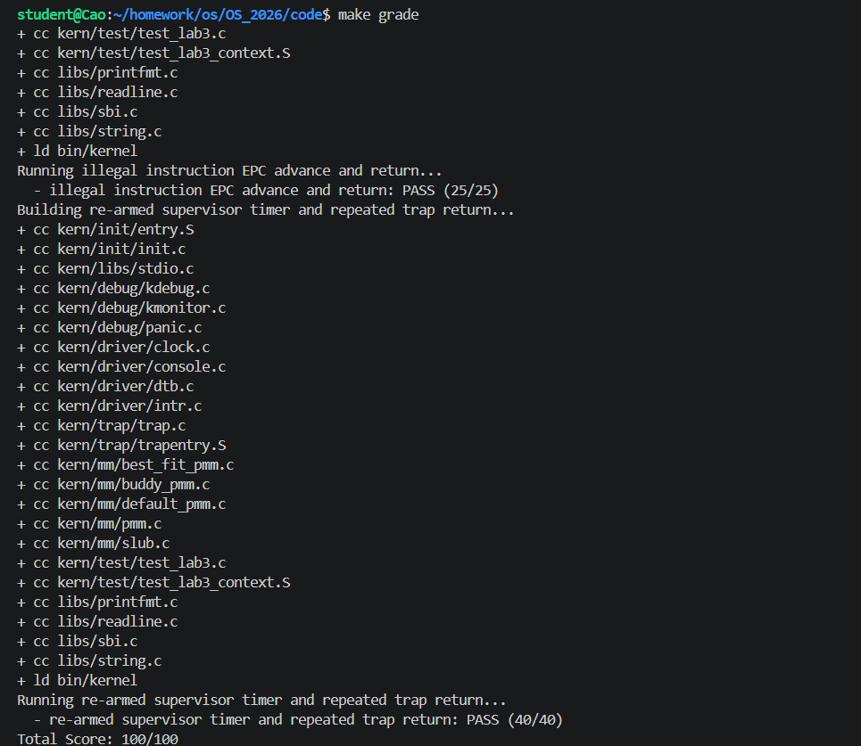

# 操作系统实验报告

## 实验基本信息

| 项目 | 内容 |
|------|------|
| **实验名称** | Lab 3：中断与异常处理 |
| **小组成员** | 2412940-曹皓轩 |
| **完成日期** | 2026-10-27 |

### 小组分工

| 成员 | 负责的练习/模块 |
|------|----------------|
| 2412940-曹皓轩 | Trap 上下文入口与恢复、中断与异常处理、测试与报告 |

---

## 一、实验目的

1. 理解 RISC-V Trap 进入、上下文保存、C 语言分发和 `sret` 返回的完整流程。
2. 实现 Trap 入口的寄存器恢复，并正确衔接 `trap(struct trapframe *)`。
3. 实现时钟中断、非法指令异常和断点异常处理，验证 `epc` 更新和持续定时器机制。

---

## 二、实验环境

| 成员 | AI 编程工具 | 底层模型 | 备注 |
|------|------------|---------|------|
| 2412940-曹皓轩 | Codex（终端 Agent） | GPT-6 |  |

---

## 三、实验整体逻辑分析

### 2.1 本章节的逻辑主线

本实验围绕 RISC-V 的 Trap 处理闭环展开：硬件发生中断或异常后，处理器根据 `stvec` 跳转到统一入口 `__alltraps`。汇编入口首先执行 `SAVE_ALL`，将通用寄存器、原始栈指针以及 `sstatus`、`sepc`、`stval`、`scause` 保存为连续的 `struct trapframe`；随后把当前 `sp` 作为参数传给 C 函数 `trap`。C 层通过 `scause` 的最高位区分中断和异常，并进一步完成时钟中断、软件中断、外部中断、非法指令和断点异常的分发。处理结束后，`__trapret` 执行 `RESTORE_ALL` 恢复处理器状态，最后由 `sret` 回到被打断的执行流。

这一流程的核心是让汇编层的保存布局、C 层的 `struct trapframe` 定义和返回阶段的恢复顺序保持一致。这样，Trap 处理函数可以直接修改 `tf->epc` 等字段来控制返回位置，同时不影响被中断代码中其他寄存器的值。

### 2.2 功能的逐步实现

1. 根据已有 `SAVE_ALL` 的槽位布局实现 `RESTORE_ALL`，建立对称的上下文恢复能力。
2. 在 `__alltraps` 中传递 `trapframe` 指针并调用 `trap`，形成汇编到 C 的稳定入口。
3. 在 `trap_dispatch` 中根据 `scause` 最高位区分中断和异常，并分别进入 `interrupt_handler` 或 `exception_handler`。
4. 在时钟中断处理过程中重新设置下一次定时器事件、累计 `ticks`，在达到 `TICK_NUM` 的整数倍时输出计时信息。
5. 在非法指令和断点异常处理中根据指令编码识别 16 位或 32 位指令，推进 `epc` 后通过统一返回路径继续执行。
6. 使用实验提供的评分脚本检查 Trap 入口、寄存器恢复、异常返回地址和持续时钟中断等关键行为。

---

## 四、实验内容与实现

### 功能模块一：Trap 上下文恢复与 Trap 入口

**负责人：** 2412940-曹皓轩

#### 模块功能描述

**需要实现/修改的函数：**

```asm
RESTORE_ALL
__alltraps
```

`SAVE_ALL` 在 `sp` 的基础上分配 `36 * REGBYTES` 字节的 Trap frame，并按照 `struct pushregs` 的槽位顺序保存寄存器。由于 x2（`sp`）在保存前需要通过 `sscratch` 暂存，因此原始栈指针保存在第 2 个槽位；第 32 至第 35 个槽位依次保存 `sstatus`、`sepc`、`stval` 和 `scause`。这一布局与 `struct trapframe` 完全对应，为 C 语言处理函数提供了可读写的上下文对象。

`RESTORE_ALL` 按照与保存相反的职责恢复上下文。宏首先从第 32、33 个槽位读取 `sstatus` 和 `sepc`，写回对应 CSR，保证 `sret` 使用正确的特权状态和返回地址；随后恢复除 `sp` 外的全部通用寄存器，最后从第 2 个槽位恢复原始 `sp`。把 `sp` 的恢复放在最后，可以保证读取 Trap frame 的过程中始终使用有效的 frame 地址。

`__alltraps` 先执行 `SAVE_ALL`，再通过 `mv a0, sp` 遵守 RISC-V 调用约定，将 Trap frame 地址作为 `trap(struct trapframe *tf)` 的第一个参数，使用 `jal trap` 进入 C 层。C 函数返回后跳转到 `__trapret`，依次完成 `RESTORE_ALL` 和 `sret`，从而形成完整的“保存—处理—恢复—返回”链路。

#### 最终提示词

见 [`pormpt.md`](./pormpt.md) 中第一个 `[PROMPT]` 块。

#### 实现迭代过程

实现以 `SAVE_ALL` 的实际槽位和 `struct trapframe` 的字段顺序为依据，补全了对称的 `RESTORE_ALL`，并在 `__alltraps` 中建立汇编到 C 的参数传递。CSR 读取和写回统一使用当前 RISC-V 工具链支持的 `stval`、`sstatus` 与 `sepc`，同时把原始 `sp` 的恢复安排在最后，保证整个恢复过程中 Trap frame 地址稳定。该实现直接覆盖了寄存器上下文保护、特权状态恢复和 `sret` 返回三个关键环节。

### 功能模块二：中断与异常处理

**负责人：** 2412940-曹皓轩

#### 模块功能描述

**需要实现/修改的函数：**

```c
void interrupt_handler(struct trapframe *tf);
void exception_handler(struct trapframe *tf);
```

该模块由 `trap_dispatch`、`interrupt_handler` 和 `exception_handler` 组成。`trap_dispatch` 通过 `(intptr_t)tf->cause < 0` 判断 `scause` 的 interrupt 标志：最高位为 1 时进入中断处理，最高位为 0 时进入异常处理。中断处理函数先调用 `trap_cause_code` 去除最高位，只保留具体的中断原因编码，再通过 `switch` 分发到不同处理分支。

在 `IRQ_S_TIMER` 分支中，`clock_set_next_event()` 负责重新设置下一次时钟事件，`ticks++` 记录已经处理的时钟中断次数，`ticks % TICK_NUM == 0` 时调用 `print_ticks()` 输出周期统计信息。`IRQ_S_SOFT` 和 `IRQ_S_EXT` 分支分别输出软件中断和外部中断信息；未知中断则输出原因编码并调用 `print_trapframe`，保留完整的现场诊断信息。

异常处理由 `exception_handler` 完成。对于 `CAUSE_ILLEGAL_INSTRUCTION` 和 `CAUSE_BREAKPOINT`，函数输出触发地址，并调用 `trap_instruction_length` 读取 `tf->epc` 指向指令的低 16 位：低两位不为 `0b11` 时按 RISC-V 压缩指令处理，长度为 2 字节；低两位为 `0b11` 时按普通指令处理，长度为 4 字节。随后将对应长度加到 `tf->epc`，确保返回后继续执行下一条指令。其他异常统一交给 `print_trapframe` 输出完整现场。

#### 最终提示词

见 [`pormpt.md`](./pormpt.md) 中第二个 `[PROMPT]` 块。

#### 实现迭代过程

实现将中断原因提取、定时器重设、异常分类和指令长度判断组织在各自的辅助函数或处理分支中：`trap_cause_code` 负责解析中断原因，`trap_instruction_length` 负责识别 16 位和 32 位指令，两个处理函数分别维护中断状态和异常返回地址。最终的分发路径保持为 `trap` → `trap_dispatch` → 具体处理函数，处理完成后返回汇编恢复路径。评分脚本覆盖了寄存器上下文恢复、非法指令返回和持续时钟中断三个场景，验证了该处理链路的完整性。

---

## 五、测试与验证

在 `code` 目录执行 `make clean && make -j2`，内核完成编译、链接和镜像生成。Trap 入口使用 `stval` 保存异常相关地址，汇编代码与当前 RISC-V 工具链的 CSR 定义保持一致。

`make grade` 完成测试注入、构建和 QEMU 运行，三项 Lab3 测试全部通过：Trap 入口与寄存器恢复 35/35，非法指令与异常返回 25/25，持续时钟中断 40/40，总分 100/100。

**测试截图：**

下图为 `make grade` 的完整评分结果。输出显示非法指令异常返回测试通过、持续时钟中断测试通过，最终总分为 100/100；同一次评分运行前面的 Trap 入口与寄存器恢复测试也显示为 35/35。



---

## 六、实验总结与收获

### 对操作系统的理解

1. Trap frame 是汇编入口和 C 处理函数之间的稳定接口，保存布局必须在保存和恢复两侧完全一致。
2. `sscratch`、`sstatus`、`sepc` 和 `scause` 共同保存了 Trap 返回所需的处理器状态；`sret` 只在这些状态正确恢复后才能回到原执行流。
3. 时钟中断是一次性事件，处理函数必须重新设置下一次事件；异常返回地址也必须前进，否则会重复执行触发异常的指令。
4. RISC-V 压缩指令使异常指令长度可能为 2 字节，不能统一使用 4 字节的 `epc` 偏移。

本实验建立了后续实现用户态系统调用、进程级 Trap 和缺页异常处理所需的基础接口：汇编入口负责保存完整上下文，C 层负责按原因分发，返回阶段统一恢复状态并执行 `sret`。在此结构上，可以继续扩展更复杂的异常类型、中断优先级和进程级处理逻辑。

### AI 协作开发的经验

AI 协作开发时，先从工程中的 `SAVE_ALL`、`struct trapframe` 和真实宏定义提取约束，再围绕模块职责组织实现要求，可以让汇编布局、C 语言接口和测试目标保持一致。汇编部分重点核对 CSR 名称、槽位偏移、寄存器恢复顺序和调用约定；C 处理部分重点核对原因分类、定时器状态更新、异常指令长度和 `epc` 返回位置。最后通过构建、QEMU 运行和评分脚本将代码结构与运行结果对应起来，形成从接口设计到行为验证的完整闭环。

---
